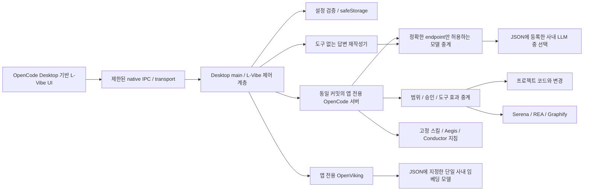

# L-Vibe: OpenCode Desktop 기반 배포판 설계

상태: 2026-11-10 사용자가 방향 전환을 승인했다. 이 문서와 최신 사용자 요구가 이전 독립 UI 설계보다 우선한다.

## 결정

L-Vibe는 공식 OpenCode Desktop의 소스를 고정하여 수정·배포하는 사내용 바이브 코딩 제품이다. 공식 앱을 직원 PC에 설치한 뒤 개인 설정을 수정하는 방식이 아니다. 제품명은 L-Vibe, 아이콘은 사용자가 지정한 흰색 LIG/검은 배경 로고를 사용한다.

검토 기준은 `anomalyco/opencode`의 `v2.2.6`, 커밋 `dc2ffcf8bf26f9e669b6aa22b95f50e12be15e06`이다. 해당 태그의 `packages/desktop/package.json`은 Electron 44.9.1, Solid 기반 앱, MIT 라이선스를 명시한다. 다른 세대의 Tauri 구조를 가정하지 않는다. 실제 커밋과 파일 해시는 구현의 upstream lock에 기록한다. Desktop·서버·클라이언트·스키마는 같은 소스 커밋으로 맞춘다. 이전 원형의 OpenCode 1.19.5를 새 Desktop과 임의 조합하지 않는다.

프로젝트·세션·대화·파일 탐색·변경 비교·모델 선택·도구 이벤트·승인·질문 UI는 upstream을 재사용한다. 별도의 React 채팅 화면을 계속 개발하지 않는다. 사내 배포·설정·모델 중계·로컬 서비스·정책에 필요한 최소 변경을 명시적인 패치로 유지한다.

## 구성



렌더러의 기본 화면과 데이터 모델은 재사용하되, 실제 API 키와 엔진 관리 자격증명은 native 계층에 남긴다. upstream transport가 렌더러에 자격증명을 전달하거나 임의 서버 연결을 허용한다면 해당 경로를 수정한다. 화면 재사용을 이유로 기존 보안 요구를 완화하지 않는다.

## 요구사항의 배치

| 항목 | 구현 위치 / 검증 기준 |
| --- | --- |
| 대화·세션·파일·diff·질문·모델 선택 | upstream Desktop/UI 재사용, 실제 사건과 결과로 표시 |
| 이름·로고·설치·데이터 경로 | Desktop metadata, 아이콘, installer, native startup |
| 여러 LLM / 한 개 임베딩 | L-Vibe JSON → 검증 → 암호화 → native provider adapter |
| API 키 보호 | native safeStorage + endpoint 중계; 렌더러·로그·내보내기·엔진 진단 검사 |
| 범위·수정·명령·MCP 승인 | 중앙 정책과 통제 도구; upstream 권한 설정만으로 직접 I/O 차단을 주장하지 않음 |
| 반복 감지·중지·재출력 | 서버 이벤트 감시 + native 상태 관리 + 독립 HTTP 재작성기 |
| 스킬·Aegis·Conductor | 고정된 순수 지침·참조 문서, 사용자 요구·승인 정책 우선 |
| Serena | 읽기 tools allowlist + 고정 clangd, REPL/activation/download 비활성화 |
| Graphify | 고정 로컬 AST/그래프 분석, hosted Graphify/OAuth/업로드 미사용 |
| REA | morluto/rea의 고정 로컬 배포; 검토한 정적 분석 도구부터 중계 |
| OpenViking | 앱 소유 프로세스·로컬 저장소·단일 임베딩·명시적 파일 색인 |

원본 스킬이나 MCP의 setup/install/doctor를 직원 PC에서 실행하지 않는다. REA의 동적 실행·디바이스 조작·디버거·임의 경로, Graphify의 외부 backend/LLM 다운로드 등은 기본 자동 허용하지 않는다. 필요한 기능은 도구 효과·런타임·승인·종료를 검증한 뒤에만 노출한다. 번들 포함과 실제 기능 검증을 별도 상태로 기록한다.

## 설정 계약

배포 JSON은 앱 설치기 옆 `agent-config.json`이다. 설정 v2는 여러 LLM과 단일 임베딩을 표현한다. 기존 단일 `model` v1은 명시적으로 호환 변환한다.

```json
{
  "schemaVersion": 2,
  "models": [
    { "name": "개발 모델", "baseUrl": "https://llm-a.internal.example/v1", "apiKey": "DISTRIBUTION_ONLY", "id": "REGISTERED_MODEL_A" },
    { "name": "리뷰 모델", "baseUrl": "https://llm-b.internal.example/v1", "apiKey": "DISTRIBUTION_ONLY", "id": "REGISTERED_MODEL_B" }
  ],
  "defaultModel": "개발 모델",
  "openViking": {
    "enabled": true,
    "embedding": { "baseUrl": "https://embedding.internal.example/v1", "apiKey": "DISTRIBUTION_ONLY", "id": "REGISTERED_EMBEDDING_ID", "dimension": 1024 }
  }
}
```

LLM 이름은 고유하며 등록된 항목만 선택할 수 있다. UI에는 이름·서버 모델 ID·endpoint 등 비밀이 아닌 메타데이터만 전달한다. 임베딩은 배열이 아닌 한 개 객체다. LLM 선택은 임베딩 선택을 변경하지 않는다. 임베딩 모델/차원 변경은 기존 벡터 공간과 호환을 확인하고 재색인 절차를 거친다. 1024는 예시이며 서버에서 확인한 차원을 입력한다.

키는 배포 JSON 및 최초 준비 파일에서만 평문일 수 있다. 검증·암호화 성공 후 앱의 준비 파일만 삭제하고 원본 배포 파일은 보존한다. 손상·복호화 실패 시 자동 덮어쓰기·평문 fallback을 하지 않는다. 설정 교체는 사용자 파일 선택과 명시적 교체로 수행한다.

## 프로세스·데이터 수명

- Desktop은 전용 서버를 시작한다. 개인 OpenCode 설치·설정·플러그인·공유 서버를 탐색하거나 복제하지 않는다. 프로젝트 실행 설정이 중앙 정책을 덮어쓰지 못하게 한다.
- OpenViking은 앱 시작 시 설정과 번들을 검사해 함께 시작하고 앱 종료 시 함께 중지한다. 설정이 없거나 시작에 실패하면 상태와 원인을 표시한다. 부모 종료·비정상 종료에서도 고아 프로세스가 남지 않는지 확인한다.
- 사용자 설정·DB·모델 선택·지식 DB는 `%APPDATA%\L-Vibe` 아래, 설치는 `%LOCALAPPDATA%\Programs\L-Vibe`로 분리한다. 제거·업데이트 시 기본 보존한다.
- 지식은 프로젝트별로 분리하고 사용자가 선택한 파일만 색인한다. 개인 대화의 자동 업로드·자동 색인은 하지 않는다.
- 승인·중지·반복 감지 상태는 작업 수명에 맞춘다. 세션 자동 승인을 영속 always 규칙으로 바꾸지 않는다. 실행 미확인 상태에서 새 실행·재출력을 막는다.

## 폐쇄망 배포

Windows 10/11 x64 일반 사용자 설치를 목표로 한다. Desktop·동일 커밋 서버·native 모듈·필요한 Git/셸/ripgrep·Python/DLL/site-packages·clangd·MCP·스킬을 빌드 PC에서 확보하여 버전·해시·라이선스를 기록한다. upstream의 사용자 환경 의존과 최초 다운로드 경로도 감사한다.

업데이트·모델 목록·models.dev·외부 인증·원격 스킬·외부 fetch/검색/공유·텔레메트리·진단 업로드·관리형 LSP 다운로드를 native/서버/UI 각 경로에서 차단한다. 환경 변수 설정만으로 보장하지 않는다. 필요한 사내 endpoint만 허용한 환경에서 설치·첫 실행·종료·재시작의 DNS/TCP를 관찰한다.

## 이관과 검증

기존 `src/renderer`, Electron entry, 엔진 1.19.5 패키징은 비교용 원형이다. 실제 출시 경로로 오인하지 않도록 명시한다. 설정 검증·암호화·모델 gateway·승인·반복 감지·재출력·지식 서비스 코드는 검증 후 제어 계층에 이관한다. 파일을 복사했다는 이유로 이관 완료를 주장하지 않는다.

설계 커밋을 먼저 원격에 푸시하고 upstream lock/patch/bootstrap 구현을 시작한다. 초기 구현 완료 기준은 고정 원본 확보, 패치의 재현성·경계 검사, 실제 원본에 대한 적용 검증, 기존 코드와 새 배포 경로의 구분이다. 이후 실제 Desktop 연결·서비스 수명·모델 선택·권한·오프라인 설치를 단계별로 검증한다. Windows와 실제 사내 모델 수용 검증 전에는 1.0 완료로 표시하지 않는다.

## 기본 스킬의 OpenViking 등록 (0.2.1)

호스트는 OpenViking 준비 후 검증된 기본 스킬을 백그라운드에서 등록한다. 설치 리소스의 `skills-lock.json`·manifest·각 파일 해시를 확인하고 정적 본문·참조·라이선스만 메모리 ZIP으로 구성한다. 임의 프로젝트 파일·Git URL·실행형 플러그인을 입력으로 받지 않는다.

`/api/v1/resources/temp_upload`와 `/api/v1/skills`를 앱 전용 인증으로 호출하며 저장 위치는 로컬 앱 계정의 `viking://agent/skills/l-vibe-<ID>`다. 패키지별 저장 내용·서버 revision을 확인한 뒤 사용자 데이터의 `openviking/bundled-skills.json`에 기록한다. 같은 패키지는 재등록하지 않고 앱이 관리하던 사본만 갱신한다. 외부 편집·소유자 충돌·손상된 등록 기록은 자동 덮어쓰지 않는다.

등록 상태는 알림 영역에서 확인한다. 등록 실패가 원본 로컬 스킬 읽기를 막지 않으며 다음 실행에서 미완료 항목을 재확인한다. 앱 종료·설정 재구성은 등록 HTTP 요청을 취소한 뒤 서비스 프로세스를 종료한다. 모델·임베딩 키는 기존 호스트 게이트웨이 안에 두고 개인 대화·프로젝트 색인은 이 자동 등록 흐름과 분리한다.
