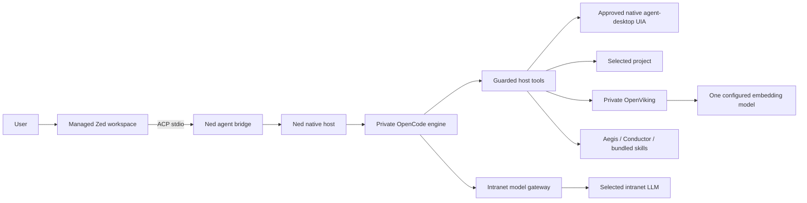

# Ned architecture and migration

Status: Windows acceptance candidate; first-launch and skill-registration diagnostics are under investigation. This document supersedes the OpenCode Desktop frontend choice. Published L-Vibe 0.2.7 artifacts remain historical builds; they do not contain this transition.

## Purpose

Ned provides one offline installation and one settings import for employees who need an AI coding assistant without assembling an IDE, agent, knowledge server and skills themselves. Zed supplies direct editing, navigation and language assistance. A private OpenCode engine supplies agent sessions. The native Ned host owns configuration, approvals, lifecycle and intranet model connections. Aegis, Conductor, the 36 reviewed skills, OpenViking, Serena, Graphify, REA and the selected MCP integrations remain managed components.

## Ownership and security

- Launch a bundled, pinned Zed binary with a Ned-owned user-data directory and child-only profile environment. Do not import or read personal Zed/OpenCode settings or credentials.
- Register a local custom ACP agent. Never install an agent through the online ACP registry. The bridge attaches to the already managed engine; it must not start a second engine using `opencode acp`.
- Actual model API keys stay in the host vault. Zed and ACP receive no model keys. Runtime connection credentials expire with the application.
- Disable editor telemetry, automatic updates, extension installation and unbundled language-server downloads. Offline assurance requires actual network observation in Windows acceptance, beyond settings alone.
- Manual editing and saving in Zed follows normal IDE behavior. Agent edits still pass native approval, base-content checks and snapshots. Unsaved editor buffers must be checked before agent writes to avoid overwriting user changes.
- Commands remain blocked except explicitly implemented, approved build tools. Detect installed VS2017/VS2019 MSBuild, inspect solution configurations, then freeze executable, arguments, working directory and environment for approval. No automatic SDK installation or retargeting. Own child processes through Windows Job Objects and confirm cancellation.
- LLM queue waits have no default elapsed-time deadline. Explicit user cancellation remains available. Infrastructure startup/health checks are separate from model generation waits.

## Desktop automation

The user explicitly expanded the original desktop-exclusion scope. Native agent-desktop 1.2.0 is bundled, with 18 reviewed host tools. Every observation and action has separate native approval; file auto-approval does not apply. Ref ownership is bound to engine session/project/window/process identity. Global input, arbitrary app launch, clipboard, terminal/system/managed editor/approval windows, raw MCP and trace export are unavailable. See [agent-desktop](agent-desktop.md).

## Packaging and name

The product name is **Ned**. The launcher, installer, tray and product UI use `assets/ned-icon.png` / `assets/ned-icon.ico`: black background, white bold Ned text. Zed retains its vendor component identity.

New installation: `%LOCALAPPDATA%\Programs\Ned`. New private data: `%APPDATA%\Ned`. Only the initial migration bootstrap uses `%LOCALAPPDATA%\Ned-Launcher`; after copying it relaunches with `%APPDATA%\Ned` as Electron userData, preserving the copied Local State encryption key. Singleton files therefore cannot interfere with copying, and the encrypted vault remains bound to its original profile key. Copy existing app-owned L-Vibe settings, engine history and OpenViking data only when the old app is stopped, preserve the original, and never overwrite an existing Ned profile. Encrypted settings must still decrypt as the same Windows user; never fall back to plaintext. Historical L-Vibe installers and repair tools keep their original paths and names.

The handover remains one ASCII-named TGZ, one offline installer EXE, one central JSON, one launch shortcut. Bundle all required runtimes, language tools, sources and license notices before import. Model weights and proprietary SDKs are not bundled.

## License and acceptance

Pin Zed v1.28.1 and its matching source. Zed is primarily GPL-3.0-or-later with marked Apache-2.0 components; include corresponding source and third-party notices. The Ned-authored host code retains its own license; do not describe the entire distribution as MIT-only. Windows minimum requirements follow the pinned editor: Windows 10 1903+ / Windows 11 22H2+, x64. Actual company Windows, model-server, offline network and lifecycle acceptance remains required before declaring release readiness.
