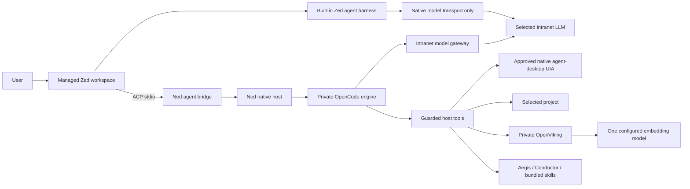

# Ned의 구성과 데이터 흐름

Ned는 Zed 편집기, 전용 OpenCode 엔진, 도구와 서비스를 관리하는 호스트로 구성됩니다. 직원이 IDE와 에이전트, 지식 서버를 각각 설치하지 않아도 사용할 수 있도록 한 배포판입니다. 현재 설명은 0.3.11 기준이며, OpenCode Desktop 화면을 사용하던 L-Vibe 0.2.7은 이전 구성으로 보관합니다.

Zed는 코드 편집과 탐색, 대화 화면을 제공합니다. Ned Agent를 선택하면 OpenCode가 세션을 진행하고 필요한 호스트 도구를 호출합니다. 기본 Zed Agent를 선택하면 Zed 자체 하네스가 도구를 선택·실행하며 OpenCode나 Ned ACP를 사용하지 않습니다. Ned 호스트는 설정과 키, 승인, 프로젝트 접근, 프로세스 실행·종료와 사내 모델 연결을 관리합니다. Aegis·Conductor, 스킬 74개, OpenViking, Serena, Graphify, REA와 MCP도 이 호스트를 통해 연결합니다.

## 편집기와 에이전트 연결

고정한 Zed 바이너리를 Ned 전용 사용자 데이터 폴더로 실행합니다. 자식 프로세스에는 별도의 프로필 환경을 전달하며, 개인 Zed·OpenCode의 설정이나 자격증명을 읽어 오지 않습니다.

Zed에는 로컬 ACP 에이전트를 등록합니다. 브리지는 호스트가 이미 실행한 엔진에 연결하므로 `opencode acp`로 두 번째 엔진을 만들지 않습니다. 온라인 ACP 레지스트리에서도 에이전트를 설치하지 않습니다. 모델 API 키는 호스트의 암호화 저장소에 두고 Zed나 ACP에 전달하지 않습니다. 실행 중 연결에 쓰는 자격증명은 앱을 종료하면 만료됩니다.

편집기의 텔레메트리, 자동 업데이트, 확장 설치와 번들에 없는 언어 서버 다운로드를 막습니다. 이 설정이 실제로 지켜지는지는 Windows에서 DNS·TCP 요청을 관찰해 확인해야 합니다.

## 기본 Zed Agent 경로

`distribution/ned/zed-models.ts`는 중앙 JSON의 모델 목록을 별도의 로컬 API로 노출합니다. Zed에는 실제 사내 키 대신 실행별 로컬 토큰을 전달합니다. 모델 제공자별 주소·인증·기본 요청 옵션을 처리하며 Zed의 메시지·도구 정의·요약 요청에 Ned 지침을 넣지 않습니다. OpenCode 실행 파일이나 Ned ACP 연결이 없어도 이 모델 중계 경로는 독립적으로 동작합니다.

이 Agent에는 Ned 스킬·MCP·OpenViking을 연결하지 않습니다. 파일 도구·터미널과 권한 판단은 Zed 자체 구현을 사용합니다. 폐쇄망용 편집기 설정에 따라 웹 도구와 임의 MCP 자동 연결은 끕니다. Ned 앱의 공통 서비스가 살아 있는 것과 Zed Agent의 호출 경로는 별개입니다. 다른 Ned 대화를 함께 열었다면 그 대화의 엔진은 별도로 실행될 수 있습니다.

Ned Agent는 호스트가 소유한 OpenCode 하위 세션을 생성해 조사·지정 파일 구현을 위임합니다. 동시 두 개, 부모 권한 상속, 파일 배정 충돌 검사와 중지 확인을 적용합니다. 기본 Zed Agent의 spawn_agent는 Zed native Agent 내부에서 부모 모델·프로필을 이어 하위 Thread를 만듭니다. 실제 실행 수용 범위와 사용법은 [두 Agent 안내](zed-native-agent.md)에 구분했습니다.

## 파일 수정과 빌드

아래 승인·스냅샷·빌드 설명은 Ned Agent의 호스트 도구에 적용됩니다. 기본 Zed Agent는 Zed 자체 도구·권한을 사용합니다.

사용자의 수동 편집·저장은 Zed의 일반 동작입니다. Ned Agent의 AI 수정은 호스트의 승인 정책을 따르며, 기준 내용과 스냅샷을 비교합니다. 쓰기 전에는 편집기 버퍼도 읽어 저장하지 않은 변경이 있는지 확인합니다.

권한은 **승인 요청**, **프로젝트 파일 자동 승인**, **전체 권한** 중 선택합니다. `PermissionPolicy`가 네이티브 승인 게이트를 관리하고, 결과는 사용자 데이터의 `permissions.json`에 저장합니다. 모델 설정과 프로젝트 설정은 이 정책을 바꾸지 않습니다. 권한 변경은 연결된 대화에 반영하며 대기 중인 승인과 진행 작업에 취소 신호를 보냅니다. 모드와 관계없이 범위·충돌·버퍼·고정 대상·중지 상태를 검사합니다.

권한 선택은 인증한 편집기 owner RPC로 전달합니다. 모델이 호출하는 도구에는 권한 설정 API를 제공하지 않습니다. 임시로 현재 대화·프로젝트의 파일 수정을 허용하는 기능도 있으며, 이 승인은 메모리에서만 유지합니다.

명령은 구현한 빌드 도구에 한해 실행합니다. VS2017/2019의 MSBuild와 솔루션 구성을 찾고 실행 파일·인자·작업 폴더·환경을 고정해 승인받습니다. SDK 설치나 자동 retarget, 임의 셸 실행은 지원하지 않습니다. Windows Job Object로 자식 프로세스를 관리하고 취소 후 종료를 확인합니다.

모델 생성 대기는 별도입니다. 사내 서버의 긴 대기열 때문에 경과 시간만으로 요청을 끊지 않으며 사용자가 취소할 수 있습니다. 서비스 준비·헬스 체크의 제한 시간을 모델 응답 대기에 적용하지 않습니다.

## 외부 GUI 앱 조작

agent-desktop 1.2.0과 검토한 호스트 도구 20종을 포함합니다. 각 관찰과 동작은 선택한 권한 모드로 처리합니다. 파일 자동 승인만 선택하면 데스크톱 작업은 따로 확인하고, 전체 권한에서는 지원 도구의 승인창을 생략합니다.

요소 참조는 에이전트 세션·프로젝트·창·프로세스에 묶습니다. GUI 앱 실행은 실행 파일을 고정하고 호출자가 추가 인자를 넣지 못하게 합니다. 사용자가 사용하는 앱은 Ned 종료 시 닫지 않으며, 관리 대상 MCP 프로세스와 종료 범위를 분리합니다.

전역 키·좌표 입력, 셸·스크립트 실행, 클립보드, 터미널·시스템·Ned 편집기·승인창 조작, 원시 MCP와 trace 내보내기는 노출하지 않습니다. 자세한 사용법은 [데스크톱 도구 안내](agent-desktop.md)에 있습니다.

## 설치 위치와 기존 데이터 이관

기본 설치 위치는 `%LOCALAPPDATA%\Programs\Ned`입니다. 설치 화면에서 `D:\Programs\Ned` 같은 전용 폴더를 선택할 수 있고, 업데이트는 등록된 `InstallLocation`을 사용합니다. 드라이브 루트, 관련 없는 파일이 든 폴더, 사용자 자료 폴더 내부는 설치 대상으로 받지 않습니다. 설치 위치를 옮기려면 기존 프로그램을 제거한 뒤 새 위치에 설치합니다.

사용자 데이터는 `%APPDATA%\Ned`에 보관합니다. 첫 이관을 준비하는 실행만 `%LOCALAPPDATA%\Ned-Launcher`를 쓰고, 복사를 마치면 `%APPDATA%\Ned`를 Electron `userData`로 지정해 다시 실행합니다. 복사한 `Local State` 암호화 키를 유지하고 singleton 파일과 이관 작업이 충돌하지 않도록 한 순서입니다.

기존 L-Vibe의 설정·엔진 기록·OpenViking 데이터는 앱이 종료된 상태에서 복사합니다. 원본을 남기고 기존 Ned 프로필은 덮어쓰지 않습니다. 설정 복호화에는 같은 Windows 사용자 계정이 필요하며, 복호화 실패 시 평문 저장으로 바꾸지 않습니다. 과거 설치기와 수정 도구는 해당 버전의 이름·경로를 유지합니다.

## 설정 적용과 편집기 상태 보존

설정 가져오기는 JSON 검증·암호화 저장, 편집기 정상 종료 요청, 편집기와 서비스 종료 확인, 호스트 재실행 순서로 처리합니다. `WM_CLOSE`는 소유권을 확인한 프로세스의 일반 창에만 전달합니다. 저장 확인창이나 다른 Zed를 강제로 종료하지 않습니다. 저장을 취소하면 재시작을 대기하고, 종료가 확인되지 않으면 새 호스트를 실행하지 않습니다.

Windows ACP 실행은 Zed → 번들 Python 콘솔 감독 프로세스 → Electron Node 모드의 Ned ACP 순서입니다. 배포 PC에서 직접 ACP 초기화는 성공했지만 PowerShell 경유 실행의 수명이 먼저 끝나는 현상을 확인해 이 구조로 바꿨습니다. 감독 프로세스가 표준 입출력과 자식 수명을 유지하므로 별도 Node 설치가 필요 없습니다.

편집기 설정은 JSONC 항목별 편집으로 보완합니다. 사용자가 지정한 글꼴·패널·UI 설정과 주석, 키맵 바이트, `editor/db` 경로를 유지하고 관리형 연결·실행 설정만 갱신합니다. 기존 appearance 설정은 현재 설정 파일이 없을 때만 이관합니다. 문법 오류나 중복 키가 있으면 원본을 보존하고 알립니다.

## Windows 폴더 선택과 스냅샷

편집기는 전용 `HOME`·`USERPROFILE`·`APPDATA`를 유지합니다. Open Folder의 네이티브 콜백 예외가 보고된 경로를 피하도록 내부 선택창을 사용합니다. 알림 영역의 프로젝트 열기는 호스트의 원래 Windows 환경에서 시스템 폴더 선택창을 열어 바탕화면과 즐겨찾기를 탐색합니다.

선택한 경로를 정규화한 뒤 번들 CLI의 `--` 다음에 인자 하나로 전달하고 전용 `--user-data-dir`을 사용합니다. 전달에 성공한 뒤 프로젝트 선택을 기록합니다. 취소, 편집기 종료, 전달 실패 시 접근 권한을 부여하지 않습니다. 보고된 예외의 정확한 내부 원인은 아직 확인하지 못했습니다.

데스크톱 스냅샷은 agent-desktop 1.2.0의 축약 응답 `{app, window:{id,title}, tree}`도 처리합니다. 프로세스 신원은 캡처 전후 창 목록으로 확인합니다. 선택 필드가 서로 모순되거나 프로세스가 바뀌면 거절하며, 스냅샷을 시도할 때마다 이전 요소 참조를 해제합니다.

## 배포와 검증

배포물은 ASCII 파일명의 TGZ, 오프라인 설치 EXE, 중앙 JSON과 실행 바로가기로 구성합니다. 필요한 런타임·언어 도구·소스·라이선스는 반입 전에 준비하며 모델 가중치와 독점 SDK는 포함하지 않습니다.

실행기·설치기·트레이에는 검은 배경의 흰색 굵은 Ned 아이콘을 사용합니다. 고정 Zed v1.28.1의 Windows 아이콘 리소스 1도 교체하며, 실행 코드와 공급자 버전 정보가 같은지 확인합니다. 원본·수정본 해시와 아이콘, 변경 스크립트를 제공하고 수정 바이너리에는 원본 서명이 없음을 기록합니다.

Zed는 주로 GPL-3.0-or-later이며 Apache-2.0 구성 요소도 있습니다. 대응 소스와 제3자 고지를 함께 제공하며, Ned 호스트의 라이선스와 구분합니다. 최소 OS는 Windows 10 1903 이상·Windows 11 22H2 이상 x64입니다.

0.3.7에서는 Windows Server 설치와 OpenViking·토크나이저·Node 로딩을 확인했습니다. 실제 사내 Windows GUI·모델 서버·네트워크·실행과 종료 검증은 [검증 기록](archive/validations/validation-0.3.7.md)의 범위에 따라 이어갑니다. 원본 0.3.1의 AppData와 빈 시작 화면 수정 이력은 [시작 수정 안내](archive/fixes/ned-startup-fix-1.md)에 남겼습니다.

## 편집기 표시와 Astryx

0.3.8 rebuild1의 메뉴·About은 고정 Zed 소스의 두 Rust 파일을 수정해 빌드하며 Ned 이름·아이콘·제품 설명을 표시합니다. 기반 Zed의 버전·소스·라이선스와 수정 대응 소스를 함께 제공합니다.

Astryx는 Ned 편집기를 다시 디자인하는 런타임이 아니라 사용자의 React UI 제작을 돕는 스킬·참조·시작 프로젝트입니다. 281개 로컬 참조와 Windows용 압축 프로젝트를 제공하며 원본 온라인 CLI를 실행하지 않습니다. 설치 파일 수 증가를 줄이기 위해 의존성은 ZIP 안에 보관합니다. [사용법](astryx.md)을 참고하세요.

## 0.3.9의 준비·대화 이관 경계

HostTools는 검증한 로컬 카탈로그를 먼저 준비하고 지식 서비스는 백그라운드로 시작합니다.
사전 생성한 skill-seed를 서비스 정지 중 배치하며 재사용·신규·갱신과 사용자 수정 충돌을
구분합니다. 로컬 스킬 준비가 모델별 검색 벡터 완료를 뜻하지 않습니다.

기본 Zed Agent는 자체 프로필 name·모델 capability를 검증하고 앱 소유 모델 프록시를 사용합니다.
개인 Zed 대화는 사용자가 지정한 DB의 readOnly SQLite snapshot만 가져오고, Ned DB 백업 후
트랜잭션으로 병합합니다. 모델 지정·sandbox 승인은 상속하지 않습니다.
EGM의 Goldfish는 새 읽기 전용 하위 세션과 별도 시스템 지침을 사용하고 부모 대화·개인 기억과
자동 스킬 주입을 전달하지 않습니다. 기존 하위 Agent 동시 두 개 한도는 공유합니다.

## 사용자 지식과 선택 팩

사용자가 승인한 프로젝트 지식과 개인 공통 지식을 OpenViking에 저장합니다. 개인 영역은 첫 저장 때 준비하며, 기존 가져온 지식은 읽기 범위로 보존합니다. [지식 사용법](knowledge-notes.md)을 참고하세요. 전체 설치본과 Core는 같은 호스트와 편집기를 사용하며, Core에 없는 REA/Ghidra는 [선택 팩](offline-packs.md)으로 설치합니다.
