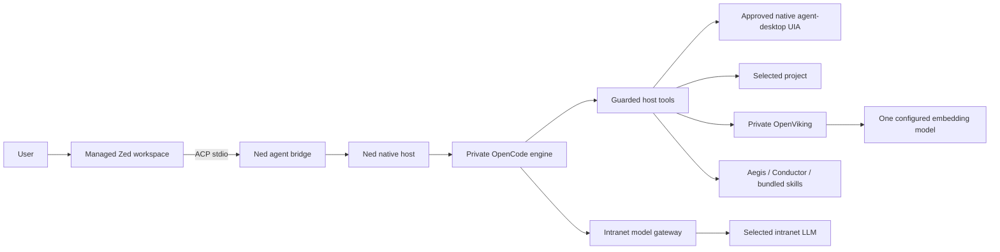

# Ned의 구성과 데이터 흐름

Ned는 Zed 편집기, 전용 OpenCode 엔진, 도구와 서비스를 관리하는 호스트로 구성됩니다. 직원이 IDE와 에이전트, 지식 서버를 각각 설치하지 않아도 사용할 수 있도록 한 배포판입니다. 현재 설명은 0.3.7 기준이며, OpenCode Desktop 화면을 사용하던 L-Vibe 0.2.7은 이전 구성으로 보관합니다.

Zed는 코드 편집과 탐색, 대화 화면을 제공합니다. OpenCode는 세션을 진행하고 필요한 도구를 호출합니다. Ned 호스트는 설정과 키, 승인, 프로젝트 접근, 프로세스 실행·종료와 사내 모델 연결을 관리합니다. Aegis·Conductor, 스킬 66개, OpenViking, Serena, Graphify, REA와 MCP도 이 호스트를 통해 연결합니다.

## 편집기와 에이전트 연결

고정한 Zed 바이너리를 Ned 전용 사용자 데이터 폴더로 실행합니다. 자식 프로세스에는 별도의 프로필 환경을 전달하며, 개인 Zed·OpenCode의 설정이나 자격증명을 읽어 오지 않습니다.

Zed에는 로컬 ACP 에이전트를 등록합니다. 브리지는 호스트가 이미 실행한 엔진에 연결하므로 `opencode acp`로 두 번째 엔진을 만들지 않습니다. 온라인 ACP 레지스트리에서도 에이전트를 설치하지 않습니다. 모델 API 키는 호스트의 암호화 저장소에 두고 Zed나 ACP에 전달하지 않습니다. 실행 중 연결에 쓰는 자격증명은 앱을 종료하면 만료됩니다.

편집기의 텔레메트리, 자동 업데이트, 확장 설치와 번들에 없는 언어 서버 다운로드를 막습니다. 이 설정이 실제로 지켜지는지는 Windows에서 DNS·TCP 요청을 관찰해 확인해야 합니다.

## 파일 수정과 빌드

사용자의 수동 편집·저장은 Zed의 일반 동작입니다. AI 수정은 호스트의 승인 정책을 따르며, 기준 내용과 스냅샷을 비교합니다. 쓰기 전에는 편집기 버퍼도 읽어 저장하지 않은 변경이 있는지 확인합니다.

권한은 **승인 요청**, **프로젝트 파일 자동 승인**, **전체 권한** 중 선택합니다. `PermissionPolicy`가 네이티브 승인 게이트를 관리하고, 결과는 사용자 데이터의 `permissions.json`에 저장합니다. 모델 설정과 프로젝트 설정은 이 정책을 바꾸지 않습니다. 권한 변경은 연결된 대화에 반영하며 대기 중인 승인과 진행 작업에 취소 신호를 보냅니다. 모드와 관계없이 범위·충돌·버퍼·고정 대상·중지 상태를 검사합니다.

권한 선택은 인증한 편집기 owner RPC로 전달합니다. 모델이 호출하는 도구에는 권한 설정 API를 제공하지 않습니다. 임시로 현재 대화·프로젝트의 파일 수정을 허용하는 기능도 있으며, 이 승인은 메모리에서만 유지합니다.

명령은 구현한 빌드 도구에 한해 실행합니다. VS2017/2019의 MSBuild와 솔루션 구성을 찾고 실행 파일·인자·작업 폴더·환경을 고정해 승인받습니다. SDK 설치나 자동 retarget, 임의 셸 실행은 지원하지 않습니다. Windows Job Object로 자식 프로세스를 관리하고 취소 후 종료를 확인합니다.

모델 생성 대기는 별도입니다. 사내 서버의 긴 대기열 때문에 경과 시간만으로 요청을 끊지 않으며 사용자가 취소할 수 있습니다. 서비스 준비·헬스 체크의 제한 시간을 모델 응답 대기에 적용하지 않습니다.

## 외부 GUI 앱 조작

agent-desktop 1.2.0과 검토한 호스트 도구 20종을 포함합니다. 각 관찰과 동작은 선택한 권한 모드로 처리합니다. 파일 자동 승인만 선택하면 데스크톱 작업은 따로 확인하고, 전체 권한에서는 지원 도구의 승인창을 생략합니다.

요소 참조는 에이전트 세션·프로젝트·창·프로세스에 묶습니다. GUI 앱 실행은 실행 파일을 고정하고 호출자가 추가 인자를 넣지 못하게 합니다. 사용자가 사용하는 앱은 Ned 종료 시 닫지 않으며, 관리 대상 MCP 프로세스와 종료 범위를 분리합니다.

전역 키·좌표 입력, 셸·스크립트 실행, 클립보드, 터미널·시스템·Ned 편집기·승인창 조작, 원시 MCP와 trace 내보내기는 노출하지 않습니다. 자세한 사용법은 [데스크톱 도구 안내](agent-desktop.md)에 있습니다.

## 설치 위치와 기존 데이터 이관

기본 설치 위치는 `%LOCALAPPDATA%\Programs\Ned`입니다. 설치 화면에서 `D:\Programs\Ned` 같은 전용 폴더를 선택할 수 있고, 업데이트는 등록된 `InstallLocation`을 사용합니다. 드라이브 루트, 관련 없는 파일이 든 폴더, 사용자 자료 폴더 내부는 설치 대상으로 받지 않습니다. 설치 위치를 옮기려면 기존 프로그램을 제거한 뒤 새 위치에 설치합니다.

사용자 데이터는 `%APPDATA%\Ned`에 보관합니다. 첫 이관을 준비하는 실행만 `%LOCALAPPDATA%\Ned-Launcher`를 쓰고, 복사를 마치면 `%APPDATA%\Ned`를 Electron `userData`로 지정해 다시 실행합니다. 복사한 `Local State` 암호화 키를 유지하고 singleton 파일과 이관 작업이 충돌하지 않도록 한 순서입니다.

기존 L-Vibe의 설정·엔진 기록·OpenViking 데이터는 앱이 종료된 상태에서 복사합니다. 원본을 남기고 기존 Ned 프로필은 덮어쓰지 않습니다. 설정 복호화에는 같은 Windows 사용자 계정이 필요하며, 복호화 실패 시 평문 저장으로 바꾸지 않습니다. 과거 설치기와 수정 도구는 해당 버전의 이름·경로를 유지합니다.

## 설정 적용과 편집기 상태 보존

설정 가져오기는 JSON 검증·암호화 저장, 편집기 정상 종료 요청, 편집기와 서비스 종료 확인, 호스트 재실행 순서로 처리합니다. `WM_CLOSE`는 소유권을 확인한 프로세스의 일반 창에만 전달합니다. 저장 확인창이나 다른 Zed를 강제로 종료하지 않습니다. 저장을 취소하면 재시작을 대기하고, 종료가 확인되지 않으면 새 호스트를 실행하지 않습니다.

Windows ACP 실행은 Zed → 번들 Python 콘솔 감독 프로세스 → Electron Node 모드의 Ned ACP 순서입니다. 배포 PC에서 직접 ACP 초기화는 성공했지만 PowerShell 경유 실행의 수명이 먼저 끝나는 현상을 확인해 이 구조로 바꿨습니다. 감독 프로세스가 표준 입출력과 자식 수명을 유지하므로 별도 Node 설치가 필요 없습니다.

편집기 설정은 JSONC 항목별 편집으로 보완합니다. 사용자가 지정한 글꼴·패널·UI 설정과 주석, 키맵 바이트, `editor/db` 경로를 유지하고 관리형 연결·실행 설정만 갱신합니다. 기존 appearance 설정은 현재 설정 파일이 없을 때만 이관합니다. 문법 오류나 중복 키가 있으면 원본을 보존하고 알립니다.

## Windows 폴더 선택과 스냅샷

편집기는 전용 `HOME`·`USERPROFILE`·`APPDATA`를 유지합니다. Open Folder의 네이티브 콜백 예외가 보고된 경로를 피하도록 내부 선택창을 사용합니다. 알림 영역의 프로젝트 열기는 호스트의 원래 Windows 환경에서 시스템 폴더 선택창을 열어 바탕화면과 즐겨찾기를 탐색합니다.

선택한 경로를 정규화한 뒤 번들 CLI의 `--` 다음에 인자 하나로 전달하고 전용 `--user-data-dir`을 사용합니다. 전달에 성공한 뒤 프로젝트 선택을 기록합니다. 취소, 편집기 종료, 전달 실패 시 접근 권한을 부여하지 않습니다. 보고된 예외의 정확한 내부 원인은 아직 확인하지 못했습니다.

데스크톱 스냅샷은 agent-desktop 1.2.0의 축약 응답 `{app, window:{id,title}, tree}`도 처리합니다. 프로세스 신원은 캡처 전후 창 목록으로 확인합니다. 선택 필드가 서로 모순되거나 프로세스가 바뀌면 거절하며, 스냅샷을 시도할 때마다 이전 요소 참조를 해제합니다.

## 배포와 검증

배포물은 ASCII 파일명의 TGZ, 오프라인 설치 EXE, 중앙 JSON과 실행 바로가기로 구성합니다. 필요한 런타임·언어 도구·소스·라이선스는 반입 전에 준비하며 모델 가중치와 독점 SDK는 포함하지 않습니다.

실행기·설치기·트레이에는 검은 배경의 흰색 굵은 Ned 아이콘을 사용합니다. 고정 Zed v1.28.1의 Windows 아이콘 리소스 1도 교체하며, 실행 코드와 공급자 버전 정보가 같은지 확인합니다. 원본·수정본 해시와 아이콘, 변경 스크립트를 제공하고 수정 바이너리에는 원본 서명이 없음을 기록합니다.

Zed는 주로 GPL-3.0-or-later이며 Apache-2.0 구성 요소도 있습니다. 대응 소스와 제3자 고지를 함께 제공하며, Ned 호스트의 라이선스와 구분합니다. 최소 OS는 Windows 10 1903 이상·Windows 11 22H2 이상 x64입니다.

0.3.7에서는 Windows Server 설치와 OpenViking·토크나이저·Node 로딩을 확인했습니다. 실제 사내 Windows GUI·모델 서버·네트워크·실행과 종료 검증은 [검증 기록](validation-0.3.7.md)의 범위에 따라 이어갑니다. 원본 0.3.1의 AppData와 빈 시작 화면 수정 이력은 [시작 수정 안내](ned-startup-fix-1.md)에 남겼습니다.
