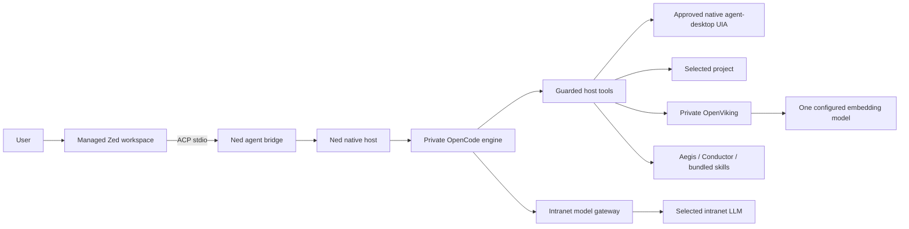

# Ned architecture and migration

Status: Windows acceptance candidate; first-launch and skill-registration diagnostics are under investigation. This document supersedes the OpenCode Desktop frontend choice. Published L-Vibe 0.2.7 artifacts remain historical builds; they do not contain this transition.

## Purpose

Ned provides one offline installation and one settings import for employees who need an AI coding assistant without assembling an IDE, agent, knowledge server and skills themselves. Zed supplies direct editing, navigation and language assistance. A private OpenCode engine supplies agent sessions. The native Ned host owns configuration, approvals, lifecycle and intranet model connections. Aegis, Conductor, the 66 reviewed skills, OpenViking, Serena, Graphify, REA and the selected MCP integrations remain managed components.

## Ownership and security

- Launch a bundled, pinned Zed binary with a Ned-owned user-data directory and child-only profile environment. Do not import or read personal Zed/OpenCode settings or credentials.
- Register a local custom ACP agent. Never install an agent through the online ACP registry. The bridge attaches to the already managed engine; it must not start a second engine using `opencode acp`.
- Actual model API keys stay in the host vault. Zed and ACP receive no model keys. Runtime connection credentials expire with the application.
- Disable editor telemetry, automatic updates, extension installation and unbundled language-server downloads. Offline assurance requires actual network observation in Windows acceptance, beyond settings alone.
- Manual editing and saving in Zed follows normal IDE behavior. Agent edits follow native host approval, including an optional memory-only current conversation/project grant; base-content checks and snapshots remain mandatory. Unsaved editor buffers must be checked before agent writes to avoid overwriting user changes.
- Commands remain blocked except explicitly implemented, approved build tools. Detect installed VS2017/VS2019 MSBuild, inspect solution configurations, then freeze executable, arguments, working directory and environment for approval. No automatic SDK installation or retargeting. Own child processes through Windows Job Objects and confirm cancellation.
- LLM queue waits have no default elapsed-time deadline. Explicit user cancellation remains available. Infrastructure startup/health checks are separate from model generation waits.

## Desktop automation

The user explicitly expanded the original desktop-exclusion scope. Native agent-desktop 1.2.0 is bundled, with 20 reviewed host tools. Every observation and action has separate native approval; file auto-approval does not apply. Ref ownership is bound to engine session/project/window/process identity. Approved GUI app dispatch is available with a frozen executable and no caller arguments; user GUI apps are outside the MCP kill-on-close Job and remain open. Global input, shell/script execution, clipboard, terminal/system/managed editor/approval windows, raw MCP and trace export are unavailable. See [agent-desktop](agent-desktop.md).

## Packaging and name

The product name is **Ned**. The launcher, installer, tray and product UI use `assets/ned-icon.png` / `assets/ned-icon.ico`: black background, white bold Ned text. Zed retains its vendor component identity.

Default installation: `%LOCALAPPDATA%\Programs\Ned`; the directory page also accepts a dedicated writable location such as `D:\Programs\Ned`. Updates default to the registered InstallLocation. Nonempty unrelated folders and drive roots are refused before cleanup. Changing an existing installation location requires uninstalling the old program first; private data is retained. New private data: `%APPDATA%\Ned`. Only the initial migration bootstrap uses `%LOCALAPPDATA%\Ned-Launcher`; after copying it relaunches with `%APPDATA%\Ned` as Electron userData, preserving the copied Local State encryption key. Singleton files therefore cannot interfere with copying, and the encrypted vault remains bound to its original profile key. Copy existing app-owned L-Vibe settings, engine history and OpenViking data only when the old app is stopped, preserve the original, and never overwrite an existing Ned profile. Encrypted settings must still decrypt as the same Windows user; never fall back to plaintext. Historical L-Vibe installers and repair tools keep their original paths and names.

The handover remains one ASCII-named TGZ, one offline installer EXE, one central JSON, one launch shortcut. Bundle all required runtimes, language tools, sources and license notices before import. Model weights and proprietary SDKs are not bundled.

## License and acceptance

Pin Zed v1.28.1 and its matching source. Zed is primarily GPL-3.0-or-later with marked Apache-2.0 components; include corresponding source and third-party notices. The Ned-authored host code retains its own license; do not describe the entire distribution as MIT-only. Windows minimum requirements follow the pinned editor: Windows 10 1903+ / Windows 11 22H2+, x64. Actual company Windows, model-server, offline network and lifecycle acceptance remains required before declaring release readiness.

시작 수정 패치 1 이후에는 프로젝트 선택을 강제하지 않고 Zed 시작 화면을 먼저 연다. 폴더 열기·최근 프로젝트 선택 후 AI 프로젝트 범위를 승인한다. 원본 0.3.1 설치본과 수정 패치의 차이 및 확인된 Windows 경로 오류는 [시작 수정 안내](ned-startup-fix-1.md)를 따른다.

설정 가져오기는 검증·암호화 저장 → 소유한 편집기 창에 정상 종료 요청 → 편집기 종료 확인 → 서비스 종료 확인 → 호스트 재실행 순서다. Windows WM_CLOSE는 정확한 소유 프로세스의 일반 창에만 전달하며 저장 확인창이나 다른 Zed에 강제 종료를 보내지 않는다. 저장 취소는 재시작 대기로 남기고, 종료 미확인은 새 호스트 실행을 차단한다.

Windows ACP 실행은 Zed → 번들 Python 콘솔 감독 프로세스 → Electron Node 모드의 Ned ACP 순서다. 배포 PC에서 직접 초기화는 성공했지만 PowerShell 경유 GUI 실행 파일의 수명이 먼저 끝나 Zed가 서버 종료로 처리한 결과를 확인했다. 기존 Job 감독 프로세스가 표준 입출력과 자식 수명을 유지하며 별도 Node 설치를 요구하지 않는다.

Editor preferences use JSONC edits: preserve current UI/font/panel settings and comments, keep keymaps byte-for-byte and retain the fixed editor/db path. Only managed connection/execution settings are regenerated. Legacy appearance is a fallback only when no live settings file exists. Malformed/duplicate settings are preserved and reported instead of reset. The bundled Windows editor icon resource 1 is replaced with the Ned ICO; non-resource sections and vendor version metadata are verified unchanged. Original Zed source/locks, the icon, modification script and before/after hashes document this unsigned resource adaptation.

## 0.3.5 권한 모드

호스트의 PermissionPolicy가 네이티브 승인 게이트를 통합한다. 사용자는 ACP 권한 선택 메뉴나 알림 영역에서 ask/edits/full을 직접 선택한다. 사용자 데이터의 permissions.json에 저장하며 모델 설정·프로젝트 설정과 분리한다. full은 지원 도구의 승인창을 생략하고, edits는 프로젝트 파일 수정만 자동 승인한다. 기본은 ask이다. 인증된 편집기 owner RPC만 권한 설정을 중계하며 모델의 도구 목록에는 설정 API를 제공하지 않는다. 모드 변경은 모든 연결된 대화에 반영하고 대기 중인 승인과 진행 작업에 취소 신호를 전달한다. 범위·스냅샷·편집 버퍼·대상 고정·중지 확인은 모든 모드에서 유지한다.

## 0.3.6 Windows project navigation

The managed editor keeps its private HOME/USERPROFILE/APPDATA. Its native Windows path prompts are disabled to avoid the reported Open Folder callback failure; the editor uses its internal picker. The host tray exposes a separate system folder picker using Electron's unchanged Windows environment, providing real Desktop and Favorites navigation. The host canonicalizes the selected path, forwards it as a literal argv item after `--` to the bundled CLI with the private `--user-data-dir`, and records the explicit project selection only after dispatch succeeds. Cancellation, editor exit and dispatch failure do not grant access. This avoids the failing route; the exact native exception cause remains unconfirmed.

Desktop snapshot accepts agent-desktop 1.2.0's compact `{app, window:{id,title}, tree}` packet. Full process identity comes from inventory before and after capture; contradictory optional identity fields, changed processes and blocked windows are refused. Every attempted snapshot clears prior refs.
