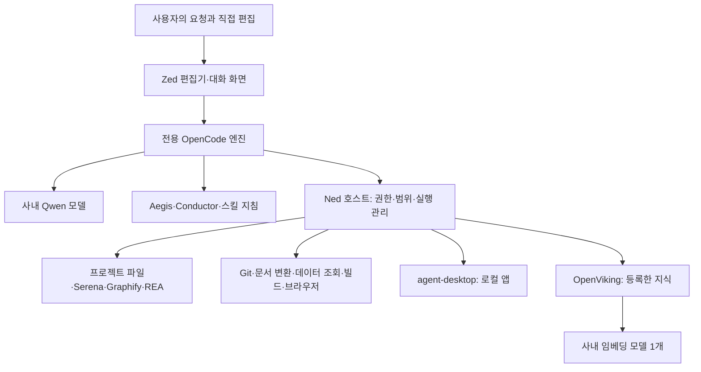

# Ned 상세 사용 안내서: Zed와의 차이부터 기본 스킬 74종까지

이 문서는 AI Agent를 처음 사용하는 분을 위한 안내서입니다. Ned 0.3.10의 기본 배포 구성을 기준으로, 각 구성 요소가 하는 일과 실제로 요청하는 방법을 설명합니다. 예시에 있는 함수명과 파일명은 이해를 돕기 위한 것이므로 자신의 프로젝트에 맞게 바꾸면 됩니다. 예시의 기대 결과는 사용 방법을 설명한 것이며, 해당 작업을 이미 실행해 성공했다는 기록은 아닙니다.

처음부터 모든 도구 이름을 외울 필요는 없습니다. 먼저 익숙한 코드나 문서 하나를 골라 읽고 설명하는 일을 맡겨 보세요. 결과를 확인할 수 있게 되면 파일 수정, 여러 단계의 작업, 지식 검색으로 범위를 넓히면 됩니다.

0.3.10은 기본 스킬을 로컬에서 읽고, 지식 서비스는 백그라운드에서 시작합니다.
[0.3.10 변경 사항](changes-0.3.10.md),
[기존 개인 Zed 대화 가져오기](zed-history-import.md), [PowerShell/CMD 선택](offline-setup.md),
[EGM 설계·검토](egm.md)를 함께 제공합니다.

0.3.8 rebuild1은 [기본 Zed Agent 선택](zed-native-agent.md)과 [Astryx UI 제작](astryx.md)을 추가합니다. Ned 통합 도구가 필요하면 Ned Agent를, Zed 자체 도구만 사용하려면 기본 Zed Agent를 선택합니다.

0.3.8에는 [OpenViking Studio 실행](openviking-studio.md), [요약 출력 한도 처리](compaction-troubleshooting.md), [새 스킬·MCP 추가 안내](extension-guide.md)가 있습니다. 0.3.7 수정 빌드 1부터 OpenViking은 0.5.5이며 저장소·기본 스킬의 내부 이름도 `ned`로 이관합니다. 기존 설치본에서 넘어오는 경우에는 [업데이트와 자료 보존 안내](openviking-0.5.5-update.md)를 함께 참고하세요.

## 이 안내서를 읽는 순서

- [Zed와 Ned의 차이](#zed-and-ned): 같은 편집 화면에서 무엇이 달라지는지 살펴봅니다.
- [기본 용어](#basic-terms): 모델, 에이전트, 도구, MCP, 스킬을 구분합니다.
- [첫 작업 따라 하기](#first-task): 프로젝트를 열고 조사·수정·검증을 요청합니다.
- [파일 삭제와 복구](#file-deletion): 실제 삭제와 빈 파일 저장을 구분하고, 지원 범위와 원본 보관 위치를 확인합니다.
- [주요 구성 요소 7종](#components): Aegis, Conductor, Serena, Graphify, REA, OpenViking, agent-desktop을 설명합니다.
- [함께 들어 있는 개발 도구](#development-tools): Git, 문서 변환, 데이터 조회, 브라우저 관찰과 빌드를 다룹니다.
- [스킬 선택 방법](#using-skills): 자동 선택과 직접 지정을 설명합니다.
- [기본 스킬 74종 상세 사전](#skill-catalog): 각각의 용도, 요청 예시와 확인할 결과를 찾습니다.
- [업무별 요청 예제](#workflows): 여러 도구와 스킬을 실제 작업 흐름으로 연결합니다.
- [권한과 결과 확인](#permissions-and-results): 승인 모드를 고르고, 완료 여부를 판단합니다.
- [자주 묻는 질문](#faq): 대기열, 지식 등록, 테스트 실행 등에 관한 혼동을 정리합니다.

<a id="zed-and-ned"></a>

## 1. 기본 Zed에 Qwen을 연결한 환경과 무엇이 다른가

### 코드를 편집하는 화면은 Zed입니다

Ned에서 파일을 열고 수정하고 저장하는 화면은 Zed입니다. 기존 Zed의 파일 탐색, 코드 편집, 탭과 패널 같은 기능을 사용합니다. 개발자가 직접 코드를 고칠 때 AI에게 허락받을 필요는 없습니다.

Zed도 자체 AI 기능과 외부 에이전트 연결을 지원합니다. Zed에 Qwen을 연결해 질문하거나 코드 수정을 요청하는 방식도 가능합니다. Ned를 이해할 때는 그 위에 기본으로 준비해 둔 개발 도구와 운영 기능을 살펴보면 됩니다.

### 직원마다 설치하고 연결하던 작업을 묶었습니다

사내 모델에 편집기를 연결한 다음에도 준비할 일이 남습니다. C++ 심볼을 분석하려면 분석 도구와 언어 서버가 필요하고, 과거 설계 문서를 검색하려면 지식 저장소와 임베딩 설정이 필요합니다. 계획·디버깅·리뷰 지침을 쓰려면 해당 문서를 준비하고 에이전트가 읽을 수 있게 해야 합니다.

Ned는 Zed, 전용 OpenCode 엔진, 개발 도구, 스킬과 OpenViking을 미리 구성한 설치본으로 제공합니다. 폐쇄망 반입 후 직원이 npm이나 pip로 개별 구성 요소를 설치하는 부담을 줄이려는 목적입니다. 여러 LLM과 임베딩 모델의 연결 정보도 중앙 JSON에서 관리합니다.

| 비교 항목 | Zed에 Qwen을 직접 연결할 때 | Ned 기본 배포 구성 |
| --- | --- | --- |
| 편집 화면 | Zed | Zed |
| AI 작업 실행 | Zed 자체 기능이나 별도로 연결한 에이전트의 구성에 따름 | Ned 전용 OpenCode 엔진 |
| 질문에 참고할 자료 | 열린 파일·대화·사용자가 연결한 도구 등에 따름 | 프로젝트 읽기·검색, 심볼 분석, 정적 구조 분석, 등록한 지식 검색 도구를 함께 제공 |
| 작업 절차 | 요청과 개인 지침에 따름 | Aegis·Conductor 어댑터와 기본 스킬 74종 제공 |
| 코드·문서 분석 도구 | 필요한 도구를 선정해 연결 | Serena·clangd, Graphify, REA, 개발 MCP 6종을 미리 구성 |
| 개인 지식 | 별도 서비스를 연결·운영 | OpenViking 프로젝트 문서 색인과 기존 개인 지식 조회 |
| Windows 앱 조작 | 별도 도구 구성 필요 | agent-desktop의 지원 동작을 호스트 도구로 제공 |
| 권한 설정 | 사용하는 에이전트와 클라이언트에 따름 | 승인 요청·프로젝트 파일 자동 승인·전체 권한을 선택하고 보존 |
| 설치·업데이트 | 구성 요소별 설치·호환성 관리 | 고정 버전·해시의 반입 TGZ와 EXE로 배포 |
| 사용자 환경 | Zed 설정에 따름 | Ned 전용 프로필에 모델 설정·대화·지식·편집기 환경 보관 |

직접 구성한 Zed에도 필요한 도구를 연결할 수 있습니다. Ned의 차이는 이 공통 구성을 배포 담당자가 준비하고, 설정과 실행·종료·권한을 한곳에서 관리한다는 데 있습니다.

### 같은 Qwen을 사용해도 작업에 제공하는 근거가 달라집니다

예를 들어 “이 함수를 바꾸면 어디에 영향이 있나?”라는 질문을 생각해 보겠습니다. 함수 본문만으로 답할 때보다 실제 참조 위치, 관련 파일의 구조, 기존 설계 기록과 테스트 결과를 함께 살펴보면 판단할 근거가 늘어납니다. Ned는 그 근거를 조사할 도구를 에이전트에 제공합니다.

Ned를 설치한다고 Qwen 모델 자체가 재학습되거나 사내 프로젝트를 미리 알게 되는 것은 아닙니다. 필요한 파일을 실제로 읽었는지, 검색 결과가 맞는지, 수정한 코드를 빌드했는지를 확인하는 과정은 여전히 중요합니다.

<a id="basic-terms"></a>

## 2. 처음 알아 두면 좋은 용어

| 용어 | 쉬운 설명 | Ned에서의 예 |
| --- | --- | --- |
| LLM·모델 | 문맥을 읽고 답변이나 다음 행동을 제안하는 AI입니다. | 사내 Qwen |
| Agent·에이전트 | 목표를 받아 자료를 조사하고, 도구 결과를 보면서 다음 작업을 이어가는 실행 방식입니다. | 파일 읽기 → 참조 조사 → 수정 제안 → 결과 확인 |
| 엔진 | 모델 요청, 대화 상태와 도구 호출 흐름을 처리하는 소프트웨어입니다. | 전용 OpenCode 엔진 |
| 호스트 | 프로젝트·권한·설정과 실제 도구 실행을 관리하는 앱 부분입니다. | Ned 호스트 |
| 도구 | 파일을 읽거나, 검색하거나, 빌드하는 등 정해진 기능을 실행합니다. | `read_file`, `semantic_symbols`, `build_project` |
| MCP | 에이전트가 외부 도구와 통신할 때 사용하는 연결 규약입니다. | Serena·Git·문서 변환 서버와의 연결 |
| 어댑터 | 원본의 지침이나 기능을 Ned의 도구·권한·실행 방식에 맞게 연결한 부분입니다. | Aegis·Conductor 지침을 호스트 파일 도구와 함께 사용 |
| 스킬 | 특정 종류의 일을 진행할 때 참고하는 절차와 판단 기준입니다. | 디버깅, 코드 리뷰, 한국어 문서 윤문 지침 |
| 세션·대화 스레드 | 특정 작업을 이어가는 대화 단위입니다. | New Agent Thread로 시작한 Ned 대화 |
| 컨텍스트·문맥 | 모델이 현재 요청을 처리하며 참고하는 대화·코드·도구 결과입니다. | 현재 요청, 읽은 함수, 빌드 오류 |
| 색인 | 문서를 나중에 검색할 수 있도록 처리해 저장하는 과정입니다. | 인터페이스 문서를 OpenViking에 등록 |
| 임베딩 | 문장의 의미를 비교할 수 있게 수치로 표현하는 계산입니다. | BGE 계열 모델을 이용한 지식 검색 |
| 정적 분석 | 대상 프로그램을 실행하지 않고 코드나 파일 구조를 조사합니다. | Graphify의 소스 구조 분석, REA의 지원 파일 검사 |
| 검증 | 요청한 동작이 실제로 맞는지 확인합니다. | 특정 테스트 실행, 빌드 결과, 화면에 표시된 값 확인 |

스킬과 도구는 역할이 다릅니다. “C++ 테스트를 어떻게 설계할지”를 안내하는 스킬이 있어도 GoogleTest나 원하는 SDK가 자동 설치되지는 않습니다. 실제 실행은 PC에 준비된 환경과 Ned가 제공하는 도구 범위에 따라 달라집니다.

이 안내서에서는 도구를 `read_file`처럼 짧은 이름으로 표기합니다. 실제 대화의 도구 이벤트에서는 `ned_host_read_file`처럼 `ned_host_`가 붙은 이름으로 보일 수 있습니다. 사용자가 도구 인자를 직접 입력할 필요는 없으며, 원하는 작업을 대화로 요청하면 에이전트가 호출합니다.

코드 설명과 작업 결과에는 다음 용어도 자주 나옵니다.

| 용어 | 읽을 때 알아 둘 의미 |
| --- | --- |
| 저장소·프로젝트 | 관련 코드·설정·문서를 모아 둔 작업 단위입니다. Git 저장소가 아닌 일반 폴더도 프로젝트로 열 수 있습니다. |
| 진입점 | 프로그램 실행이 시작되는 함수나 파일입니다. |
| 빌드 | 소스 코드를 컴파일·연결해 실행 파일 등 산출물을 만드는 과정입니다. |
| SDK | 특정 플랫폼·장비용 개발에 필요한 헤더·라이브러리·도구 묶음입니다. VxWorks SDK처럼 별도 제공이 필요한 경우가 있습니다. |
| 런타임·의존성 | 프로그램을 실행하거나 빌드할 때 함께 필요한 실행 환경과 라이브러리입니다. |
| 인터페이스·API | 모듈이나 서비스가 입력을 받고 결과를 돌려주는 약속입니다. 입력값·순서·오류 처리도 그 약속에 포함됩니다. |
| diff | 수정 전후에 어떤 줄이 추가·삭제·변경됐는지 보여 주는 비교입니다. |
| 테스트 | 특정 입력과 조건에서 기대한 동작이 나오는지 확인하는 작업입니다. 빌드 성공과 별개입니다. |
| 회귀 | 새 변경 때문에 기존에 되던 동작이 깨지는 문제입니다. 회귀 테스트는 이런 문제를 다시 잡기 위한 검사입니다. |
| CLI | 명령줄에서 실행하는 방식입니다. 원본 도구에 CLI가 있더라도 Ned가 그 명령을 전부 노출하는 것은 아닙니다. |

모르는 용어가 나와도 작업을 멈출 필요는 없습니다. “이 용어가 이 프로젝트에서는 무엇을 뜻하는지 파일이나 동작 예시로 설명해 주세요”라고 요청하면 됩니다.

전체 연결 구조는 다음과 같습니다.



OpenCode는 에이전트 작업을 실행하고, OpenViking은 등록한 자료를 검색합니다. 이 둘의 이름과 역할을 구분해 두면 설정과 오류를 확인할 때도 편합니다.

<a id="first-task"></a>

## 3. 첫 작업 따라 하기

### 3.1 프로젝트와 Ned 대화를 엽니다

설치와 사내 모델 설정을 마쳤다면 다음 순서로 시작합니다. 설정이 아직 없다면 [설치 안내](offline-setup.md)와 [설정 가져오기](configuration-recovery.md)를 먼저 참고하세요.

1. Ned를 실행하고 시작 안내가 끝날 때까지 기다립니다.
2. Windows 알림 영역의 Ned 아이콘을 오른쪽 클릭해 **프로젝트 폴더 열기**를 선택합니다. 분석할 파일들이 들어 있는 프로젝트 폴더를 고릅니다.
3. Zed의 에이전트 패널을 엽니다. **Ctrl+Shift+A** 또는 **New Agent Thread**에서 새 대화를 시작하고 에이전트로 **Ned**를 선택합니다.
4. 모델 선택 메뉴에서 사용할 사내 모델을 확인합니다. 여러 모델은 설정 JSON에 등록한 목록 안에서 선택합니다.
5. 처음에는 **승인 요청** 모드로 읽기·설명 작업을 해 봅니다. 자주 하는 작업의 범위를 알게 되면 [권한 모드](#permissions-and-results)를 조절할 수 있습니다.

### 3.2 먼저 코드 설명을 요청합니다

> 이 프로젝트를 처음 맡았습니다. 파일은 수정하지 말고 주요 폴더, 프로그램 시작점, 설정 파일과 핵심 모듈을 조사해 주세요. 실제로 읽은 파일 경로를 근거로 설명하고, 아직 확인하지 못한 내용은 따로 적어 주세요.

답변에서 폴더 이름과 실제 파일 경로를 확인합니다. 모르는 용어가 있으면 “여기서 말하는 진입점이 무엇인지 이 프로젝트의 함수 이름으로 설명해 주세요”처럼 물어보면 됩니다. 파일 구조가 예상과 다르면 곧바로 수정하기보다 조사 범위를 좁혀 다시 확인하는 편이 좋습니다.

### 3.3 작은 수정으로 이어갑니다

> `src/settings.cpp`에서 빈 설정 경로를 받으면 사용자가 원인을 알 수 있게 오류 메시지를 개선해 주세요. 정상 경로에서의 동작과 공개 함수의 인자는 유지해 주세요. 먼저 현재 오류 처리 방식을 확인한 뒤 수정하고, 확인한 결과를 알려 주세요.

좋은 요청에는 대상, 바꿀 동작, 유지할 조건이 들어 있습니다. 함수를 정확히 모르면 파일이나 화면의 증상을 알려 주어도 됩니다. AI는 관련 코드를 조사하고, 권한 모드에 따라 수정 승인을 요청하거나 바로 변경합니다.

직접 편집 중인 파일은 먼저 저장하세요. Ned는 저장하지 않은 편집 내용과 디스크의 파일이 다르면 수정을 멈추고 확인을 요청할 수 있습니다.

### 3.4 수정과 검증을 구분합니다

> 변경한 파일과 이유를 정리해 주세요. 실제로 실행한 빌드·테스트는 결과를 함께 적고, 실행할 수 없었던 검사는 필요한 환경과 함께 구분해 주세요.

“테스트할 항목을 정리했다”와 “테스트를 실행해 통과했다”는 다릅니다. 예를 들어 VS2019와 필요한 SDK가 설치되어 있으면 지원하는 MSBuild를 실행할 수 있습니다. 0.3.8부터는 설치된 Conda 환경을 사용자가 고르고 그 환경으로 Python 실행·컴파일 검사·pytest·wheel·PyInstaller 작업을 실행할 수 있습니다. 선택은 프로젝트별로 유지합니다. 0.3.10에서는 프로젝트에서 CMD 또는 PowerShell 명령 실행을 Ned Agent에 요청할 수 있습니다. 실행 결과와 종료 코드를 확인하세요.

### 3.5 요청할 내용이 막막하면 이 틀을 사용합니다

모든 항목을 채울 필요는 없습니다. 알고 있는 조건부터 적으면 됩니다. 함수명을 모르면 발생한 화면과 순서를 설명해 주세요.

```text
하고 싶은 일: 설정 파일이 없을 때 사용자가 다음 행동을 알 수 있게 만들고 싶습니다.
대상: 프로그램 시작 시 설정 파일을 불러오는 부분입니다. 함수명은 모릅니다.
현재 문제: 파일이 없으면 오류 코드만 보입니다.
원하는 결과: 필요한 파일 위치와 설정 방법을 한국어로 안내했으면 합니다.
유지할 조건: 기존 설정 파일 형식과 정상 실행 동작은 바꾸지 마세요.
이번 작업 범위: 관련 코드를 먼저 조사하고 필요한 부분만 수정해 주세요.
완료 확인: 변경 전후 동작을 비교하고, 실행한 검증과 미실행 검증을 구분해 주세요.
```

반대로 아직 수정하고 싶지 않다면 “이번에는 조사와 설명만 하고 파일은 바꾸지 마세요”라고 범위를 적습니다. 그 지시는 전체 권한 모드에서도 이번 작업의 의도로 전달됩니다. 실제 승인 정책과 별개로 무엇을 요청했는지도 분명하게 하는 방법입니다.

<a id="file-deletion"></a>

### 3.6 필요 없는 파일을 삭제하기

0.3.7 수정 빌드 1에는 `ned_host_delete_file` 도구가 있습니다. 한 번에 프로젝트 안의 기존 UTF-8 텍스트 파일 하나를 실제로 삭제합니다. 현재는 직접 편집 도구와 같은 2 MiB 이하 텍스트 범위를 지원하며, 디렉터리·재귀 삭제·와일드카드·바이너리 파일 삭제는 제공하지 않습니다.

> `docs/obsolete-notes.md`가 더 이상 사용되지 않는지 관련 참조를 먼저 확인해 주세요. 불필요한 파일이 맞으면 `delete_file`로 삭제하고 실제 삭제 결과와 복구 스냅샷 ID를 알려 주세요. 다른 파일은 지우지 마세요.

`propose_edit`로 내용을 빈 문자열로 저장하면 빈 파일이 남습니다. `delete_file`은 해당 파일의 디렉터리 항목을 없애므로 파일 자체가 사라집니다. 읽기·검색과 달리 파일 변경 권한을 적용합니다. **승인 요청**에서는 대상·원본 해시·삭제 안내를 확인하며, **프로젝트 파일 자동 승인**과 **전체 권한**에서는 허용한 프로젝트 안의 삭제도 자동 승인합니다.

모든 모드에서 미저장 버퍼와 외부 변경, 보호 경로·심볼릭 링크를 확인합니다. `.git`, `.zed` 같은 내부 관리 경로는 삭제 대상으로 사용할 수 없습니다. 승인 대기 중 파일이 바뀌거나 작업이 취소되면 기존 제안을 그대로 실행하지 않습니다. 삭제 직전에 잡은 파일 내용도 다시 대조합니다.

삭제 전 원문은 `%APPDATA%\Ned\snapshots\<세션 ID>\<스냅샷 ID>.json`에 보관합니다. 결과의 `status: deleted`, `after: null`과 스냅샷 ID를 확인하세요. 이 스냅샷은 휴지통이나 자동 실행취소 버튼과는 별개입니다. 필요하면 이전 도구 결과의 원문이나 스냅샷의 `before` 내용을 확인해 파일 재생성을 요청할 수 있으며, 복구도 현재 파일 상태와 권한 검사를 거칩니다.

<a id="components"></a>

## 4. 주요 구성 요소 7종

각 이름은 다음 질문과 연결해 기억하면 편합니다.

| 구성 요소 | 떠올릴 질문 | 맡는 일 |
| --- | --- | --- |
| Aegis | “큰 작업을 어떤 순서와 기준으로 진행할까?” | 조사·계획·변경·검증 지침 |
| Conductor | “지난번에 어디까지 했고 무엇을 하기로 했나?” | 프로젝트 트랙과 진행 기록 |
| Serena·clangd | “이 함수는 어디에 정의되어 있고 어디서 참조하나?” | C/C++ 심볼의 의미 분석 |
| Graphify | “선택한 소스에는 어떤 요소와 관계가 있나?” | 정적 문법 구조의 노드·관계 추출 |
| REA | “이 지원 형식의 산출물에서 무엇을 알아낼 수 있나?” | 일부 바이너리·산출물의 정적 검사 |
| OpenViking | “예전에 등록한 문서나 개인 결정은 어디에 있나?” | 등록·가져온 지식의 색인·검색 |
| agent-desktop | “로컬 앱을 열고 화면에서 확인할 수 있나?” | 지원하는 Windows 창 관찰·조작 |

### 4.1 Aegis: 큰 작업을 조사·계획·변경·검증으로 나누는 지침

Aegis는 AI 개발 작업의 진행 방법을 정리한 방법론입니다. 여러 파일을 바꾸거나, 플랫폼을 옮기거나, 실패하면 영향이 큰 작업에서 먼저 현재 상태와 완료 기준을 확인하도록 돕습니다. 코드를 분석하는 별도 모델이나 빌드 실행기와는 역할이 다릅니다.

예를 들어 “통신 모듈을 Windows로 포팅해 달라”는 요청에는 기존 플랫폼 지원 여부, 소켓 동작, 스레드 종료, 빌드 환경 등 여러 결정이 숨어 있습니다. Aegis 지침을 참고하면 다음과 같이 일을 나눌 수 있습니다.

1. 관련 코드와 기존 동작, 제약을 조사합니다.
2. 유지할 기능과 바꿀 범위를 확인합니다.
3. 작은 구현 단계와 단계별 확인 방법을 정합니다.
4. 변경 후 실제 검증 결과와 남은 문제를 기록합니다.

**이럴 때 요청해 보세요.**

> Aegis 지침을 참고해 통신 모듈의 Windows 이식 범위와 검증 기준을 먼저 정리해 주세요. 기존 VxWorks 지원은 유지해야 합니다. 필요한 변경 파일과 불확실한 부분을 조사한 뒤 단계별 계획을 제시해 주세요.

받을 결과는 실제 파일에 근거한 범위, 계획, 확인할 조건입니다. 계획이 생겼다고 구현이 완료된 것은 아니므로 변경 결과와 검증 기록을 이어서 확인합니다.

Ned는 Aegis의 검토한 지침을 로컬 문서와 어댑터로 사용합니다. 원본의 온라인 설치·업데이트·doctor 전체를 실행하는 구성은 아닙니다. 간단한 질문이나 오탈자 수정에 긴 계획 문서를 강제하지 않으며, 스킬을 선택할 때마다 동의를 다시 구하지 않습니다.

### 4.2 Conductor: 긴 작업의 목표와 진행 상태를 프로젝트에 남기는 방식

Conductor는 기능 개발이나 수정 작업을 **트랙**으로 관리하는 방법론입니다. 트랙은 한 작업의 요구사항, 계획과 진행 기록을 묶은 단위입니다. 며칠 뒤 다시 작업하거나 다른 담당자가 이어받을 때 무엇을 하기로 했는지 확인하는 데 도움이 됩니다.

예를 들어 “장비 연결 상태 표시 개선”이라는 트랙에는 어떤 상태를 보여 줄지, 기존 동작 중 무엇을 유지할지, 구현과 확인을 어떤 순서로 할지를 남길 수 있습니다. 프로젝트에는 `conductor/index.md`, `conductor/tracks.md`와 관련 `spec.md`·`plan.md` 같은 문서가 있을 수 있습니다. 실제 경로는 기존 프로젝트 구성을 따릅니다.

**기존 작업을 이어갈 때는 이렇게 요청합니다.**

> 기존 Conductor 트랙에서 장비 연결 상태 표시와 관련된 내용을 찾아 주세요. 요구사항과 계획을 현재 코드에 대조하고, 실제로 끝난 단계와 남은 단계를 확인한 뒤 이어서 작업해 주세요.

**새로운 긴 작업을 남기고 싶다면 이렇게 요청합니다.**

> 이 작업은 여러 번에 나눠 진행할 예정입니다. 기존 Conductor 구성을 조사하고, 필요하면 이번 작업의 요구사항과 단계별 계획을 프로젝트 문서로 제안해 주세요. 완료 표시는 실제 변경·검증 결과가 있을 때 갱신해 주세요.

트랙 문서 작성도 파일 수정 권한을 따릅니다. 작은 일마다 트랙을 만들 필요는 없습니다. Aegis가 작업을 진행하는 판단 기준을 돕는다면, Conductor는 그 목표와 진행 상황을 프로젝트 파일에 남겨 이어가기 쉽게 합니다. Ned는 Conductor 원본을 호스트 도구에 맞춰 사용하며, Gemini용 설치 명령을 실행하거나 공식 OpenCode 네이티브 플러그인으로 설치하는 방식은 사용하지 않습니다.

### 4.3 Serena와 clangd: 함수·변수의 정의와 참조를 조사하는 도구

Serena는 코드의 심볼을 조사하는 도구입니다. 심볼은 함수, 변수, 클래스처럼 코드에서 이름을 가진 대상을 말합니다. C/C++ 분석에서는 clangd라는 언어 서버를 함께 사용합니다. 언어 서버는 컴파일 옵션과 코드 구조를 참고해 “이 이름이 어떤 선언을 가리키는가”를 해석합니다.

문자열 검색으로 `connect`를 찾으면 같은 글자가 들어간 주석, 다른 클래스의 함수, 사용하지 않는 코드가 함께 나올 수 있습니다. 의미 분석은 가능한 범위에서 이들을 구분해 실제 정의와 참조를 찾는 데 도움을 줍니다.

Ned에서 노출하는 범위는 C/C++ 심볼 개요, 정의, 참조의 읽기 분석입니다. Serena의 임의 REPL이나 직접 수정·명령 기능은 노출하지 않습니다. AI가 코드를 바꿀 때는 공통 파일 수정 도구와 권한 정책을 따릅니다.

> `src/transport.cpp`의 `send_packet` 정의와 참조 위치를 Serena로 조사해 주세요. 그 결과를 바탕으로 인자 형식을 바꾸면 영향을 받을 호출부를 설명해 주세요. 텍스트 검색으로 대체했다면 그 사실을 표시해 주세요.

**확인할 결과:** 정의 위치, 참조한 파일과 코드 위치, 분석에 사용한 범위, 찾지 못한 조건입니다. 참조 목록은 영향 조사의 출발점이며, 동적으로 연결되거나 분석 범위 밖에 있는 호출까지 전부 입증하지는 않습니다.

C/C++에서는 `compile_commands.json`, include 경로, 매크로, 컴파일 옵션과 SDK 헤더가 중요합니다. 예를 들어 VxWorks 헤더가 없으면 특정 타입과 조건부 컴파일을 정확히 해석하지 못할 수 있습니다. 결과가 비거나 실패한 경우에는 해당 설정을 확인하고, 텍스트 검색 결과와 구분해서 읽어야 합니다.

### 4.4 Graphify: 선택한 소스의 구조를 관계 데이터로 정리하는 도구

Graphify는 소스 파일을 파싱해 코드 요소와 관계를 정리합니다. 여기서 쓰는 AST는 소스의 문법 구조를 표현한 트리입니다. 이를 바탕으로 코드 요소를 **노드**, 그 사이의 관계를 **간선**으로 나타냅니다. 작은 모듈의 구조를 파악하거나 어떤 파일과 요소를 더 조사할지 찾을 때 유용합니다.

Ned에서는 선택한 프로젝트 텍스트 파일을 복사해 정적으로 분석합니다. 한 번에 최대 50개 파일, 총 20 MiB를 입력받습니다. 결과에는 전체 노드·간선 수와 일부 상세 데이터가 들어 있으며, 상세 반환은 노드 300개·간선 600개까지입니다. 잘렸다는 표시가 있으면 범위를 좁혀 조사해야 합니다.

> `src/network`의 핵심 소스 10개를 골라 Graphify로 구조를 조사해 주세요. 반환된 노드와 관계를 근거로 모듈 구성을 설명하고, 의미를 확정하려면 더 읽어야 할 파일을 알려 주세요.

Serena가 특정 심볼의 정의와 참조를 해석하는 데 초점을 둔다면, Graphify는 선택한 파일의 정적 문법 구조를 관계 데이터로 살펴보는 데 적합합니다. 분석 언어와 구문 지원에 따라 결과가 달라질 수 있습니다. 이 결과만으로 실행 중 호출 관계나 전체 의존성을 확정할 수는 없습니다.

현재 Ned 연결은 AST 분석 데이터를 반환하는 기능입니다. 원본 프로젝트의 모든 지식 그래프 기능이나 별도의 대화형 그래프 화면을 기본 제공하는 것으로 이해하지 않아도 됩니다. 이 분석 과정에서는 LLM이나 외부 네트워크를 사용하지 않습니다.

### 4.5 REA: 지원하는 프로그램 산출물의 내부 정보를 정적으로 살펴보는 도구

REA는 **Reverse Engineer Anything**의 약자이며, 프로그램과 산출물을 조사하는 도구 모음입니다. Ned의 `rea_inspect`는 다음 다섯 종류의 형식별 정적 검사를 제공합니다. 0.3.8부터 `rea_ghidra`로 Ghidra 기반 함수·호출 관계 분석과 의사코드 생성도 제공합니다. [구체적인 사용법](git-and-binary-analysis.md)을 함께 읽어 보세요.

| Ned에서 선택할 분석 종류 | 조사 대상 | 활용 예 |
| --- | --- | --- |
| `go` | 지원하는 Go 바이너리 | 빌드·모듈 정보 등 확인 가능한 메타데이터 조사 |
| `rust` | 지원하는 Rust 바이너리 | 파일에서 확인할 수 있는 Rust 관련 흔적과 구조 조사 |
| `python-pyc` | Python `.pyc` | 지원 버전의 바이트코드와 내부 구조 조사 |
| `electron-fuses` | Electron 실행 파일 | Electron의 실행 기능을 제어하는 fuse 설정 조사 |
| `model` | 지원하는 모델 산출물 | 형식에 따라 확인 가능한 구조·메타데이터 조사 |

> 프로젝트의 `artifacts/helper.exe`를 Go 바이너리 정적 분석으로 조사해 주세요. 확인된 빌드 정보를 정리하고, 이 파일만으로 알 수 없는 내용은 구분해 주세요. 대상 프로그램은 실행하지 마세요.

Ned는 프로젝트 안의 일반 파일을 복사해 분석하며 크기는 64 MiB 이하로 제한합니다. 형식과 버전이 맞지 않으면 실패하거나 정보가 적을 수 있습니다. 임의의 Windows EXE·DLL을 모두 디컴파일하거나, 원래 소스 코드를 완전히 복원하는 기능은 아닙니다. 디버거 연결, 대상 실행, 장치 조작이나 원본 REA의 임의 도구 실행도 제공하지 않습니다.

일반적인 소스 수정은 Serena나 파일 검색부터 시작하면 됩니다. REA는 소스보다 빌드 산출물의 특성을 확인해야 할 때 선택합니다.

### 4.6 OpenViking: 등록한 문서와 가져온 개인 지식을 찾아 쓰는 저장소

OpenViking은 필요한 자료를 저장하고 검색하는 지식 서비스입니다. 예전 설계 결정, 인터페이스 설명, 장애 대응 문서를 다시 찾을 때 사용할 수 있습니다. Ned와 함께 시작하고 종료하며 데이터는 사용자 폴더에 보관합니다.

LLM은 답변을 만들고, OpenViking은 그 답변에 참고할 등록 자료를 찾습니다. 임베딩 모델은 문서와 질문의 의미를 비교할 수 있도록 계산합니다. 예를 들어 문서에 “재접속 간격”이라고 적혀 있어도 “연결이 끊긴 뒤 다시 시도하는 주기”라는 질문으로 관련 내용을 찾는 데 활용합니다. 검색 품질은 원문 구성과 임베딩 모델, 색인 상태에 따라 달라집니다.

#### 프로젝트 지식과 개인 공통 지식을 구분합니다

| 범위 | 어떤 자료인가 | 언제 쓰나 |
| --- | --- | --- |
| 프로젝트 지식 | 현재 프로젝트에서 사용자가 선택해 색인한 텍스트 문서 | 해당 프로젝트의 인터페이스·운영 규칙 검색 |
| 가져온 개인 공통 지식 | 기존 OpenViking에서 명시적으로 가져온 기억·문서 등 | 같은 사용자의 여러 프로젝트에서 이전 결정과 선호 검색 |

**처음에는 작은 Markdown 문서 하나로 확인합니다.**

> 프로젝트의 `docs/interface-notes.md`를 현재 프로젝트 지식으로 색인해 주세요. 등록이 완료되면 이 문서에 있는 재접속 규칙을 검색하고, 찾은 원문의 URI와 근거를 알려 주세요.

색인은 해당 문서를 로컬 OpenViking과 설정한 사내 모델 처리 경로로 전달하는 작업입니다. 권한 모드에 따라 승인을 받습니다. PDF나 Office 문서는 현재 색인 도구에 그대로 넘기는 대신 문서 변환 도구로 텍스트를 확인한 뒤 프로젝트의 Markdown 등으로 저장해 색인하는 순서가 적합합니다.

**가져온 개인 지식에는 이렇게 요청할 수 있습니다.**

> 내가 이전에 정한 C++ 오류 처리 규칙을 개인 공통 지식에서 찾아 주세요. 관련 원문을 읽고 이번 프로젝트에 적용할 수 있는 부분과 현재 코드와 다른 부분을 나눠 설명해 주세요.

대화와 기본 스킬은 Ned의 로컬 경로에서 동작합니다. 프로젝트 문서를 검색하려면 OpenViking을 실행하고 해당 문서를 먼저 색인하세요.

Ned는 새 대화나 프로젝트 전체를 자동으로 장기 기억에 올리지 않습니다. 기존 개인 지식은 승인해 가져온 범위에서 읽기 전용으로 조회합니다. `.ovpack` 가져오기와 지원 영역은 [개인 지식 이관 안내](openviking-personal-migration.md)에 설명했습니다. 공유 지식 저장소나 다른 직원의 기억도 자동으로 연결하지 않습니다.

### 4.7 agent-desktop: Windows 앱의 요소를 읽고 지원 동작을 수행하는 도구

agent-desktop은 로컬 앱의 화면 요소를 읽고 조작하는 도구입니다. 자체 AI 모델은 없으며, Ned의 에이전트가 어떤 창을 확인하고 어떤 동작을 할지 결정합니다. Windows에서는 접근성 정보인 UI Automation을 사용합니다. 화면의 버튼·입력란·선택 항목을 프로그램이 읽을 수 있는 형태로 제공받는 방식입니다.

기본 흐름은 다음과 같습니다.

1. 데스크톱 도구 상태를 확인합니다.
2. 필요한 앱을 찾고 실행하거나, 열린 창 목록에서 대상을 고릅니다.
3. 해당 창의 스냅샷을 읽어 실제 요소를 확인합니다.
4. 관찰한 요소에 클릭·값 설정·선택·스크롤 등 지원 동작을 수행합니다.
5. 다시 읽어 결과가 달라졌는지 확인합니다.

> Windows 계산기를 실행해 주세요. 공학용 모드인지 실제 화면 요소로 확인한 뒤 `3+4*2`를 입력하고, 표시된 결과를 다시 읽어 알려 주세요. 조작에 실패했다면 어디까지 실행됐는지 설명해 주세요.

공학용 모드에서 연산자 우선순위를 적용하면 기대 값은 11입니다. 표준 모드의 순차 입력은 14가 나올 수 있어 모드를 먼저 확인해야 합니다. 대화에서 산술 계산만 해 11이라고 답한 것과 계산기에서 실제로 읽은 결과는 구분합니다.

앱 실행은 계산기·메모장·그림판 별칭이나 지원하는 로컬 GUI `.exe` 경로로 할 수 있습니다. 임의 명령행 인자, 셸 문자열, URI 연결 프로그램은 지정할 수 없습니다. 앱 실행 요청이 전달된 뒤 실제 창이 열렸는지 다시 관찰해야 합니다. Ned를 종료해도 이렇게 실행한 사용자 GUI 앱은 그대로 남을 수 있습니다.

사용할 때는 다음 범위를 기억해 주세요.

- 지원 대상은 잠금 해제된 Windows 사용자 데스크톱과 읽을 수 있는 접근성 요소입니다. 앱이 접근성 정보를 충분히 제공하지 않으면 조작이 어려울 수 있습니다.
- Ned·Zed 자체, 승인창, 터미널과 시스템 창은 조작 대상에서 제외합니다. UAC 보안 화면과 관리자 권한 앱도 지원 범위 밖입니다.
- 전역 키 입력, 임의 화면 좌표 클릭과 클립보드 조작은 노출하지 않습니다. 원본 프로젝트의 모든 명령이 Ned에 있는 것은 아닙니다.
- 지정 창의 스크린샷은 선택한 권한 모드에 따라 사내 모델 문맥과 로컬 대화 기록에 포함될 수 있습니다. OpenViking에 자동 등록되지는 않습니다.
- 실행 여부가 불분명한 클릭이나 입력을 반복하면 중복 처리될 수 있습니다. 새로 관찰해 현재 상태부터 확인합니다.

도구 이름과 진단 방법은 [데스크톱 사용 안내](agent-desktop.md)에 정리했습니다.

<a id="development-tools"></a>

## 5. 함께 들어 있는 개발 도구는 어디에 쓰나

Serena를 포함한 개발 MCP는 여섯 종류입니다. Graphify·REA·OpenViking·agent-desktop은 이 여섯 개와 별도의 연결 기능입니다. 이름을 모두 기억하기보다 아래의 작업 예시로 접근해도 됩니다.

| 도구 | 실제로 할 수 있는 일 | 요청 예시와 준비 조건 |
| --- | --- | --- |
| Serena·clangd | C/C++ 개요·정의·참조 조사 | “이 함수의 참조 위치를 찾아 주세요.” 컴파일 옵션과 필요한 헤더가 있어야 정확도가 높습니다. |
| Git MCP | 상태·diff·staged diff·log·show 조회 | “최근 변경 중 연결 종료 처리와 관련된 수정 내용을 조사해 주세요.” 지원하는 로컬 `.git` 저장소가 필요합니다. 스테이징·커밋은 별도 호스트 도구 `git_stage`, `git_commit`으로 수행합니다. checkout·push는 지원하지 않습니다. [커밋 안내](git-and-binary-analysis.md)를 참고하세요. |
| MarkItDown MCP | 선택한 PDF·DOCX·PPTX·XLSX·XLS·CSV·텍스트를 Markdown으로 변환 | “`docs/protocol.pdf`에서 패킷 형식을 읽고 코드와 비교해 주세요.” 스캔 이미지 OCR·HWP·Office 원본 편집·매크로 실행은 제공하지 않습니다. |
| DuckDB Local MCP | 복사한 CSV·TSV·Parquet 또는 로컬 `.duckdb`에 단일 SELECT 수행 | “`data/events.csv`의 오류 코드별 건수를 조회해 주세요.” CSV 등은 `input_0` 같은 뷰로 조회합니다. 출력은 최대 200행이며 DB 쓰기·외부 서버·HTTP·확장 설치는 차단합니다. |
| Playwright MCP | 허용한 로컬 HTTP 페이지의 접근성 스냅샷·콘솔·선택적 스크린샷 | “이미 실행 중인 `http://127.0.0.1:3000` 페이지의 콘솔 오류와 접근성 구조를 확인해 주세요.” 개인 브라우저 프로필과 외부 사이트는 사용하지 않습니다. |
| Chrome DevTools MCP | 로컬 페이지 관찰, 선택적 재탐색·5초 성능 trace | “같은 로컬 페이지를 다시 불러오며 성능 기록을 확인해 주세요.” 페이지 GET/HEAD 관찰 중심이며 클릭·입력·임의 JavaScript 실행 도구는 노출하지 않습니다. |

두 브라우저 연결은 모두 Ned가 허용한 로컬 HTTP origin에서 관찰 중심으로 사용합니다. 폼 제출·파일 업로드·자동 클릭 시나리오 전체를 수행하는 브라우저 자동화 도구로 생각하면 지원 범위와 차이가 생깁니다. 개발 서버도 미리 준비해 실행해야 합니다. 필요한 경우 별도 승인된 로컬 검증 환경에서 테스트를 실행하고 결과를 Ned와 함께 검토할 수 있습니다.

### Python은 어떤 환경에서 실행하나

PC에 설치된 Conda 환경을 조사하고 **프로젝트의 Python 환경 선택** 창에서 사용할 환경을 고릅니다. 전체 권한에서도 환경은 사용자가 결정합니다. 한 번 선택하면 같은 프로젝트는 재시작·업데이트 후에도 같은 환경을 쓰며, 변경을 요청할 때만 다시 고릅니다. OpenViking이 활성화되어 있으면 선택 이력도 프로젝트 지식에 기록합니다.

> 이 프로젝트를 실행할 Conda 환경을 찾아 주세요. 환경은 제가 고르겠습니다. 선택한 환경으로 `main.py`를 실행하고 실제 종료 코드와 출력을 확인해 주세요.

`.py` 실행, `py_compile`, 설치된 pytest, wheel 빌드와 PyInstaller 패키징을 지원합니다. 패키지는 자동 설치하지 않습니다. 긴 작업은 작업 ID로 상태를 확인하고, 중지하면 Ned가 시작한 자식 프로세스를 함께 종료합니다. [Conda 상세 안내](python-conda.md)에 환경을 찾는 위치, 환경 변경, 각 작업의 요청 예시를 정리했습니다.

### VS2017/2019 빌드는 어떻게 하나

Ned에는 설치된 VS2017/2019의 MSBuild와 프로젝트 구성을 조사하는 `inspect_build`, 확인한 구성으로 빌드하는 `build_project`가 있습니다.

> 이 프로젝트의 솔루션과 설치된 VS2017/2019 빌드 도구를 조사해 주세요. 가능한 구성과 플랫폼을 알려 주고, `Release / x64`가 있으면 해당 구성으로 빌드해 주세요. SDK가 없으면 자동 설치하거나 프로젝트를 retarget하지 말고 필요한 항목을 설명해 주세요.

MSBuild는 프로젝트의 빌드 이벤트 등 코드를 실행할 수 있으므로 신뢰하는 프로젝트를 대상으로 사용합니다. Ned가 고정한 실행 파일·인자·환경으로 지원하는 빌드를 실행하며, 일반 셸 명령을 자유롭게 해석하는 방식은 제공하지 않습니다. 빌드가 통과해도 실제 장비 동작이나 모든 테스트가 통과한 것은 아니므로 목적에 맞는 추가 검증이 필요합니다.

<a id="using-skills"></a>

## 6. 스킬은 어떻게 고르면 되나

### 이름을 몰라도 작업을 설명하면 됩니다

> 실행 직후 설정 화면이 닫힙니다. 오류가 발생한 단계를 조사하고 원인을 확인한 뒤 수정해 주세요.

이처럼 목적과 증상을 설명하면 Ned가 현재 요청, 최근 사용자 문맥과 관련 도구 활동을 참고해 스킬 후보를 고릅니다. 호스트는 최대 3개의 후보 지침을 요청에 넣고, 모델은 프로젝트와 실제 결과를 보며 관련성을 다시 판단합니다. 규칙에 따른 후보 선정이므로 늘 가장 적합한 조합이 정해지는 것은 아니며, 작업이 바뀌면 다시 고를 수 있습니다.

74개는 74개의 AI 모델이나 동시에 실행되는 에이전트를 뜻하지 않습니다. 작업할 때 필요한 지침을 골라 읽는 문서 모음입니다. 별도의 분류 모델을 호출하거나 매번 모든 스킬을 읽지는 않습니다. 문맥 공간이 부족하면 본문을 더 넣는 대신 필요한 문서를 도구로 나눠 읽습니다.

### 특정 관점이 필요하면 이름을 지정합니다

> `change-impact` 스킬을 적용해 설정 형식 변경의 영향 범위를 조사해 주세요. 지금은 코드를 수정하지 말고 데이터 호환성과 복구 방법을 먼저 정리해 주세요.

영문 ID를 쓰면 같은 뜻의 여러 스킬 사이에서 원하는 지침을 분명하게 지정할 수 있습니다. 보통은 한두 개의 관련 관점이면 충분합니다. “모든 스킬을 적용해 달라”는 요청은 간단한 작업에도 불필요한 절차와 문맥을 늘릴 수 있습니다.

그 요청에서 자동 적용을 원하지 않으면 “이번 요청에서는 스킬을 사용하지 마”라고 말할 수 있습니다. 스킬이 어떤 작업을 권장하더라도 파일 수정·빌드·지식 전달·데스크톱 실행 권한은 사용자가 선택한 호스트 정책을 따릅니다.

### 비슷한 이름은 적용 시점과 초점으로 구분합니다

| 고민 | 먼저 떠올릴 스킬 | 구분 방법 |
| --- | --- | --- |
| 목표가 아직 모호함 | `goal-framing` | 무엇을 끝내야 하는지와 제외 범위를 정합니다. |
| 목표는 정했지만 순서가 필요함 | `writing-plans` | 실제 실행할 단계와 단계별 확인 방법을 정합니다. |
| 구현 전에 설계 위험이 걱정됨 | `plan-eng-review` | 실패·호환성·복구·성능 문제를 구현 전에 검토합니다. |
| 오류 원인이 모호함 | `systematic-debugging`, `diagnosing-bugs` | 앞의 스킬은 원인과 소유 계층을 추적하는 절차, 뒤의 스킬은 작은 재현과 가설별 피드백에 초점을 둡니다. |
| 테스트를 먼저 작성하고 싶음 | `test-driven-development`, `tdd` | 전자는 Aegis 기반 TDD 절차, 후자는 관찰 가능한 동작과 적절한 테스트 경계에 초점을 둡니다. 중복 적용은 필수가 아닙니다. |
| 리뷰를 의뢰할 내용을 정리함 | `requesting-code-review` | 변경 배경·범위·검증 근거를 갖춰 리뷰할 수 있게 합니다. |
| 요구사항 누락까지 코드와 대조함 | `code-review` | 요청 충족과 코드 규칙을 나누어 봅니다. |
| 수정 때문에 기존 동작이 깨질까 걱정됨 | `review` | diff와 실제 호출 경로의 회귀를 집중 검토합니다. |
| 보안에 영향을 주는 변경임 | `differential-review` | 인증·권한·입력 경계 등 보안 회귀를 중심으로 봅니다. |
| 처음 보는 코드 구조를 익힘 | `codebase-onboarding` | 개발자가 저장소를 이해하도록 설명합니다. |
| 제품의 첫 사용이 어려움 | `onboarding` | 최종 사용자의 설치·설정·첫 작업 흐름을 개선합니다. |
| 기존 코드의 작성 관례를 유지함 | `inherit-legacy-style` | 이름·형식·오류 처리 등 기존 관례를 조사합니다. |
| 낡은 구조를 점진적으로 바꿈 | `legacy-modernizer` | 기존 동작을 보존하며 이행·복구를 계획합니다. |

<a id="skill-catalog"></a>

## 7. 기본 스킬 74종 상세 사전

아래 목록은 Ned 0.3.10의 기본 스킬 74종을 용도별로 정리했습니다. 번호는 안내용이며 호출할 때는 각 ID를 사용합니다. 각 항목의 요청 예시는 대화에 그대로 옮겨 자신의 대상과 조건으로 바꾸어 사용할 수 있습니다. “확인할 결과”는 답변을 읽을 때 살펴볼 항목입니다. 특정 프로그램·프레임워크·SDK가 필요한 경우에는 미리 반입된 프로젝트와 환경이 있어야 합니다.

필요한 항목만 먼저 읽어도 됩니다.

| 지금 하려는 일 | 시작하기 좋은 항목 |
| --- | --- |
| 코드를 처음 이해하기 | [24. 기존 코드 파악](#skill-codebase-onboarding), [15. 개발 문서](#skill-developer-documents) |
| 큰 작업의 목표·순서 정하기 | [03. 요구사항 구체화](#skill-goal-framing), [04. 구현 계획](#skill-writing-plans), [46. 구현 전 검토](#skill-plan-eng-review) |
| C++ 수정·포팅 | [21. C++ 구현·성능](#skill-cpp-pro), [22. C++ 테스트](#skill-cpp-testing), [23. 레거시 개선](#skill-legacy-modernizer), [39. C++ 품질](#skill-cpp-coding-standards) |
| 오류 조사 | [06. 원인 기반 디버깅](#skill-systematic-debugging), [43. 재현 중심 디버깅](#skill-diagnosing-bugs) |
| 변경 검토·완료 확인 | [38. 변경 영향](#skill-change-impact), [45. 코드 리뷰](#skill-code-review), [47. 회귀 리뷰](#skill-review), [07. 완료 전 검증](#skill-verification-before-completion) |
| 웹 UI 개선 | [12. 프런트엔드 설계](#skill-frontend-design), [16. 접근성](#skill-ui-accessibility), [52. UI 완성도](#skill-unslop), [66. 웹 표준](#skill-modern-web-guidance) |
| 데이터 분석 | [31. 탐색](#skill-explore-data), [32. 결과 검증](#skill-validate-data), [33. 시각화](#skill-data-visualization), [34. 통계](#skill-statistical-analysis) |
| 소개·안내 문서 | [50. 한국어 윤문](#skill-humanize-korean), [53. 문안 작성](#skill-copywriting), [54. 문안 편집](#skill-copy-editing), [56. 최초 사용 흐름](#skill-onboarding) |
| 검색·개인 지식 활용 | [20. 검색 품질](#skill-rag-search-quality), [OpenViking 설명](#components) |
| 게임·교육 시뮬레이션 | [57. 게임 설계](#skill-game-studio)부터 프로젝트의 2D·3D 항목으로 이어갑니다. |
| Windows 앱 조작 | [01. 데스크톱 UI](#skill-agent-desktop), [02. Windows UI](#skill-agent-desktop-windows) |

<a id="skill-agent-desktop"></a>

### 01. 데스크톱 UI 작업 — `agent-desktop`

로컬 앱을 관찰하고 조작한 뒤 결과를 다시 확인하는 절차입니다. 버튼 이름이나 위치를 추측하기보다 실제 창과 접근성 요소를 읽도록 안내합니다.

- **잘 맞는 상황:** 계산기 등 지원 앱을 실행하고 입력·클릭 결과를 확인하려는 경우입니다.
- **요청 예시:** “`agent-desktop` 지침으로 계산기를 실행하고 공학용 모드에서 `3+4*2`를 계산해 주세요. 화면에서 읽은 값을 알려 주세요.”
- **확인할 결과:** 대상 창 확인, 실제 수행한 동작, 결과 재관찰입니다. 스킬은 호출 절차이고 실제 동작은 데스크톱 도구가 수행합니다.

<a id="skill-agent-desktop-windows"></a>

### 02. Windows UI 자동화 — `agent-desktop-windows`

Windows 접근성 정보와 대화형 세션, 권한 차이, 창 수명 같은 조건을 고려하는 지침입니다. 같은 앱이라도 최소화·잠금·권한 상태에 따라 관찰 결과가 달라질 수 있습니다.

- **잘 맞는 상황:** 창은 보이는데 버튼을 못 읽거나, 실행 직후 창을 찾지 못하는 등 Windows UI 작업에 문제가 생긴 경우입니다.
- **요청 예시:** “`agent-desktop-windows` 지침으로 현재 계산기 창을 읽을 수 있는지 확인하고, 지원하지 않는 상태라면 그 이유를 알려 주세요.”
- **확인할 결과:** 창과 요소의 실제 상태, 지원 여부, 실패한 단계입니다. 관리자 권한이나 전역 좌표 클릭으로 우회하는 절차는 제공하지 않습니다.

<a id="skill-goal-framing"></a>

### 03. 요구사항 구체화 — `goal-framing`

막연한 요청을 목표, 성공 기준, 중단 조건과 제외 범위로 정리합니다. 바로 구현하기보다 “어떤 결과를 얻으면 끝인가”를 먼저 합의하고 싶을 때 직접 요청하면 좋습니다.

- **잘 맞는 상황:** “장비 로그를 보기 편하게 만들고 싶다”처럼 목적은 있지만 작업 범위가 아직 모호한 경우입니다.
- **요청 예시:** “`goal-framing`으로 로그 조회 개선의 목표를 정리해 주세요. 원본 로그 형식은 유지하고, 검색과 오류 원인 확인이 쉬워지는 것을 기준으로 해 주세요.”
- **확인할 결과:** 원하는 결과, 유지할 조건, 완료 판단 근거와 아직 결정할 사항입니다. 작은 질문에 목표 문서를 늘 만드는 용도는 아닙니다.

<a id="skill-writing-plans"></a>

### 04. 구현 계획 — `writing-plans`

정해진 요구사항을 조사·구현·검증 가능한 단계로 나눕니다. 각 단계에서 바꿀 대상과 완료를 확인할 방법을 연결합니다.

- **잘 맞는 상황:** 여러 파일에 걸친 기능 추가나 플랫폼 이식처럼 순서가 중요한 작업입니다.
- **요청 예시:** “`writing-plans`로 통신 모듈 이식 계획을 세워 주세요. 현재 코드를 조사한 뒤 수정 파일, 선행 조건과 단계별 검증을 적어 주세요.”
- **확인할 결과:** 실제 코드와 연결된 단계, 필요한 의존성, 검증·전달 순서입니다. 범위가 작은 수정은 짧은 실행 순서만으로 충분할 수 있습니다.

<a id="skill-test-driven-development"></a>

### 05. 테스트 주도 개발 — `test-driven-development`

실패하는 테스트를 먼저 확인하고, 이를 통과하는 최소 구현을 만든 뒤 정리하는 TDD 절차입니다. Aegis 기반의 작업 방식과 검증 기준을 참고합니다.

- **잘 맞는 상황:** 수정하려는 버그가 다시 생기지 않도록 재현 테스트부터 남기고 싶은 경우입니다.
- **요청 예시:** “`test-driven-development`를 적용해 빈 패킷 처리 오류를 재현하는 테스트부터 설계해 주세요. 실행할 환경이 없으면 작성한 테스트와 미실행 항목을 구분해 주세요.”
- **확인할 결과:** 수정 전 실패와 수정 후 성공을 가르는 조건입니다. 테스트 도구가 없으면 코드 작성까지와 실제 실행을 구분하며, 모든 작업에 TDD를 강제하지 않습니다.

<a id="skill-systematic-debugging"></a>

### 06. 원인 기반 디버깅 — `systematic-debugging`

오류 메시지부터 관련 로직과 시스템 조건을 추적하며 원인을 검증합니다. 우연히 증상이 사라진 변경과 원인을 고친 변경을 구분하는 데 도움을 줍니다.

- **잘 맞는 상황:** 임시 수정이 반복되거나, 여러 모듈·플랫폼 사이에서 같은 오류가 재발하는 경우입니다.
- **요청 예시:** “`systematic-debugging`으로 종료 시 간헐적으로 멈추는 원인을 조사해 주세요. 정상 종료와 비교해 잠금·스레드·자원 정리 경로를 확인해 주세요.”
- **확인할 결과:** 재현 조건, 의심 지점의 근거와 원인을 구분하는 검사입니다. 원인 확정 전에는 가설로 표시해야 합니다.

<a id="skill-verification-before-completion"></a>

### 07. 완료 전 검증 — `verification-before-completion`

완료 보고를 실제 확인 결과와 맞춰 보는 지침입니다. 코드 수정, 빌드 성공, 사용자 동작 확인의 범위를 나눕니다.

- **잘 맞는 상황:** 긴 작업을 마무리하거나 다른 사람에게 결과를 전달하기 직전입니다.
- **요청 예시:** “`verification-before-completion`으로 이번 변경의 완료 여부를 확인해 주세요. 요청한 기능별로 실행 근거와 아직 확인하지 못한 항목을 정리해 주세요.”
- **확인할 결과:** 수행한 검사, 결과, 적용 범위와 남은 검증입니다. 예전에 통과한 다른 버전의 결과를 현재 버전의 실행 결과로 섞지 않아야 합니다.

<a id="skill-requesting-code-review"></a>

### 08. 코드 리뷰 의뢰 — `requesting-code-review`

리뷰를 받을 수 있도록 변경 목적, 비교 범위, 위험과 검증 근거를 갖추는 절차입니다. 리뷰할 사람이 무엇을 중점적으로 봐야 하는지 분명하게 합니다.

- **잘 맞는 상황:** 큰 변경 후 리뷰를 요청하거나, 무엇을 확인해 달라고 해야 할지 정리할 때입니다.
- **요청 예시:** “`requesting-code-review` 지침으로 이번 통신 처리 변경의 리뷰 자료를 정리하고 검토해 주세요. 변경 배경과 비교 기준, 실행한 검증을 먼저 확인해 주세요.”
- **확인할 결과:** 리뷰 범위, 구체적인 문제와 근거입니다. 이 스킬 이름만으로 별도 AI 리뷰어가 자동 실행되거나 독립 검토가 보장되는 것은 아닙니다.

<a id="skill-skill-creator"></a>

### 09. 스킬 작성 — `skill-creator`

팀에서 반복하는 절차를 재사용할 수 있는 스킬 문서로 정리합니다. 언제 적용할지, 무엇을 읽을지, 어떤 결과를 남길지 작성하는 데 도움을 줍니다.

- **잘 맞는 상황:** 팀 고유의 코드 리뷰 기준이나 장비 오류 조사 절차가 반복되는 경우입니다.
- **요청 예시:** “`skill-creator`로 우리 프로젝트의 통신 오류 조사 절차를 스킬 초안으로 작성해 주세요. 적용 조건, 필요한 자료와 결과 형식을 포함해 주세요.”
- **확인할 결과:** 간결한 지침 초안과 적용 조건입니다. 프로젝트 문서 작성은 수정 권한을 따르며, 작성한 스킬을 앱 기본 번들에 자동 설치·등록하는 기능은 아닙니다. 배포 반영은 별도 검토가 필요합니다.

<a id="skill-security-best-practices"></a>

### 10. 보안 구현 검토 — `security-best-practices`

언어와 프레임워크에 맞는 보안 구현 기준을 확인합니다. 기본 원문 지침은 Python, JavaScript/TypeScript, Go를 중심으로 하므로 먼저 적용 가능한 참조가 있는지 살펴봅니다.

- **잘 맞는 상황:** 파일 업로드, 로그인, 입력 검증이나 비밀정보 처리 코드를 보안 관점에서 검토하려는 경우입니다.
- **요청 예시:** “`security-best-practices`로 이 Python API의 파일 경로 검증과 인증 처리를 검토해 주세요. 실제 코드 위치와 악용 조건을 함께 설명해 주세요.”
- **확인할 결과:** 구현 근거가 있는 문제와 개선안입니다. C++ 등 다른 언어에 해당 참조가 있다고 가정하지 말고 적용 범위를 확인합니다. 보안 인증이나 전수 취약점 검사를 대신하지는 않습니다.

<a id="skill-security-threat-model"></a>

### 11. 위협 모델 — `security-threat-model`

보호할 자료, 외부 입력, 신뢰 구역 사이의 연결을 살펴 공격이 가능한 경로를 정리합니다. 개별 코드 줄보다 시스템의 데이터 흐름을 먼저 봅니다.

- **잘 맞는 상황:** 새 파일 가져오기 기능이나 외부 장비·서비스 연결을 설계하는 경우입니다.
- **요청 예시:** “`security-threat-model`로 설정 파일 가져오기 기능의 위협을 분석해 주세요. 입력 파일, 키 저장, 실행 경로와 권한이 만나는 지점을 실제 코드로 확인해 주세요.”
- **확인할 결과:** 보호 대상, 공격자의 전제, 가능한 악용 경로와 대응입니다. 확인한 구조와 가정을 구분해야 합니다.

<a id="skill-frontend-design"></a>

### 12. 프런트엔드 설계 — `frontend-design`

화면의 목적과 사용자를 바탕으로 정보 배치, 글꼴, 색상과 상호작용을 설계합니다. 새 UI를 만들거나 기존 화면의 방향을 바꿀 때 적합합니다.

- **잘 맞는 상황:** 장비 상태 대시보드처럼 어떤 정보부터 보여 줄지 정해야 하는 경우입니다.
- **요청 예시:** “`frontend-design`으로 장비 상태 화면을 설계해 주세요. 운영자가 이상 장비를 빠르게 찾도록 하고, 기존 프로젝트의 로컬 자산과 기술 구성을 사용해 주세요.”
- **확인할 결과:** 실제 업무 정보에 맞는 배치와 구현 근거입니다. 외부 글꼴·이미지가 자동 다운로드되거나 브라우저 화면이 자동 검증되는 것은 아닙니다.

<a id="skill-webapp-testing"></a>

### 13. 웹 앱 테스트 — `webapp-testing`

웹 화면의 주요 사용자 흐름을 정하고 테스트 계획·코드를 작성하는 지침입니다. 브라우저에서 무엇을 관찰해야 하는지도 안내합니다.

- **잘 맞는 상황:** 화면 변경 후 오류, 빈 상태, 로딩 상태와 주요 사용 흐름을 확인하려는 경우입니다.
- **요청 예시:** “`webapp-testing`으로 로컬 설정 화면의 정상·오류·빈 데이터 검증 항목을 정리하고, 현재 실행 가능한 브라우저 관찰을 수행해 주세요.”
- **확인할 결과:** 관찰한 접근성 구조·콘솔·화면과 별도 실행이 필요한 테스트입니다. Ned 브라우저 도구는 관찰 중심이므로 원본 스킬의 임의 Playwright 스크립트·클릭 테스트를 모두 실행할 수는 없습니다.

<a id="skill-mcp-builder"></a>

### 14. MCP 개발 — `mcp-builder`

모델이 이해하고 사용할 수 있는 도구 인터페이스를 설계하는 지침입니다. 입력·출력 형식, 이름, 오류 처리와 필요한 맥락을 정리합니다.

- **잘 맞는 상황:** 사내 장비 정보 조회 같은 서비스를 MCP로 연결하는 코드를 개발할 때입니다.
- **요청 예시:** “`mcp-builder`로 로컬 장비 목록을 읽기 전용으로 조회하는 MCP 서버를 설계해 주세요. 입력 검증, 반환 형식과 실패 응답을 먼저 정리해 주세요.”
- **확인할 결과:** 작고 명확한 도구 계약과 구현·검증 계획입니다. 서버 코드를 작성하는 것과 직원 PC의 Ned에 임의 MCP를 설치하는 것은 별개이며, 런타임 반입과 호스트 연동 검토가 필요합니다.

<a id="skill-developer-documents"></a>

### 15. 개발 문서 — `developer-documents`

실제 요구사항과 코드에 맞춰 설계·API·운영·검증 문서를 작성합니다. 필요한 문서 종류를 고르고, 요청·구현·검증 상태를 구분합니다.

- **잘 맞는 상황:** 코드 구조 설명, API 사용법, 배포 절차나 인수인계 문서가 필요한 경우입니다.
- **요청 예시:** “`developer-documents`로 이 통신 모듈의 개발자 안내서를 작성해 주세요. 진입점, 입력·출력, 오류 처리와 실제 코드 예시를 포함해 주세요.”
- **확인할 결과:** 현재 파일과 일치하는 설명, 구체적인 예시와 아직 확인되지 않은 항목입니다. 문서 저장은 파일 수정 정책을 따릅니다.

<a id="skill-ui-accessibility"></a>

### 16. UI 사용성·접근성 — `ui-accessibility`

키보드, 포커스, 이름표, 대비와 다양한 화면 상태를 중심으로 UI를 검토합니다. 마우스로 한 번 눌러 보는 것만으로 놓치기 쉬운 문제를 찾습니다.

- **잘 맞는 상황:** 키보드만으로 설정을 바꾸기 어렵거나, 오류·로딩 상태가 사용자에게 분명하지 않은 경우입니다.
- **요청 예시:** “`ui-accessibility`로 설정 화면의 키보드 이동, 포커스, 입력 이름표와 오류 안내를 검토해 주세요. 실제 관찰과 소스 검토를 구분해 주세요.”
- **확인할 결과:** 재현 조건, 사용자 영향과 구체적인 개선안입니다. 사용 가능한 실행 도구에 따라 화면 검증 범위를 밝힙니다.

<a id="skill-react-best-practices"></a>

### 17. React 품질 — `react-best-practices`

React·Next.js의 데이터 요청, 번들 크기, 렌더링과 상태 흐름을 검토합니다. 불필요한 렌더링이나 순차 데이터 대기 때문에 느려지는 화면을 살펴볼 때 유용합니다.

- **잘 맞는 상황:** React 화면이 느리거나 데이터를 불러오는 순서와 컴포넌트 동작을 점검할 때입니다.
- **요청 예시:** “`react-best-practices`로 이 목록 화면의 데이터 요청과 재렌더링 원인을 검토해 주세요. 실제 병목 근거가 있는 변경부터 제안해 주세요.”
- **확인할 결과:** 문제 지점과 동작을 유지하는 개선안입니다. 기존 React·Next.js 버전을 확인하고, 측정하지 않은 성능 향상을 수치로 단정하지 않아야 합니다.

<a id="skill-composition-patterns"></a>

### 18. 컴포넌트 구조 — `composition-patterns`

React 컴포넌트의 역할과 조합 방식을 정리합니다. 옵션이 너무 많거나 상태 관리가 흩어진 컴포넌트를 이해하고 재사용하기 쉽게 만드는 데 초점을 둡니다.

- **잘 맞는 상황:** 한 컴포넌트에 여러 boolean 옵션이 쌓이거나 비슷한 UI 구현이 반복되는 경우입니다.
- **요청 예시:** “`composition-patterns`로 이 대화상자 컴포넌트의 중복과 상태 소유권을 검토해 주세요. 현재 호출부의 동작을 유지하면서 구조를 단순화해 주세요.”
- **확인할 결과:** 호출부 변경 범위, 상태를 관리할 위치와 호환성입니다. 원문에 있는 최신 API를 프로젝트 버전 확인 없이 적용하지 않습니다.

<a id="skill-postgres-best-practices"></a>

### 19. PostgreSQL 품질 — `postgres-best-practices`

PostgreSQL의 쿼리, 인덱스, 트랜잭션, 연결과 권한 구성을 검토합니다. SQL이 같은 결과를 내더라도 잠금이나 대량 데이터에서 문제가 생길 수 있는 부분을 살펴봅니다.

- **잘 맞는 상황:** PostgreSQL용 SQL·스키마를 설계하거나 느린 조회를 분석하는 경우입니다.
- **요청 예시:** “`postgres-best-practices`로 이 SQL과 스키마를 검토해 주세요. 인덱스 후보와 잠금 위험을 설명하고, 실제 DB 측정이 필요한 항목을 구분해 주세요.”
- **확인할 결과:** SQL·스키마에 근거한 판단과 측정할 항목입니다. Ned의 기본 데이터 실행기는 DuckDB Local이며, PostgreSQL 서버 연결·운영 DB 변경 권한을 이 스킬이 추가하지는 않습니다.

<a id="skill-rag-search-quality"></a>

### 20. 검색 품질 — `rag-search-quality`

문서가 잘 검색되지 않는 원인을 데이터 구성, 청킹, 임베딩과 검색 평가 관점에서 조사합니다. 청킹은 긴 문서를 검색할 단위로 나누는 과정입니다.

- **잘 맞는 상황:** OpenViking 검색 결과가 엉뚱하거나 반드시 나와야 할 문서가 빠지는 경우입니다.
- **요청 예시:** “`rag-search-quality`로 재접속 규칙 문서가 검색되지 않는 이유를 조사해 주세요. 색인 상태와 대표 질문·정답 문서를 확인하고 개선 전후 비교 방법을 제안해 주세요.”
- **확인할 결과:** 문제를 재현하는 질문, 기대 문서와 실제 결과의 차이입니다. 원본 Qdrant 지침의 검색 원리를 참고하며, Qdrant 서버나 해당 기능을 OpenViking에 자동 설치하는 것은 아닙니다.

<a id="skill-cpp-pro"></a>

### 21. C++ 구현·성능 — `cpp-pro`

C++ 자원 수명, 소유권, 동시성과 성능을 고려해 코드를 작성·개선합니다. 문법만 고르는 데 그치지 않고 빌드 환경과 실제 요구 성능을 함께 봅니다.

- **잘 맞는 상황:** 누수·동시성 문제를 고치거나 기존 C++ 모듈의 구현과 성능을 개선하는 경우입니다.
- **요청 예시:** “`cpp-pro`로 패킷 버퍼의 소유권과 해제 경로를 검토해 주세요. VS2017과 현재 C++ 표준을 유지하면서 수정안을 제시해 주세요.”
- **확인할 결과:** 기존 컴파일러와 호환되는 코드, 실패·종료 경로와 검증 결과입니다. 최신 C++ 기능이나 sanitizer를 자동 설치·강제하지 않습니다.

<a id="skill-cpp-testing"></a>

### 22. C++ 테스트 — `cpp-testing`

C++ 코드에 회귀·특성화 테스트를 설계하는 지침입니다. 특성화 테스트는 기존 코드가 실제로 하는 일을 먼저 기록해 변경 전후를 비교하는 테스트입니다.

- **잘 맞는 상황:** 기존 C++ 코드를 바꾸기 전에 현재 동작을 고정하거나, 간헐적인 테스트 실패를 조사할 때입니다.
- **요청 예시:** “`cpp-testing`으로 기존 패킷 파서의 정상·빈 입력·잘못된 길이 테스트를 설계하고 프로젝트의 기존 테스트 방식에 맞춰 작성해 주세요.”
- **확인할 결과:** 실제 오류를 검출하는 조건, 테스트 입력과 실행 결과입니다. GoogleTest·CTest·sanitizer는 준비된 경우에만 사용하며, 테스트 코드 작성과 실행을 구분합니다.

<a id="skill-legacy-modernizer"></a>

### 23. 레거시 개선·포팅 — `legacy-modernizer`

오래된 시스템의 동작과 제약을 조사하고, 한 번에 전부 교체하기보다 작은 단계로 이행하는 지침입니다. 기존 동작의 확인과 되돌릴 방법을 중요하게 다룹니다.

- **잘 맞는 상황:** VxWorks 코드를 Windows로 옮기거나 낡은 API·구조를 점진적으로 교체할 때입니다.
- **요청 예시:** “`legacy-modernizer`로 이 모듈의 포팅 방안을 검토해 주세요. 기존 VxWorks 지원을 유지하고, 공통 코드와 플랫폼 코드를 나눌 순서와 복구 기준을 정리해 주세요.”
- **확인할 결과:** 현재 동작의 근거, 단계별 호환성·검증·복구 계획입니다. 분석 없이 전체를 새 구조로 다시 쓰는 방향으로 확대하지 않도록 범위를 확인합니다.

<a id="skill-codebase-onboarding"></a>

### 24. 기존 코드 파악 — `codebase-onboarding`

처음 보는 저장소의 시작점, 주요 모듈, 데이터 흐름과 개발 규칙을 조사합니다. 폴더 이름만 요약하기보다 실제 파일이 맡는 일을 연결해 설명합니다.

- **잘 맞는 상황:** 새 프로젝트를 맡았거나 다른 담당자의 코드를 이어받은 경우입니다.
- **요청 예시:** “`codebase-onboarding`으로 이 저장소를 안내해 주세요. 실행 시작점에서 장비 응답을 처리하는 경로까지 주요 파일을 순서대로 설명해 주세요.”
- **확인할 결과:** 실제 파일 경로와 읽을 순서, 빌드·설정의 위치입니다. 자동으로 개인 설정을 복제하거나 새 규칙 파일을 반드시 생성하는 용도는 아닙니다.

<a id="skill-api-design"></a>

### 25. API 계약 설계 — `api-design`

API 경로, 입력·출력, 오류 응답과 호환성을 정리합니다. API 계약은 호출하는 쪽과 제공하는 쪽이 무엇을 주고받기로 했는지에 대한 약속입니다.

- **잘 맞는 상황:** 조회·등록 API를 추가하거나 기존 응답 형식을 바꾸려는 경우입니다.
- **요청 예시:** “`api-design`으로 장비 목록 조회 API를 설계해 주세요. 페이지 처리, 오류 응답과 기존 클라이언트 호환성을 포함해 주세요.”
- **확인할 결과:** 요청·응답 예시, 필수 값, 실패 조건과 버전 처리입니다. 실제 서버 실행·배포와는 별개의 설계 작업입니다.

<a id="skill-database-migrations"></a>

### 26. DB 마이그레이션 — `database-migrations`

테이블·컬럼·데이터 형식 변경을 기존 데이터와 운영 흐름에 맞춰 계획합니다. 백업, 구버전과의 공존, 잠금과 복구를 함께 고려합니다.

- **잘 맞는 상황:** 새 컬럼을 추가하거나 기존 값의 형식을 바꿔야 하는 경우입니다.
- **요청 예시:** “`database-migrations`로 장비 식별자 컬럼 변경 계획을 작성해 주세요. 기존 데이터 변환, 구버전 호환, 검증과 실패 시 복구 방법을 포함해 주세요.”
- **확인할 결과:** 스키마와 데이터 변경 순서, 되돌릴 수 없는 조건과 검사입니다. 기본 도구로 운영 DB를 직접 변경하는 기능은 제공하지 않습니다.

<a id="skill-error-handling-patterns"></a>

### 27. 오류 처리·복구 — `error-handling-patterns`

예외, 오류 코드, 취소와 자원 정리를 일관되게 설계합니다. 재시도할 수 있는 실패와 반복하면 위험한 작업을 구분하는 데도 도움이 됩니다.

- **잘 맞는 상황:** 원인을 알기 어려운 오류 메시지, 과도한 재시도나 실패 뒤 자원이 남는 문제가 있는 경우입니다.
- **요청 예시:** “`error-handling-patterns`로 연결 실패 처리를 검토해 주세요. 사용자 취소, 실제 연결 오류와 서버 대기 중 상태를 구분하고 중복 전송 위험을 확인해 주세요.”
- **확인할 결과:** 오류 분류, 사용자 안내, 재시도 조건과 자원 정리입니다. 긴 모델 대기열에 임의의 기본 종료 시간을 넣는 근거로 사용하지 않습니다.

<a id="skill-architecture-decision-records"></a>

### 28. 설계 결정 기록 — `architecture-decision-records`

중요한 기술 선택의 배경, 대안, 결정과 결과를 ADR로 정리합니다. ADR은 나중에 “왜 이렇게 만들었나”를 확인할 수 있는 짧은 설계 기록입니다.

- **잘 맞는 상황:** 저장 방식, 모듈 경계나 통신 방식을 선택하고 이유를 남겨야 하는 경우입니다.
- **요청 예시:** “`architecture-decision-records`로 통신 계층을 분리한 이유를 기록해 주세요. 비교한 대안과 제약, 선택의 영향과 되돌릴 조건을 현재 코드와 맞춰 주세요.”
- **확인할 결과:** 실제 결정과 근거가 연결된 기록입니다. 사소한 수정마다 새 ADR을 만들 필요는 없으며 기존 Conductor 문서로 충분하면 그곳에 정리할 수 있습니다.

<a id="skill-differential-review"></a>

### 29. 보안 변경 리뷰 — `differential-review`

변경 전후를 비교해 보안상 새로 생긴 위험을 조사합니다. 특히 인증·권한·파일 경로·외부 입력과 관련된 변경을 집중해서 봅니다.

- **잘 맞는 상황:** 접근 범위를 넓히거나 검증·인증 로직을 변경한 경우입니다.
- **요청 예시:** “`differential-review`로 이번 파일 가져오기 변경을 검토해 주세요. 이전 버전과 비교해 경로 이탈이나 검증 누락이 생겼는지 실제 호출 경로로 확인해 주세요.”
- **확인할 결과:** 비교 기준, 악용 가능한 조건, 코드 위치와 검증 근거입니다. 변경량이 작다는 이유로 영향이 작다고 단정하지 않습니다.

<a id="skill-session-handoff"></a>

### 30. 작업 인계·재개 — `session-handoff`

긴 작업에서 결정한 내용, 실제 변경, 검증과 남은 일을 이어받기 쉽게 정리합니다. 다음 대화에서는 요약을 현재 파일과 다시 대조하도록 안내합니다.

- **잘 맞는 상황:** 다른 PC나 세션으로 옮기거나 며칠 뒤 작업을 이어갈 때입니다.
- **요청 예시:** “`session-handoff`로 이번 작업을 인계할 내용을 정리해 주세요. 확정한 결정, 수정한 파일, 실행한 검사와 다음 할 일을 구분해 주세요.”
- **확인할 결과:** 다시 확인할 수 있는 경로·커밋·검증 근거입니다. 기본은 대화 요약이며 영속 문서를 원하면 저장을 요청합니다. 자동 백업이나 대화의 OpenViking 자동 업로드 기능은 아닙니다.

<a id="skill-explore-data"></a>

### 31. 로컬 데이터 탐색 — `explore-data`

본격적인 분석 전에 데이터의 단위, 키, 결측·중복과 분포를 조사합니다. 한 행이 무엇을 나타내는지부터 확인해 잘못된 집계를 줄입니다.

- **잘 맞는 상황:** 처음 받은 CSV·JSON·조회 결과의 구조와 품질을 파악할 때입니다.
- **요청 예시:** “`explore-data`로 `data/events.csv`를 조사해 주세요. 한 행의 의미, 기간, 단위와 결측·중복 현황을 확인해 주세요.”
- **확인할 결과:** 실제 조회한 범위와 데이터 품질 요약입니다. 지원하는 DuckDB 조회를 활용할 수 있지만 포맷이나 계산 실행기가 없으면 작성한 분석 코드와 미실행을 구분합니다.

<a id="skill-validate-data"></a>

### 32. 분석 결과 검증 — `validate-data`

분석을 공유하기 전에 조인, 집계 기준, 분모·기간과 편향을 검토합니다. 숫자가 계산됐는지와 그 숫자로 해당 결론을 내릴 수 있는지를 함께 봅니다.

- **잘 맞는 상황:** 오류율·장애 건수·성능 보고서를 다른 부서에 전달하기 전입니다.
- **요청 예시:** “`validate-data`로 이 장애율 보고서와 집계 SQL을 검토해 주세요. 중복 집계, 분모와 기간의 차이 때문에 결론이 바뀌는지 확인해 주세요.”
- **확인할 결과:** 계산 근거, 잘못된 가정과 필요한 재계산입니다. 원본이나 실행 결과 없이 맞는 수치라고 확정하지 않아야 합니다.

<a id="skill-data-visualization"></a>

### 33. 데이터 시각화 — `data-visualization`

비교, 추세, 분포 등 질문에 맞는 차트를 고르고 축·단위·색상과 설명을 설계합니다. 외부 CDN 없이 사용할 산출물을 준비하는 방향입니다.

- **잘 맞는 상황:** 로그 집계나 시험 결과를 보고서용 그래프로 정리하려는 경우입니다.
- **요청 예시:** “`data-visualization`으로 일자별 오류 건수와 처리량을 오해 없이 비교할 차트를 설계해 주세요. 로컬 실행 코드와 축·단위 설명을 포함해 주세요.”
- **확인할 결과:** 원자료와 연결된 차트·코드, 단위와 해석입니다. 렌더링 도구가 준비되지 않았다면 실제 그래프를 생성한 상태인지 코드만 작성한 상태인지 구분합니다.

<a id="skill-statistical-analysis"></a>

### 34. 통계 해석 — `statistical-analysis`

평균·중앙값·분산, 이상치와 통계적 비교를 상황에 맞게 해석합니다. 표본 수와 불확실성을 함께 설명해 수치 차이를 과장하지 않도록 돕습니다.

- **잘 맞는 상황:** 개선 전후 응답 시간이나 장비별 시험 결과 차이를 판단할 때입니다.
- **요청 예시:** “`statistical-analysis`로 변경 전후 지연 시간 자료를 비교해 주세요. 평균과 중앙값, 이상치, 표본 수를 확인하고 차이를 어느 범위까지 해석할 수 있는지 알려 주세요.”
- **확인할 결과:** 계산 방법, 불확실성과 해석의 한계입니다. 함께 변한 조건이 있으면 단순 차이를 개선의 인과 효과로 단정할 수 없습니다.

<a id="skill-ab-testing"></a>

### 35. A/B 실험 설계·판정 — `ab-testing`

두 대안을 비교하는 실험의 가설, 배정 방식, 지표와 중단 기준을 정합니다. MDE는 구별하고 싶은 최소 효과 크기이며, 표본 수를 정할 때 영향을 줍니다.

- **잘 맞는 상황:** 두 안내 화면이나 설정 흐름 중 어느 쪽이 더 사용하기 쉬운지 검증하려는 경우입니다.
- **요청 예시:** “`ab-testing`으로 두 설치 안내문의 효과를 비교할 실험을 설계해 주세요. 완료율·오입력 지표, 무작위 배정과 사전에 정할 중단 기준을 포함해 주세요.”
- **확인할 결과:** 가설, 측정 방법, 필요한 표본과 판정 기준입니다. 분석 지침이며 사용자 추적·실험 플랫폼이나 외부 분석 서비스를 자동 연결하지 않습니다.

<a id="skill-web-design-guidelines"></a>

### 36. UI 품질 검토 — `web-design-guidelines`

고정한 웹 인터페이스 규칙으로 폼, 포커스, 상태, 반응형과 성능을 점검합니다. 구현된 화면에 빠진 기본 사용성 항목을 찾는 데 적합합니다.

- **잘 맞는 상황:** 웹 화면 출시 전에 버튼·폼·오류 안내와 작은 화면 대응을 점검할 때입니다.
- **요청 예시:** “`web-design-guidelines`로 이 설정 페이지를 검토해 주세요. 버튼 의미, 입력 이름표, 오류 메시지, 키보드 접근과 긴 한국어 문구를 중심으로 확인해 주세요.”
- **확인할 결과:** 위반한 규칙, 파일 위치와 사용자 영향입니다. 필요한 규칙을 로컬 문서에서 읽으며 원격 최신 문서를 자동 조회하지 않습니다.

<a id="skill-inherit-legacy-style"></a>

### 37. 기존 코드 관례 유지 — `inherit-legacy-style`

수정할 코드와 인접 파일의 이름·구조·오류 처리 관례를 먼저 읽습니다. 작은 변경이 무관한 전체 재포맷이나 새로운 구조 도입으로 번지는 것을 줄입니다.

- **잘 맞는 상황:** 여러 사람이 오래 유지한 프로젝트에서 기존 코드와 어울리는 수정을 원할 때입니다.
- **요청 예시:** “`inherit-legacy-style`로 주변 코드의 이름과 오류 처리 방식을 확인한 뒤 이 기능을 추가해 주세요. 관련 없는 파일의 형식은 바꾸지 마세요.”
- **확인할 결과:** 참고한 기존 구현과 필요한 범위의 diff입니다. 기존 코드에 결함이 있으면 관례라는 이유로 그대로 복제하지 않습니다.

<a id="skill-change-impact"></a>

### 38. 변경 영향 분석 — `change-impact`

코드뿐 아니라 설정, 저장 데이터, API, 문서와 배포에 미치는 영향을 조사합니다. 수정 전 예상한 범위와 수정 후 실제 diff를 비교합니다.

- **잘 맞는 상황:** 공통 타입, 설정 형식이나 여러 플랫폼이 공유하는 함수를 바꾸려는 경우입니다.
- **요청 예시:** “`change-impact`로 이 설정 키의 이름을 바꿀 때 영향을 조사해 주세요. 읽기·저장·예제·이전 설정 이관과 복구까지 확인해 주세요.”
- **확인할 결과:** 실제 정의·참조·설정 경로, 미확인 범위와 검증 대상입니다. 비슷한 파일 이름만으로 의존 관계를 단정하지 않습니다.

<a id="skill-cpp-coding-standards"></a>

### 39. C++ 코드 품질 — `cpp-coding-standards`

C/C++의 수명, 소유권, 초기화, 범위·정수 변환과 동시성을 검토합니다. 오래된 컴파일러·SDK와 바이너리 인터페이스 호환성도 고려합니다.

- **잘 맞는 상황:** VS2017/2019·VxWorks 제약이 있는 코드의 품질과 호환성을 점검할 때입니다.
- **요청 예시:** “`cpp-coding-standards`로 이 수신 버퍼 코드의 범위 검사, 정수 변환과 해제를 검토해 주세요. 현재 컴파일러·SDK·ABI를 유지해 주세요.”
- **확인할 결과:** 문제가 생기는 실제 입력·실패 경로와 호환되는 수정안입니다. `cpp-pro`가 구현·성능까지 넓게 다룬다면 이 스킬은 품질 기준 확인에 초점을 둡니다.

<a id="skill-mcp-dependency-review"></a>

### 40. MCP 의존성 검토 — `mcp-dependency-review`

MCP 설정과 패키지 의존성의 고정 버전, 실행 조건, 다운로드와 통계 전송 경로를 정적으로 검토합니다. 설정에 적힌 명령을 그대로 실행하는 절차가 아닙니다.

- **잘 맞는 상황:** 새 MCP를 폐쇄망에 반입하기 전이거나 기존 구성의 오프라인 의존성을 조사할 때입니다.
- **요청 예시:** “`mcp-dependency-review`로 이 MCP 구성의 반입 조건을 검토해 주세요. 검토 중 서버는 실행하지 말고 가변 버전, 최초 다운로드, 외부 인증과 라이선스를 확인해 주세요.”
- **확인할 결과:** 고정되지 않은 입력, 필요한 런타임·자료와 남은 실행 검증입니다. 버전 고정만으로 전체 안전성이나 외부 통신 차단이 입증되지는 않습니다.

<a id="skill-codebase-design"></a>

### 41. 모듈·인터페이스 설계 — `codebase-design`

복잡한 내부 처리를 이해하기 쉬운 모듈과 인터페이스로 나누는 지침입니다. 호출자가 알아야 하는 순서·상태·오류와 자원 소유권을 분명하게 합니다.

- **잘 맞는 상황:** 파일 하나에 여러 책임이 모였거나 호출 순서가 복잡해 변경이 어려운 경우입니다.
- **요청 예시:** “`codebase-design`으로 연결 관리와 패킷 처리를 분리할 방안을 검토해 주세요. 호출 계약과 취소·종료 시 자원 소유권을 포함해 주세요.”
- **확인할 결과:** 실제 호출부와 맞는 인터페이스와 검증 대상입니다. 필요가 확인되지 않은 미래용 추상화나 단순 전달 계층은 줄이는 방향입니다.

<a id="skill-domain-modeling"></a>

### 42. 도메인 모델링 — `domain-modeling`

업무 용어와 코드의 상태·규칙을 일치시키는 지침입니다. 무엇을 하나의 대상으로 보고 어떤 상태 전이가 허용되는지 예제로 확인합니다.

- **잘 맞는 상황:** “연결”, “준비”, “활성” 같은 말이 모듈마다 다르게 쓰여 오류가 생기는 경우입니다.
- **요청 예시:** “`domain-modeling`으로 장비 연결 상태와 작업 상태를 구분해 주세요. 기존 코드의 용어를 조사하고 가능한 전이와 금지할 조합을 정리해 주세요.”
- **확인할 결과:** 용어의 정의, 상태 전이와 실제 데이터 예시입니다. 서로 충돌하는 업무 규칙은 사용자 결정이 필요할 수 있습니다.

<a id="skill-diagnosing-bugs"></a>

### 43. 재현 중심 디버깅 — `diagnosing-bugs`

정확한 증상과 실패 단계를 확인하고, 작은 재현으로 가설을 구분하는 지침입니다. 한 번에 한 조건을 바꾸어 수정이 실제 문제에 영향을 줬는지 살펴봅니다.

- **잘 맞는 상황:** 특정 PC나 버전에서만 오류가 발생하거나, 여러 가설을 빠르게 구분해야 할 때입니다.
- **요청 예시:** “`diagnosing-bugs`로 업데이트 후 설정이 초기화되는 문제를 조사해 주세요. 재현 조건과 가설별 확인 방법을 정하고 기존 사용자 자료는 유지해 주세요.”
- **확인할 결과:** 실패→성공을 보여 줄 재현, 원인별 관찰과 회귀 검사입니다. 환경이 없어 실행하지 못한 검사는 별도로 표시합니다.

<a id="skill-tdd"></a>

### 44. 행동 중심 TDD — `tdd`

사용자가 관찰할 수 있는 동작을 기준으로 작은 테스트를 만들고 수정하는 지침입니다. 구현 내부를 그대로 따라 쓰는 테스트보다 실제 결함을 잡는 경계를 중요하게 봅니다.

- **잘 맞는 상황:** 테스트는 통과하는데 실제 사용 오류는 남는 경우나, 어느 수준에서 테스트해야 할지 정할 때입니다.
- **요청 예시:** “`tdd`로 설정 교체 후 다음 실행에 새 모델이 적용되는 동작을 검증할 테스트를 설계해 주세요. 내부 함수 호출만 확인하는 테스트는 피해주세요.”
- **확인할 결과:** 사용자 동작과 연결된 실패 조건, 최소 수정과 회귀 결과입니다. 문서 수정이나 가벼운 변경에 새 테스트를 무조건 추가하는 절차는 아닙니다.

<a id="skill-code-review"></a>

### 45. 요구사항·규칙 코드 리뷰 — `code-review`

요청한 일을 제대로 했는지와 코드 품질·프로젝트 규칙을 지켰는지를 나누어 검토합니다. 동작은 맞지만 요구사항 일부가 빠진 변경도 확인합니다.

- **잘 맞는 상황:** 구현을 마친 뒤 요청 누락, 호환성이나 검증 공백까지 함께 점검할 때입니다.
- **요청 예시:** “`code-review`로 이번 변경을 검토해 주세요. 요구사항 충족 여부와 코드·오류 처리·취소·검증 품질을 나눠 보고 실제 결함부터 설명해 주세요.”
- **확인할 결과:** 조건·영향·코드 위치가 있는 문제와 최소 조치입니다. 외부 이슈 서비스나 별도 리뷰 에이전트를 필수로 요구하지 않습니다.

<a id="skill-plan-eng-review"></a>

### 46. 구현 전 엔지니어링 검토 — `plan-eng-review`

구현 전에 설계와 계획의 실패 가능성, 호환성, 데이터 손실과 운영 비용을 살펴봅니다. 필요한 대안을 비교하고 단순하게 진행할 수 있는 방법을 찾습니다.

- **잘 맞는 상황:** 큰 기능을 시작하기 전이나 저장 구조·서비스 수명을 바꾸려는 경우입니다.
- **요청 예시:** “`plan-eng-review`로 이 설정 저장 방식 변경안을 검토해 주세요. 암호화 실패, 구버전 호환과 복구를 중심으로 구현 전에 빠진 조건을 찾아 주세요.”
- **확인할 결과:** 먼저 해결할 설계 문제, 선택한 접근과 검증 순서입니다. 이미 코드를 바꾼 뒤 diff를 보는 `review`와 적용 시점이 다릅니다.

<a id="skill-review"></a>

### 47. 변경 회귀 리뷰 — `review`

실제 diff와 호출자·데이터 흐름을 따라 기존 동작이 깨지는 조건을 찾습니다. 빈 값, 중복, 순서, 동시성과 경계 입력을 집중해서 봅니다.

- **잘 맞는 상황:** 변경은 작지만 기존 기능에 미칠 영향이 걱정될 때입니다.
- **요청 예시:** “`review`로 이번 재시도 로직의 diff를 검토해 주세요. 취소 이후 재실행, 중복 전송과 동시에 들어오는 요청에서 회귀가 생기는지 확인해 주세요.”
- **확인할 결과:** 실제로 문제가 생기는 조건·영향·위치입니다. 취향이나 형식 차이를 기능 오류와 섞지 않아야 합니다.

<a id="skill-qa-only"></a>

### 48. 사용자 흐름 QA — `qa-only`

코드를 고치는 작업과 구분해 사용자 시나리오를 검증하고 문제를 보고합니다. 지침의 ‘독립 관점’은 검증에 초점을 둔다는 뜻이며 별도 사람이나 모델의 독립 검사를 보장하지 않습니다.

- **잘 맞는 상황:** 구현된 기능을 사용자의 순서로 확인하고 재현 가능한 결함 목록이 필요한 경우입니다.
- **요청 예시:** “`qa-only`로 설치 후 첫 설정과 프로젝트 열기 흐름을 검토해 주세요. 지금은 수정하지 말고 재현 순서, 기대 결과와 실제 결과를 보고해 주세요.”
- **확인할 결과:** 실행 환경과 버전, 시나리오별 증거와 미실행 항목입니다. 사용할 수 있는 도구의 관찰·조작 범위를 따릅니다.

<a id="skill-retro"></a>

### 49. 작업 회고 — `retro`

작업 기록을 바탕으로 잘된 점, 재작업 원인과 다음 개선을 정리합니다. 체감이나 추측으로 성과 수치를 만드는 대신 실제 변경·실패·검증을 활용합니다.

- **잘 맞는 상황:** 긴 작업이나 반복 장애 처리를 마치고 같은 낭비를 줄이고 싶은 경우입니다.
- **요청 예시:** “`retro`로 이번 이식 작업을 돌아봐 주세요. 실제 재작업 원인, 유효했던 확인 방법과 다음 작업에서 바꿀 점을 짧게 정리해 주세요.”
- **확인할 결과:** 기록과 연결된 개선 항목입니다. 팀 활동 추적이나 개인 대화 수집·외부 분석 전송은 수행하지 않습니다.

<a id="skill-humanize-korean"></a>

### 50. 한국어 문서 윤문 — `humanize-korean`

한국어 문서의 번역투, 기계적인 나열, 반복과 어색한 연결을 다듬습니다. 의미와 장르, 높임말을 유지하며 실제로 고칠 부분을 편집합니다.

- **잘 맞는 상황:** 기술 설명서나 보고서를 자연스럽고 읽기 쉬운 문어체로 다듬을 때입니다.
- **요청 예시:** “`humanize-korean`으로 이 안내서를 자연스러운 한국어 기술 블로그 문체로 다듬어 주세요. 코드, 수치, 제품명과 검증 범위는 유지해 주세요.”
- **확인할 결과:** 사실을 보존한 수정 문안입니다. 새 경험·통계·근거를 만들거나 AI 작성 탐지 점수·회피를 보장하는 기능은 아닙니다.

<a id="skill-humanizer"></a>

### 51. 영문 문서 윤문 — `humanizer`

영문 글의 상투적 도입, 과장, 불필요한 수사와 반복을 줄입니다. 작성자의 뜻과 기술 문서의 중립적인 어조를 유지합니다.

- **잘 맞는 상황:** 영문 README·기술 설명이 장황하거나 어색해 다듬고 싶은 경우입니다.
- **요청 예시:** “`humanizer`로 이 영문 README를 간결하게 다듬어 주세요. 기능과 제약, 코드와 링크는 그대로 유지해 주세요.”
- **확인할 결과:** 원문과 의미가 일치하는 영문입니다. 사용자가 요청한 영문 산출물의 편집을 뜻하며, 일반 응답 언어와 별도로 원하는 언어를 지정하면 됩니다.

<a id="skill-unslop"></a>

### 52. UI 완성도 개선 — `unslop`

이미 만든 화면의 간격, 색상, 글꼴, 아이콘, 문구와 정보 밀도를 다듬습니다. 새 화면의 큰 방향을 정하는 것보다 현재 화면에서 어색한 세부를 개선하는 데 적합합니다.

- **잘 맞는 상황:** 기능은 동작하지만 화면이 산만하거나 모든 요소가 비슷한 중요도로 보이는 경우입니다.
- **요청 예시:** “`unslop`으로 이 장비 목록 화면을 다듬어 주세요. 기존 브랜드는 유지하고 행 간격, 상태 강조와 버튼의 우선순위를 개선해 주세요.”
- **확인할 결과:** 관찰한 문제와 그에 대응하는 수정입니다. 반입된 자산을 사용하며 이미지 생성기·영상 제작기·외부 자산 다운로드는 포함하지 않습니다.

<a id="skill-copywriting"></a>

### 53. 소개·안내 문안 작성 — `copywriting`

독자와 목적에 맞춰 새 소개문·공지·안내 문안을 작성합니다. 기능을 나열하는 데 그치지 않고 사용자가 무엇을 얻고 다음에 무엇을 하면 되는지 설명합니다.

- **잘 맞는 상황:** 사내 배포 안내, 기능 소개나 사용 장려 글을 새로 작성하는 경우입니다.
- **요청 예시:** “`copywriting`으로 비개발자를 위한 이 도구의 소개문을 작성해 주세요. 실제 기능만 사용해 목적, 첫 사용 방법과 업무 예시를 설명해 주세요.”
- **확인할 결과:** 대상 독자가 이해할 문안과 구체적인 다음 행동입니다. 확인되지 않은 고객·성과·보장 수치를 추가하거나 외부에 자동 게시하지 않습니다.

<a id="skill-copy-editing"></a>

### 54. 문안 편집 — `copy-editing`

이미 작성된 글의 흐름, 명확성, 중복과 근거를 점검합니다. 원래 목적과 말투를 유지하면서 전달을 방해하는 부분을 다듬습니다.

- **잘 맞는 상황:** 소개문이 길지만 핵심을 파악하기 어렵거나, 같은 설명이 여러 번 나오는 경우입니다.
- **요청 예시:** “`copy-editing`으로 이 사용 안내의 중복을 줄여 주세요. 처음 읽는 사람이 설치와 설정의 순서를 따라갈 수 있도록 연결을 다듬어 주세요.”
- **확인할 결과:** 바뀐 문장이 원래 조건·제약·수치를 유지하는지입니다. 새 글 작성에는 `copywriting`, 한국어 표현 자체의 윤문에는 `humanize-korean`을 함께 참고할 수 있습니다.

<a id="skill-product-marketing"></a>

### 55. 제품 메시지·대상 정리 — `product-marketing`

누가 어떤 문제 때문에 제품을 사용하며, 어떤 대안과 차이가 있는지 정리합니다. 소개문을 쓰기 전에 내용의 근거를 마련하는 데 적합합니다.

- **잘 맞는 상황:** 개발자는 기능을 알지만 사용자에게 왜 필요한지 설명하기 어려운 경우입니다.
- **요청 예시:** “`product-marketing`으로 이 사내 도구의 대상 사용자와 해결할 문제를 정리해 주세요. 기존 업무 방식과 실제 구현 기능을 비교하고 가정은 표시해 주세요.”
- **확인할 결과:** 확인한 사용자 문제·효용·차별점과 미확인 가정입니다. 경쟁사 온라인 조사나 미구현 기능을 장점으로 소개하는 작업은 기본 범위에 넣지 않습니다.

<a id="skill-onboarding"></a>

### 56. 최초 사용 흐름 개선 — `onboarding`

최종 사용자가 설치·설정부터 첫 작업에 도달하는 과정을 검토합니다. 어려운 용어, 반복 입력, 상태를 알 수 없는 대기와 막다른 화면을 줄이는 데 초점을 둡니다.

- **잘 맞는 상황:** 처음 설치한 사용자가 설정 파일 위치나 다음 단계를 몰라 멈추는 경우입니다.
- **요청 예시:** “`onboarding`으로 비개발자의 첫 실행 경로를 검토해 주세요. 설정이 없을 때, 서버가 느릴 때와 첫 작업을 성공한 뒤 안내를 구체적으로 제안해 주세요.”
- **확인할 결과:** 단계별 걸림돌과 개선안, 설정 보존과 복구 경로입니다. 저장소 구조를 배우는 `codebase-onboarding`과 대상이 다릅니다.

<a id="skill-game-studio"></a>

### 57. 브라우저 게임 설계 — `game-studio`

플레이어의 핵심 행동, 성공·실패와 진행 흐름을 정해 게임·교육용 시뮬레이션을 설계합니다. 필요에 따라 2D·3D 전문 지침으로 연결합니다.

- **잘 맞는 상황:** 안전 교육이나 절차 학습을 위한 작은 브라우저 게임을 기획할 때입니다.
- **요청 예시:** “`game-studio`로 장비 점검 순서를 익히는 2D 교육 게임을 설계해 주세요. 기존 로컬 환경을 확인하고 핵심 행동, 오답 피드백과 완료 기준을 정해 주세요.”
- **확인할 결과:** 구현 가능한 게임 흐름과 필요한 자산·검증입니다. Phaser·Three.js나 이미지 생성기가 이 스킬만으로 설치되는 것은 아닙니다.

<a id="skill-web-game-foundations"></a>

### 58. 웹 게임 구조 — `web-game-foundations`

게임 루프, 시간, 입력, 상태와 저장의 기본 구조를 설계합니다. 프레임 속도에 따라 움직임이 달라지거나 게임 입력과 화면 UI가 충돌하는 문제를 다룹니다.

- **잘 맞는 상황:** 프로토타입을 만들기 전 구조를 정하거나 재시작·일시정지 처리가 복잡한 경우입니다.
- **요청 예시:** “`web-game-foundations`로 이 훈련 시뮬레이션의 시작·진행·일시정지·종료 상태와 입력 처리 구조를 정리해 주세요.”
- **확인할 결과:** 상태와 시간 처리, 입력·저장 경계와 작은 검증 방법입니다. 필요한 범위를 넘겨 새 엔진 의존성을 추가하지 않습니다.

<a id="skill-phaser-2d-game"></a>

### 59. Phaser 2D 구현 — `phaser-2d-game`

준비된 Phaser 프로젝트의 장면, 입력, 물리·충돌과 애니메이션을 구현하는 지침입니다. 자산 로드와 재시작 등 장면 수명도 함께 봅니다.

- **잘 맞는 상황:** 기존 Phaser 기반 2D 게임에 이동·충돌·진행 기능을 추가하는 경우입니다.
- **요청 예시:** “`phaser-2d-game`으로 현재 프로젝트에 장애물 충돌과 재시작을 추가해 주세요. 반입된 Phaser 버전과 로컬 이미지를 사용해 주세요.”
- **확인할 결과:** 기존 버전과 맞는 구현, 충돌·재시작·프레임 차이의 검증입니다. 실제 플레이 검증이 불가능하면 소스 수정과 미실행을 구분합니다.

<a id="skill-three-webgl-game"></a>

### 60. Three.js 3D 구현 — `three-webgl-game`

Three.js의 장면, 카메라, 조명과 렌더 루프를 구현하는 지침입니다. 화면 크기 변경, 자산 로드와 GPU 자원 해제도 고려합니다.

- **잘 맞는 상황:** 로컬 3D 장비 모델을 보여 주거나 기존 WebGL 시뮬레이션을 개선하는 경우입니다.
- **요청 예시:** “`three-webgl-game`으로 기존 프로젝트의 로컬 장비 모델 표시를 개선해 주세요. 카메라·창 크기 변경·장면 종료 시 자원 정리를 확인해 주세요.”
- **확인할 결과:** 기존 좌표계와 버전에 맞는 구현과 실제 렌더링 확인 범위입니다. 3D 자산을 자동 생성하거나 외부에서 내려받지 않습니다.

<a id="skill-react-three-fiber-game"></a>

### 61. React 3D 구성 — `react-three-fiber-game`

React Three Fiber를 쓰는 프로젝트에서 3D 렌더링과 React 상태·일반 UI의 역할을 나눕니다. 프레임마다 불필요한 React 갱신이 일어나지 않도록 검토합니다.

- **잘 맞는 상황:** React 화면과 3D 장면이 결합되어 상태·입력·로딩 처리가 복잡한 경우입니다.
- **요청 예시:** “`react-three-fiber-game`으로 현재 장면의 프레임 갱신과 React 상태를 검토해 주세요. 3D 조작과 설정 패널의 입력 충돌을 줄여 주세요.”
- **확인할 결과:** Canvas·UI·상태의 역할, 자원 수명과 시각 검증입니다. 이미 준비된 React·R3F·Three 버전과 의존성을 사용합니다.

<a id="skill-web-3d-asset-pipeline"></a>

### 62. 3D 자산 최적화 — `web-3d-asset-pipeline`

로컬 GLB/glTF, 텍스처와 모델 크기가 로딩·메모리에 미치는 영향을 검토합니다. LOD는 거리에 따라 상세 수준을 조절하는 방식입니다.

- **잘 맞는 상황:** 장비 모델을 불러올 때 오래 걸리거나 화면이 느려지는 경우입니다.
- **요청 예시:** “`web-3d-asset-pipeline`으로 반입된 모델의 좌표·단위·텍스처와 용량을 조사해 주세요. 준비된 변환 도구로 가능한 개선과 별도 도구가 필요한 항목을 나눠 주세요.”
- **확인할 결과:** 자산 특성, 용량·메모리 예산과 변경 전후 결과입니다. 변환기·디코더는 반입된 도구만 사용하며 외부 자산 다운로드는 하지 않습니다.

<a id="skill-game-ui-frontend"></a>

### 63. 게임 HUD·메뉴 — `game-ui-frontend`

게임 진행 정보를 보여 주는 HUD와 메뉴를 설계합니다. HUD는 점수·남은 시간·상태처럼 플레이 중 계속 보는 정보 영역입니다.

- **잘 맞는 상황:** 게임 화면을 메뉴가 가리거나, 진행·오류·일시정지 상태가 불분명한 경우입니다.
- **요청 예시:** “`game-ui-frontend`로 훈련 화면의 남은 단계, 오류 안내와 일시정지 메뉴를 개선해 주세요. 핵심 화면을 가리지 않고 키보드로도 사용할 수 있게 해 주세요.”
- **확인할 결과:** 정보 우선순위, 상태 표시와 게임 입력 충돌 여부입니다. 작은 화면과 긴 한국어 문구도 함께 확인하면 좋습니다.

<a id="skill-sprite-pipeline"></a>

### 64. 2D 스프라이트 정리 — `sprite-pipeline`

제공된 2D 이미지의 크기, 중심·기준점과 애니메이션 프레임 일관성을 정리하는 지침입니다. 프레임마다 캐릭터가 흔들려 보이는 문제 등을 살펴봅니다.

- **잘 맞는 상황:** 반입한 스프라이트의 크기·앵커가 달라 애니메이션이 어색한 경우입니다.
- **요청 예시:** “`sprite-pipeline`으로 제공한 프레임의 크기와 기준점을 정리할 명세를 작성해 주세요. 실제 이미지 편집 도구가 없으면 필요한 조정과 미실행을 설명해 주세요.”
- **확인할 결과:** 프레임별 규격, 정렬 기준과 확인 가능한 미리보기입니다. 전용 이미지 생성·정규화 실행기는 이 스킬에 포함되지 않습니다.

<a id="skill-game-playtest"></a>

### 65. 게임 플레이 검증 — `game-playtest`

시작, 입력, 성공·실패, 재시작과 메뉴를 실제 플레이 순서로 검증하는 지침입니다. 화면 요소가 존재하는지만으로 게임이 동작한다고 판단하지 않도록 합니다.

- **잘 맞는 상황:** 교육 게임의 배포 전에 핵심 흐름과 시각 상태를 확인하는 경우입니다.
- **요청 예시:** “`game-playtest`로 이 게임의 시작·오답·완료·재시작 시나리오를 정리하고, 현재 승인된 로컬 도구로 검증할 수 있는 부분을 확인해 주세요.”
- **확인할 결과:** 실제 입력과 행동 결과·화면 증거, 실행하지 못한 시나리오입니다. Canvas/WebGL의 플레이 동작은 DOM 검사만으로 통과 처리할 수 없으며, 현재 브라우저 연결의 관찰 범위를 넘어서는 입력 검증은 별도 환경이 필요합니다.

<a id="skill-modern-web-guidance"></a>

### 66. 웹 표준·성능·호환성 — `modern-web-guidance`

웹 기능의 브라우저 호환성, 접근성, 성능과 대체 구현을 검토합니다. 웹 문서 204개와 로컬 참조 색인을 선별해 제공하며 AI 모델 다운로드 가이드 5개는 제외했습니다.

- **잘 맞는 상황:** 새 브라우저 API를 도입하거나 한국어 IME, 포커스·반응형·긴 작업 처리 문제를 점검하는 경우입니다.
- **요청 예시:** “`modern-web-guidance`로 이 대화상자의 브라우저 호환성과 한국어 입력을 검토해 주세요. 실제 지원 브라우저 버전을 확인하고 필요한 대체 구현을 제안해 주세요.”
- **확인할 결과:** 적용한 로컬 가이드, 확인한 브라우저 조건과 대체안입니다. 온라인 CLI·자동 업데이트·통계 전송은 포함하지 않으며, 최신 웹 기능 전체가 지원된다고 가정하지 않습니다.

<a id="skill-astryx"></a>

### 67. Astryx UI 디자인 시스템 — `astryx`

React 19 프로젝트에서 실제 UI 컴포넌트와 테마를 고르고 구현하는 데 사용합니다. 버튼·입력 폼·대화상자·표 등의 API와 접근성·레이아웃 지침을 로컬 문서로 제공합니다. Core 0.7.16과 일곱 가지 테마, Windows 빌드 도구를 담은 시작 프로젝트도 함께 제공합니다.

- **잘 맞는 상황:** 새 사내 React 대시보드·업무 화면을 만들거나 이미 Astryx를 쓰는 프로젝트의 폼과 테마를 개선할 때입니다. 다른 프레임워크의 프로젝트를 자동으로 React로 바꾸는 지침은 아닙니다.
- **요청 예시:** “Astryx로 장비 점검 현황 화면을 만들어 주세요. 검색·상태 필터·키보드 조작을 지원하고 외부 폰트나 CDN은 쓰지 마세요.”
- **확인할 결과:** 실제 컴포넌트 import와 props, 호환되는 React 버전, 로컬 빌드 결과와 브라우저에서 확인한 동작입니다. [시작 프로젝트 사용법](astryx.md)에서 압축 해제·빌드 순서를 확인할 수 있습니다.

<a id="workflows"></a>

### 68. 아이디어·요구사항 탐색 — `egm-brainstorm`

- **잘 맞는 상황:** 새 기능의 목적·대안·제약을 정리하고 개념 문서를 만들 때입니다.
- **요청 예시:** “이 기능의 요구사항과 가능한 대안을 egm-brainstorm으로 정리해 주세요.”
- **확인할 결과:** 대안·합의한 요구·남은 사용자 결정과 검토 근거입니다.

### 69. 구현 전 설계 작성 — `egm-draft`

- **잘 맞는 상황:** 합의한 요구를 단계별 설계와 검증 계획으로 구체화할 때입니다.
- **요청 예시:** “egm-draft로 장비 연결 재시도 기능의 설계를 작성해 주세요.”
- **확인할 결과:** 필수 설계 자료·단계별 검토와 사용자 승인할 결정입니다.

### 70. 단계별 독립 설계 검토 — `egm-review`

- **잘 맞는 상황:** 구현 전에 설계의 누락·모순·구현 가능성을 확인할 때입니다.
- **요청 예시:** “이 설계 문서를 egm-review로 검토해 주세요.”
- **확인할 결과:** 새 Goldfish 검토자가 실제 읽은 자료·근거와 지적 사항입니다.

### 71. 지정 기준의 독립 리뷰 — `egm-review-loop`

- **잘 맞는 상황:** 검토자와 평가 기준을 정해 한 설계를 집중 검토할 때입니다.
- **요청 예시:** “구조와 이해 가능성을 기준으로 egm-review-loop를 실행해 주세요.”
- **확인할 결과:** 지정 검토자·기준·완료/미완료와 검토 결과입니다.

### 72. 리뷰 지적 사항 해결 — `egm-resolve`

- **잘 맞는 상황:** 설계 리뷰의 상충하는 의견을 검토하고 문서를 고칠 때입니다.
- **요청 예시:** “egm-resolve로 이 리뷰 지적을 검토하고 합의한 문서 수정안을 만들어 주세요.”
- **확인할 결과:** 수용·보류·반박의 근거와 사용자 결정, 승인한 문서 변경입니다.

### 73. 기존 코드에서 설계 문서 작성 — `egm-bootstrap`

- **잘 맞는 상황:** 기존 프로젝트의 실제 구조와 동작을 문서로 남길 때입니다.
- **요청 예시:** “egm-bootstrap으로 현재 통신 모듈의 설계 문서를 작성해 주세요.”
- **확인할 결과:** 실제로 읽은 코드 근거와 확인하지 못한 영역입니다.

### 74. 설계와 구현 차이 보고 — `egm-drift-report`

- **잘 맞는 상황:** 승인한 설계와 현재 코드가 어느 부분에서 달라졌는지 확인할 때입니다.
- **요청 예시:** “egm-drift-report로 설계와 현재 코드의 차이를 보고해 주세요.”
- **확인할 결과:** 파일·동작의 비교 근거와 의도된 차이/확인이 필요한 차이입니다.

EGM은 설계·검토 워크플로입니다. 제품 코드 구현은 별도 지시를 따릅니다. Goldfish는 부모 대화·개인 기억 없이 새 읽기 전용 세션에서 검토하며 기존 동시 실행 한도 두 개를 공유합니다. [상세 안내](egm.md)를 참고하세요.

## 8. 업무별로 연결해서 사용하는 예

### 8.1 처음 맡은 C++ 프로젝트를 이해하고 설명서를 만들기

**목표:** 코드 구조를 이해하고 다음 담당자도 읽을 수 있는 안내를 남깁니다.

> 이 저장소를 처음 맡았습니다. `codebase-onboarding` 관점으로 진입점과 주요 모듈을 조사해 주세요. C++ 핵심 심볼은 Serena로 확인하고, 필요하면 선택 파일을 Graphify로 조사해 주세요. 파일 경로를 근거로 데이터 흐름을 설명한 뒤 `developer-documents` 관점으로 개발자 안내서를 제안해 주세요. 지금은 소스 코드를 변경하지 마세요.

먼저 파일과 심볼을 조사하고, 그 결과를 설명에 연결합니다. Graphify 관계 데이터가 나오더라도 의미가 불분명하면 관련 소스를 더 읽어야 합니다. 설명서 저장을 원하면 파일 수정을 승인하거나 허용된 권한 모드를 선택합니다.

**사용자가 확인할 것:** 잘 아는 진입점이 맞는지, 실제 파일 경로가 있는지, 조사하지 않은 모듈까지 확정적으로 설명하지 않는지입니다.

### 8.2 VxWorks 지원을 유지하며 Windows로 포팅하기

**목표:** 기존 플랫폼의 동작을 유지하면서 Windows 구현을 추가합니다.

> 기존 VxWorks 지원을 유지하면서 이 모듈을 Windows에서도 사용할 수 있게 해 주세요. 기존 Conductor 트랙과 개인 지식의 관련 결정을 먼저 확인해 주세요. Aegis와 `change-impact`, `legacy-modernizer` 관점으로 플랫폼 의존 코드와 빌드 조건을 조사하고 작은 단계로 진행해 주세요. VS2019가 있으면 지원 구성을 확인해 빌드하고, 실제로 실행하지 못한 검증은 구분해 주세요.

이 요청에서는 기존 결정·트랙을 읽고 심볼과 의존성을 조사한 뒤, 플랫폼 분리와 오류·자원 처리 방식을 정합니다. 필요한 SDK가 없으면 그 제한을 설명해야 합니다. “지원 유지”처럼 중요한 조건을 사용자가 먼저 알려 주면 불필요한 확인을 줄일 수 있습니다.

**사용자가 확인할 것:** Windows 빌드 성공뿐 아니라 기존 플랫폼 코드가 유지됐는지, 공통 코드 변경의 영향과 남은 장비 시험이 정리됐는지입니다.

### 8.3 오류를 재현하고 작은 수정으로 해결하기

**목표:** 증상을 가리는 임시 처리 대신 원인을 확인하고 회귀를 줄입니다.

> 업데이트 후 설정 화면의 모델 목록이 이전 값으로 남습니다. `diagnosing-bugs`와 `systematic-debugging` 관점으로 저장·불러오기 경로를 조사해 주세요. 사용자 자료는 초기화하지 마세요. 원인을 구분할 재현을 정하고, 확인된 부분만 수정한 뒤 원래 증상과 관련 회귀를 검증해 주세요.

모든 디버깅 스킬을 동시에 지정할 필요는 없습니다. 간단한 오류라면 자연어로 증상과 환경만 알려 주어도 시작할 수 있습니다. 중요한 것은 버전·발생 순서·기대 결과를 구체적으로 주는 것입니다.

**사용자가 확인할 것:** 수정 전 실패 조건, 수정 후 달라진 결과, 다른 정상 경로가 유지되는지입니다. 서버 대기열이 긴 경우에는 단순 지연과 실제 연결 실패를 구분해야 합니다.

### 8.4 설계 문서를 읽고 코드와 비교하기

**목표:** 문서에 적힌 계약과 구현의 차이를 찾습니다.

> `docs/protocol.pdf`를 문서 변환 도구로 읽고 현재 패킷 파서와 비교해 주세요. 필드 길이, 바이트 순서, 잘못된 길이 처리에서 일치·불일치·추가 확인을 구분해 주세요. 필요한 부분만 개발 문서로 정리해 주세요.

PDF가 스캔 이미지라면 현재 변환기로 내용이 충분히 나오지 않을 수 있습니다. 변환 결과를 확인하고, 문서의 표나 단위가 잘못 읽혔는지도 살펴봅니다. 이 문서를 계속 검색하려면 확인한 텍스트를 프로젝트 Markdown으로 저장한 뒤 OpenViking 색인을 별도로 요청할 수 있습니다.

**사용자가 확인할 것:** 원문 필드와 실제 코드 위치, 해석이 애매한 단위·버전, 구현 변경 전에 정해야 할 계약입니다.

### 8.5 CSV 로그를 분석하고 보고서로 만들기

**목표:** 데이터 품질과 계산 근거를 확인한 뒤 해석합니다.

> `data/events.csv`를 먼저 탐색해 기간·한 행의 의미·결측·중복을 확인해 주세요. DuckDB Local로 날짜별 오류 건수와 전체 처리 건수를 조회하고, `validate-data` 관점으로 오류율의 분모를 검토해 주세요. 보고서에는 실제 계산한 값과 가정, 표본이 부족한 구간을 구분해 주세요.

조회 결과는 기본 도구의 행 수 제한 안에서 집계하는 편이 좋습니다. 많은 원시 행을 그대로 출력하기보다 일자별·오류별 요약을 요청합니다. 차트가 필요하면 `data-visualization`으로 형태와 코드를 정할 수 있으며, 실제 렌더링에 필요한 실행기가 있는지도 확인합니다.

**사용자가 확인할 것:** 같은 기간과 기준으로 비교했는지, 중복 로그 때문에 오류 건수가 부풀지 않았는지, 상관관계를 원인으로 단정하지 않았는지입니다.

### 8.6 사내 도구의 사용 안내를 개선하기

**목표:** 비개발자도 설치·설정·첫 작업을 따라갈 수 있게 합니다.

> 현재 설치 안내와 첫 실행 화면을 조사해 주세요. `onboarding` 관점으로 막히는 단계를 찾고, `developer-documents`와 `humanize-korean` 관점으로 안내서를 작성해 주세요. 처음 보는 용어는 설명하고 실제 메뉴 이름, 파일 위치와 오류 복구 방법을 포함해 주세요.

새 안내문이 필요하면 `copywriting`, 기존 문안의 흐름을 다듬으려면 `copy-editing`도 선택할 수 있습니다. 설치 명령이나 메뉴를 상상해 추가하지 않고 실제 구현과 화면을 대조하는 것이 중요합니다.

**사용자가 확인할 것:** 안내에 적힌 파일이 실제 위치에 있는지, 설정을 처음 만드는 경우와 이미 저장한 경우를 구분했는지, 실패했을 때 다음 행동이 있는지입니다.

<a id="permissions-and-results"></a>

## 9. 권한을 고르고 결과를 확인하는 방법

### 9.1 승인 모드는 작업 종류에 맞춰 선택합니다

대화 입력창의 **권한** 메뉴나 알림 영역의 **Ned → 권한**에서 선택합니다.

| 모드 | 사용하기 좋은 상황 | 동작 |
| --- | --- | --- |
| 승인 요청 | 처음 쓰는 프로젝트·도구의 실행 내용을 확인할 때 | 프로젝트 읽기·검색 외 수정·빌드·지식 전달·데스크톱 작업을 확인합니다. |
| 프로젝트 파일 자동 승인 | 신뢰하는 프로젝트의 코드 수정을 이어갈 때 | 프로젝트 파일 수정 승인을 줄이고 빌드·지식·데스크톱 작업은 확인합니다. |
| 전체 권한 | 지원 도구의 작업을 반복 확인 없이 진행하고 싶을 때 | Ned가 지원하는 수정·빌드·지식 전달·앱 실행·데스크톱 작업의 반복 승인창을 생략합니다. |

이 선택은 재시작과 업데이트 후에도 유지됩니다. 파일 수정 승인창에서는 현재 요청 또는 현재 대화·프로젝트에 한해 잠시 자동 승인하는 방식도 고를 수 있습니다. 임시 승인은 대화·프로젝트 전환, 중지·재시작 등에 따라 해제되므로 지속 권한 모드와 구분합니다. 상세 조건은 [권한 안내](approval-modes.md)를 참고하세요.

전체 권한을 선택해도 프로젝트 범위, 보호 경로, 외부 변경 충돌, 미저장 버퍼와 중지 확인은 계속 검사합니다. 지원 도구가 늘어나거나 임의 터미널·인터넷 기능이 생기는 설정도 아닙니다. “기존 VxWorks를 유지할지”, “어느 데이터가 원본인지” 같은 업무·제품 결정에는 사용자의 판단이 필요할 수 있습니다.

### 9.2 답변의 상태를 나누어 읽습니다

| 표시·설명 | 무엇을 의미하나 | 다음에 확인할 것 |
| --- | --- | --- |
| 계획·제안 | 앞으로 하려는 일입니다. | 실제 파일 읽기·변경·실행 결과가 뒤따르는지 확인합니다. |
| 도구 읽기·검색 성공 | 해당 호출이 결과를 반환했습니다. | 대상과 범위가 맞는지, 결과가 잘리거나 비어 있지 않은지 확인합니다. |
| 파일 변경 완료 | 파일 쓰기가 수행됐습니다. | diff와 수정 이유, 유지할 동작을 확인합니다. |
| 빌드 성공 | 해당 구성에서 빌드가 통과했습니다. | 실제 동작·다른 플랫폼·추가 시험 범위는 별도로 봅니다. |
| 미실행·검증 필요 | 필요한 환경이 없거나 아직 확인하지 못했습니다. | 필요한 SDK·도구·시험을 준비하거나 담당자에게 전달합니다. |
| 검색 결과 없음 | 해당 질문과 범위에서 결과를 찾지 못했습니다. | 색인·검색 범위·질문과 원문 존재 여부를 확인합니다. |
| 취소·종료 확인 불명확 | 작업이 끝났는지 확정할 수 없습니다. | 새 실행이나 중복 클릭보다 종료 상태 확인을 먼저 합니다. |

잘 아는 파일 한 곳과 기능 한 가지부터 확인하면 답변을 판단하기 쉽습니다. 결과가 기대와 다르면 “틀렸다”라고만 하기보다 기대한 동작과 실제 결과를 함께 알려 주세요.

> 기대한 동작은 빈 목록에서도 검색 버튼이 동작하는 것입니다. 현재는 빈 목록이면 버튼이 비활성화됩니다. 이 차이를 재현하고 수정 범위를 다시 확인해 주세요.

### 9.3 설정과 자료의 위치

- **최초 설정 준비:** `%APPDATA%\Ned\config-import.json`입니다. 검증·암호화 저장 후 삭제될 수 있습니다.
- **저장한 모델 설정 변경:** **설정 JSON 가져와 적용 (자동 재시작)** 메뉴를 사용합니다. 암호화 파일은 직접 편집하지 않습니다.
- **설정·대화·지식·편집기 환경:** Ned 사용자 데이터 폴더인 `%APPDATA%\Ned`에 보관합니다. 업데이트할 때 보존하는 대상입니다.
- **프로젝트 문서:** Conductor 트랙과 개발 산출물은 해당 프로젝트 안에 저장합니다. 다른 PC로 옮길 때는 필요한 프로젝트 문서도 함께 관리합니다.

설치 드라이브를 D로 바꾸더라도 사용자 데이터가 자동으로 D로 이동하지는 않습니다. 실제 키를 담은 JSON과 개인 지식 패키지는 공개 저장소나 지원 채팅에 올리지 마세요.

<a id="faq"></a>

## 10. 자주 묻는 질문

### 스킬을 설치하면 Qwen의 성능이 올라가나요

모델 가중치를 바꾸는 작업은 아닙니다. 관련 지침과 참고 자료를 현재 요청의 문맥에 제공해 조사·판단의 기준을 보완합니다. 효과는 모델의 지시 이해, 프로젝트 준비 상태와 실제 검증에 따라 달라집니다. 스킬 수가 많다는 이유만으로 정확도가 일정 비율 올라간다고 해석할 수는 없습니다.

### “이 스킬을 적용했다”는 말만으로 실행이 확인되나요

지침을 읽고 따랐다는 설명과 도구 실행 결과를 구분해야 합니다. 예를 들어 `cpp-testing`을 적용해 테스트 코드를 작성할 수는 있지만, 실행 도구가 없으면 그 테스트는 아직 미실행입니다. `agent-desktop`도 실제 창 관찰·동작·재확인 결과가 있어야 화면에서 수행했다고 볼 수 있습니다.

### 대화가 되는데 왜 문서 검색은 안 되나요

LLM 연결, OpenViking 실행, 임베딩 설정과 해당 문서 색인은 각각 따로 확인해야 합니다. 먼저 그 문서를 명시적으로 색인했는지, 현재 프로젝트 지식인지 가져온 개인 지식인지 확인합니다. 작은 문서에만 있는 고유한 내용으로 검색해 원문까지 읽히는지 시험하면 원인을 구분하기 쉽습니다.

### 사내 서버가 느리면 Ned가 실패한 건가요

서버 대기열 때문에 응답을 오래 기다릴 수 있습니다. Ned는 모델 생성에 기본 경과 시간 제한을 두지 않습니다. 서비스 시작 확인 시간이나 실제 연결 오류와 모델 대기는 구분합니다. `ECONNRESET`처럼 연결이 실제로 닫힌 경우에는 서버·중계기·네트워크 등 어느 구간에서 끊겼는지 별도 조사가 필요합니다. 사용자는 진행 중 작업을 중지할 수 있습니다.

### 전체 권한이면 외부 인터넷이나 모든 PC 파일을 쓸 수 있나요

전체 권한은 제공되는 호스트 도구의 반복 승인창을 줄이는 모드입니다. 파일 도구의 프로젝트 범위와 보호 경로, 브라우저의 로컬 관찰 제한과 데스크톱 제외 대상은 그대로입니다. 다만 실행한 일반 GUI 앱이나 프로젝트 빌드가 자체적으로 하는 파일·네트워크 동작까지 완전한 OS 샌드박스로 제한하는 기능은 아니므로, 사용할 앱과 프로젝트를 확인해야 합니다.

### 인터넷이 없어도 모든 예제를 바로 실행할 수 있나요

기본 런타임과 지침은 폐쇄망용으로 준비하지만, 프로젝트마다 필요한 SDK·라이브러리·빌드 의존성·게임 자산까지 모두 들어 있는 것은 아닙니다. 사내 LLM·임베딩 API 연결도 필요합니다. 특히 게임·React·DB·테스트 스킬은 해당 프로젝트와 실행 환경을 먼저 준비해야 합니다. 누락한 항목은 직원 PC에서 온라인 설치하기보다 배포·개발 담당자와 반입 구성을 확인하세요.

### 비개발자는 무엇부터 써 보면 좋나요

다음 세 가지는 결과를 확인하며 시작하기 좋습니다.

1. 익숙한 프로젝트나 문서를 열고 “수정하지 말고 구조와 용어를 설명해 달라”고 요청합니다.
2. 이미 작성한 안내문의 중복·번역투를 줄이거나, 알고 있는 기능의 사용법을 작성하게 합니다.
3. 작은 CSV의 건수·결측·기간을 조회하게 하고 직접 아는 값과 비교합니다.

코드 수정은 확인할 수 있는 작은 범위부터 넓힙니다. “오류가 없게 알아서 전부 고쳐 달라”보다 “이 파일에서 이 조건일 때 이런 결과가 나오게 하되 기존 정상 동작은 유지해 달라”는 요청이 결과를 검토하기 쉽습니다.

## 관련 안내와 설명의 기준

이 문서의 74종 목록은 [기본 스킬 manifest](../vendor/skills/manifest.json)와 개별 지침을 기준으로 작성했습니다. 실제 분석·조회·실행 범위는 [호스트 도구 정의](../distribution/host-tools.ts), [개발 MCP 연결](../src/main/mcp-extensions.ts), [데스크톱 안내](agent-desktop.md), [스킬 자동 적용 안내](skills-0.3.7.md)를 대조했습니다. 원본 프로젝트의 기능 전체와 Ned에서 검토해 노출한 기능은 다를 수 있습니다.

이어 읽을 문서는 다음과 같습니다.

- [Ned 소개](ned-introduction.md): 도입 목적과 전체 활용을 짧게 설명합니다.
- [Zed 비교 요약](ned-vs-zed.md): 구성과 운영 차이를 표로 정리했습니다.
- [설치와 첫 실행](offline-setup.md), [설정 변경·복구](configuration-recovery.md), [모델·thinking 설정](model-controls.md)
- [권한 모드](approval-modes.md), [기존 OpenViking 지식 가져오기](openviking-personal-migration.md), [Windows 진단](windows-diagnostics.md)
- [0.3.7 검증 기록](validation-0.3.7.md), [라이선스 정책](license-policy.md)

현재 배포본에서 Windows Server 설치·로딩과 직원 PC의 실제 GUI·사내 모델·SDK·외부 통신 차단 검증은 구분해 관리합니다. 특정 기능의 일반적인 사용 방법을 이 문서에서 설명했다고 모든 직원 환경의 검증이 끝난 것은 아닙니다. 배포·지원 담당자는 버전별 검증 기록을 함께 확인해 주세요.

## 0.3.8의 Git·Ghidra·외부 참조 자료

[Git 커밋과 Ghidra 분석 안내](git-and-binary-analysis.md)에 실제 요청 예시, 승인 모드, 작성자 정보, 스테이징 보존, 바이너리 디컴파일과 전체 권한의 외부 읽기 범위를 설명합니다. 기존 REA 정적 검사에 Ghidra 본체와 Java를 추가했으며, 사용자 프로그램을 실행하는 기능과는 구분합니다.

## 큰 작업을 나눠 맡기는 서브에이전트

0.3.8 rebuild1의 Ned Agent는 조사와 구현을 실제 하위 Agent에게 나눠 맡길 수 있습니다. “기존 함수의 영향 범위를 먼저 조사하고, 별도 Agent에게 수정과 검토를 나눠 맡겨 줘”처럼 요청하면 됩니다. 주 Agent가 각 작업의 맥락을 전달하고 돌아온 결과를 통합합니다. 조사 Agent는 읽기만 하고, 구현 Agent는 지정한 파일만 바꿉니다. 부모 대화의 권한과 미저장 파일 검사를 그대로 적용합니다.

동시에 실행되는 하위 Agent는 Ned 전체 두 개입니다. 사내 서버가 혼잡하면 각 Agent도 대기하므로 언제나 더 빨라지는 것은 아닙니다. 대화를 중지하거나 새 요청을 보내면 이전 요청의 하위 작업도 중지합니다. 기본 Zed Agent는 이 기능 대신 Zed 자체 하위 Agent를 사용합니다. 상태 확인·권한·실패 처리와 구체적인 예시는 [서브에이전트 안내](subagents.md)에 정리했습니다.
