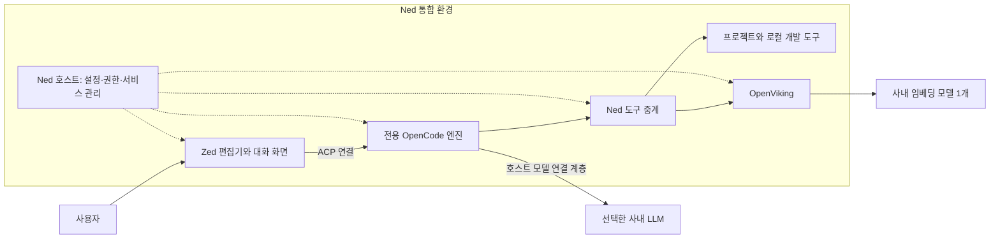

# Ned와 Zed는 어떻게 다른가

Ned의 편집 화면은 Zed입니다. 파일을 열고 코드를 수정하며 패널을 배치하는 기능은 Zed가 담당합니다. Ned는 여기에 전용 OpenCode 엔진, 사내 모델 설정, 개발 도구와 스킬, OpenViking을 연결하고 한 번에 설치할 수 있도록 묶었습니다. 이 글은 0.3.7 기본 배포 구성을 기준으로 설명합니다.

## 여러 직원에게 같은 환경을 배포하려면

사내에서도 Zed에 Qwen을 연결해 AI와 코드 작업을 할 수 있었습니다. 여기에 Aegis·Conductor, 심볼 분석, 지식 검색을 더하려면 도구마다 설치법과 설정을 익혀야 했습니다. 개발 환경을 직접 구성하기 어려운 직원에게는 이 준비 과정이 부담이었습니다. 폐쇄망에서는 누락한 파일을 나중에 받는 일도 간단하지 않습니다.

Ned는 배포 담당자가 도구와 런타임을 미리 준비합니다. 사용자는 TGZ를 풀고 EXE를 설치한 뒤 사내 모델 정보를 설정하면 됩니다. 조직에서 사용할 구성을 정하고, 직원에게 같은 설치·실행 절차를 제공하려는 목적입니다.

Zed 자체도 AI 기능과 외부 에이전트 연결을 지원합니다. 비교할 때는 기능의 존재뿐 아니라 기본 배포 구성과 도구를 연결·관리하는 주체를 함께 살펴봐야 합니다.

| 항목 | Zed를 직접 구성할 때 | Ned 기본 배포판 |
| --- | --- | --- |
| 코드 편집 | Zed에서 탐색·편집·저장 | 같은 Zed 편집 기능 사용 |
| 에이전트 | Zed 자체 AI 또는 사용자가 연결한 에이전트 | Ned 전용 OpenCode 엔진 연결 |
| 모델 설정 | 연결 방식에 맞춰 개별 설정 | 중앙 JSON에서 여러 LLM과 단일 임베딩 설정 |
| 도구 준비 | 필요한 도구·런타임 선정과 설치 | 검토한 런타임과 도구를 반입 묶음에 포함 |
| 작업 지침 | 개인이나 조직이 준비 | 기본 스킬 66개와 Aegis·Conductor 어댑터 |
| 코드·자료 분석 | 선택한 도구 구성에 따름 | Serena·clangd, Graphify, REA와 개발 MCP 6종 |
| 지식 검색 | 별도 서비스 연결과 운영 | OpenViking 실행·종료, 스킬 등록, 자료 색인·검색 |
| 권한 | 에이전트와 클라이언트 설정에 따름 | 호스트에서 승인 요청·파일 자동 승인·전체 권한 선택 |
| 빌드 | 터미널 또는 연결한 도구 사용 | 설치된 VS2017/2019 MSBuild 조사와 지원 빌드 |
| 외부 앱 조작 | 별도 도구 구성에 따름 | agent-desktop의 제한된 앱 실행·창 관찰·UI 동작 |
| 사용자 환경 | 개인 Zed 설정 관리 | Ned 전용 프로필에 설정·대화·지식 보관 |
| 업데이트 | 구성 요소별로 관리 | 버전과 해시를 고정해 검증한 설치본 배포 |

직접 구성하는 방식은 도구를 바꾸거나 최신 기능을 시험하기에 편합니다. Ned는 공통 구성을 유지하면서 설치와 운영 부담을 줄이는 데 맞췄습니다. 구성 요소를 바꾸려면 배포 담당자가 오프라인 의존성과 실행 결과를 검토해야 합니다.

## 화면 뒤의 연결 구조

Zed는 편집과 대화 화면을, OpenCode는 세션과 에이전트 실행을 맡습니다. Ned 호스트는 키를 보관하고 프로젝트 접근과 도구 승인, 서비스 실행·종료를 관리합니다. 사내 LLM과 임베딩 API가 계산을 담당하므로 모델 가중치는 EXE에 들어 있지 않습니다.

스킬은 작업 절차를 안내하고, 연결된 도구는 실제 파일과 실행 결과를 제공합니다. Aegis·Conductor의 지침과 관련 트랙을 읽어 계획을 세울 수 있고, Serena·clangd로 심볼을 조사하거나 Graphify·REA로 지원하는 정적 분석을 수행할 수 있습니다. 개발 MCP는 Serena, Git, Playwright, MarkItDown, Chrome DevTools, DuckDB Local입니다. 도구마다 Ned에서 허용한 기능만 연결합니다.

## 사용하면서 달라지는 점

### 설정을 한곳에서 관리합니다

최초 설치 시 EXE 옆에 `agent-config.json`이 있으면 준비 파일로 복사합니다. 첫 실행에서 내용을 검증하고 API 키를 Windows 사용자 보호 기능으로 암호화합니다. 이후 변경은 설정 가져오기 메뉴로 적용하며, 저장 확인을 마치면 자동으로 재시작합니다.

여러 LLM을 등록해 대화에서 선택하고, 임베딩은 별도로 한 개를 지정합니다. 업데이트할 때는 기존 모델 설정과 글꼴·패널 배치·키맵을 유지합니다. 개인 Zed의 설정이나 플러그인을 자동 복제하지는 않습니다.

### 작업에 맞는 지침을 불러옵니다

기본 스킬은 계획, 디버깅, 리뷰, 문서, UI, 데이터 분석 등의 관점을 제공합니다. 0.3.7부터 요청과 최근 대화 문맥으로 관련 지침을 자동 선택합니다. 선택을 위해 별도 모델을 호출하거나 모든 스킬을 한꺼번에 읽지는 않습니다.

지침을 읽은 뒤에는 실제 프로젝트와 도구 결과로 판단합니다. 예를 들어 테스트 계획을 작성한 단계와 테스트를 실행해 통과한 단계는 구분해 기록합니다.

### 자료를 여러 프로젝트에서 다시 찾습니다

OpenViking은 Ned와 함께 실행됩니다. 사용자가 선택해 색인한 문서를 검색하고, 가져온 개인 지식은 같은 사용자의 모든 프로젝트에서 읽기 전용으로 조회합니다. 새 대화를 자동으로 장기 기억이나 공용 지식에 올리지 않습니다.

Zed에서도 지식 서비스를 별도로 연결할 수 있습니다. Ned에는 그 서비스의 배포와 실행·종료, 등록 상태 확인, 검색 도구 연결이 기본 구성에 포함됩니다.

### 반복 승인을 조절합니다

대화 입력창이나 알림 영역의 **권한** 메뉴에서 **승인 요청**, **프로젝트 파일 자동 승인**, **전체 권한**을 선택할 수 있습니다. 선택은 재시작과 업데이트 후에도 유지됩니다.

전체 권한은 Ned가 지원하는 도구의 승인창을 생략합니다. 파일 경로와 충돌, 저장하지 않은 편집 내용, 실행 대상과 중지 상태는 계속 검사합니다. 기존 플랫폼 지원을 유지할지처럼 제품 방향에 영향을 주는 질문에는 사용자의 답이 필요합니다. [권한 안내](approval-modes.md)에 모드별 범위를 정리했습니다.

## C++ 이식 작업을 예로 들면

> 이 C++ 모듈의 Windows 이식 방안을 조사하고 수정하라. 기존 VxWorks 지원은 유지해야 하며, 가능한 범위에서 빌드하고 변경 내용을 문서로 남겨라.

이 작업에는 코드 조사 외에도 호출 관계, 기존 계획, SDK와 빌드 환경, 이전에 정한 제약을 확인하는 과정이 필요합니다. Ned에서는 저장소와 관련 트랙을 읽고, 심볼 분석과 지식 검색 결과를 참고해 변경을 진행할 수 있도록 도구를 연결해 둡니다. VS2017/2019가 있으면 MSBuild와 솔루션 구성을 찾아 지원하는 빌드를 실행할 수 있습니다.

결과의 정확도는 프로젝트 환경에도 달려 있습니다. `compile_commands.json`, include 경로와 매크로, 필요한 SDK가 없으면 C/C++ 의미 분석에 제약이 생깁니다. 빌드 도구와 의존성도 미리 준비해야 합니다. Ned는 확인한 결과와 실행하지 못한 검사를 구분해 제시합니다.

같은 Qwen 모델을 사용하더라도, 필요한 자료와 도구를 어느 정도 준비했는지에 따라 작업 방식이 달라집니다. Ned는 여러 직원이 이 준비를 반복하지 않도록 공통 환경으로 배포합니다.

## 도입 전에 확인할 점

통합 구성에는 배포 용량과 시작 시 준비 작업이 필요합니다. 0.3.7은 Python SDK와 호스트 번들을 정리해 설치 부담을 줄였으며, Windows Server에서 설치와 OpenViking 로딩을 검사했습니다. 실제 직원 PC의 Windows 10·11 GUI, 사내 모델, SDK와 외부망 차단 환경은 별도 검증 항목으로 남아 있습니다.

프로젝트는 알림 영역의 **Ned → 프로젝트 폴더 열기**에서 선택합니다. 이 창은 실제 Windows의 바탕화면·즐겨찾기를 탐색하고, 편집기 내부 Open Folder는 내부 경로 선택창을 사용합니다. 설치 위치는 D 드라이브 등으로 바꿀 수 있지만 사용자 데이터는 `%APPDATA%\Ned`에 유지됩니다.

[소개와 활용](ned-introduction.md) · [설치 안내](offline-setup.md) · [0.3.7 검증 기록](validation-0.3.7.md) · [라이선스](license-policy.md)
