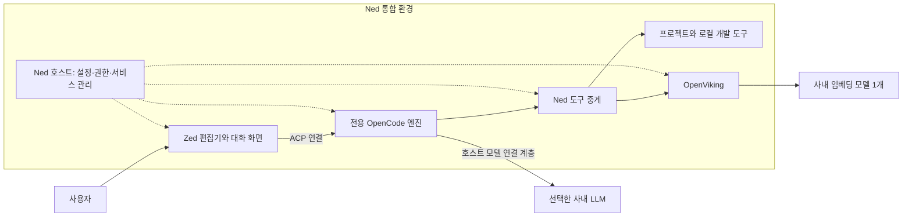

# Ned와 Zed는 어떻게 다른가

> Ned 0.3.5 기준. 사내 사용자와 배포 담당자가 두 소프트웨어의 역할과 활용 차이를 이해하기 위한 문서이다.

**Zed는 코드 편집과 AI 협업 기능을 제공하는 편집기이며, Ned는 Zed를 기반으로 사내 모델·에이전트·개발 도구·지식 저장소를 함께 설치하고 운영하도록 구성한 Windows용 AI 개발 작업 환경이다.**

Ned에서 사용하는 파일 탐색, 코드 직접 편집, 저장, 패널 배치와 대화 화면의 기반은 Zed이다. Ned가 더하는 핵심 가치는 직원이 여러 도구를 직접 설치하고 연결하지 않아도, 사내에서 준비한 AI 개발 환경을 같은 방식으로 사용할 수 있도록 하는 데 있다.

## 1. 출발점: 직원에게 필요한 것은 연결된 작업 환경이다

기존 사내 환경에서도 Zed에 회사가 제공하는 Qwen 모델을 연결하면 AI와 대화하고 코드 작업을 수행할 수 있었다. 여기에 개발 방법론, 작업 계획 관리, 코드 의미 분석, 지식 검색 등의 기능을 추가하려면 에이전트와 도구를 설치하고 설정해야 했다.

문제는 모든 직원이 이러한 환경을 직접 구성할 수 있는 개발자는 아니라는 점이었다. 설치 방법이 다른 도구를 연결하고, 모델 주소와 키를 넣고, 실행 순서와 저장 위치를 관리하는 일 자체가 사용을 시작하는 장벽이 되었다. 폐쇄망에서는 반입 후 필요한 구성 요소를 추가로 내려받기도 어렵다.

Ned는 이 준비 과정을 배포 단계에서 수행한다. 사용자는 반입용 파일을 압축 해제하고 설치 EXE를 실행한 뒤, 사내 모델 설정을 준비하여 업무를 시작하는 흐름을 따른다. 개별 도구를 조립하는 부담을 줄이고, 직원에게 공통된 사용 절차를 제공하는 것이 개발 목적이다.

## 2. 기능과 운영 방식 비교

비교 기준은 일반적인 Zed 단독 설치와 Ned의 기본 배포 구성이다. **Zed도 AI 기능과 외부 에이전트 연결을 지원하며, 필요한 도구를 별도로 구성하여 활용할 수 있다.** 아래에서 말하는 차이는 기능을 구현할 수 있는지뿐 아니라, 무엇이 기본 제공되고 누가 연결·운영을 담당하는지에 관한 차이이다.

| 항목 | Zed를 직접 구성하여 사용하는 경우 | Ned의 기본 구성 |
|---|---|---|
| 주된 역할 | 코드 편집과 AI 협업을 위한 편집기 | 편집기·에이전트·도구·지식을 통합한 사내 배포 환경 |
| 코드 직접 편집 | Zed의 편집·탐색·저장 기능 사용 | 같은 Zed 기반 편집 기능 사용 |
| AI 작업 수행 | Zed 자체 AI 기능 또는 사용자가 연결한 외부 에이전트 활용 | Ned 전용 OpenCode 엔진을 Zed에 연결 |
| 사내 모델 설정 | 사용할 연결 방식에 맞게 설정 | 중앙 JSON으로 여러 LLM의 주소·키·모델·한도를 관리하고 모델 선택 지원 |
| 추가 도구 준비 | 필요한 도구와 런타임을 선정·설치·연결 | 검토한 도구·런타임·스킬을 반입 묶음에 포함 |
| 개발 작업 지침 | 사용자 또는 조직이 지침을 준비 | 기본 스킬 36개와 Aegis·Conductor 어댑터 제공 |
| 코드·문서·데이터 조사 | 선택한 에이전트와 도구 구성에 따라 달라짐 | Serena·clangd, Git·문서·브라우저·데이터 MCP 등을 관리형 도구로 연결 |
| 개발 지식 활용 | 사용할 지식 서비스의 연결과 운영을 별도로 구성 | OpenViking의 시작·종료, 기본 스킬 등록, 명시적 자료 색인·검색을 연결 |
| 작업 승인 | 선택한 에이전트와 클라이언트의 권한 설정에 따름 | Ned 호스트가 파일·빌드·지식·데스크톱 도구의 승인을 통합 관리 |
| 반복 승인 조절 | 사용하는 에이전트의 지원 방식에 따름 | 승인 요청·프로젝트 파일 자동 승인·전체 권한을 메뉴에서 선택하고 유지 |
| 빌드 연동 | 터미널이나 구성한 에이전트를 활용 | 설치된 VS2017/2019의 MSBuild와 프로젝트 구성을 조사하여 지원 범위에서 빌드 |
| 외부 프로그램 조작 | 별도 자동화 도구와 연결 구성에 따라 달라짐 | agent-desktop의 제한된 창 관찰·앱 실행·의미 기반 UI 조작 연결 |
| 사용자 설정 | 사용자가 자신의 Zed 환경을 관리 | Ned 전용 프로필에 설정·대화·지식을 보관하고 개인 Zed 설정과 분리 |
| 업데이트 운영 | Zed와 추가 도구의 업데이트를 각각 관리 | 고정한 구성 요소를 검증하여 새 설치본으로 배포 |

Zed를 직접 구성하면 조직이나 개발자가 원하는 조합을 폭넓게 선택할 수 있다. Ned는 사내에서 사용할 구성을 미리 정하고 연결함으로써 설치와 운영을 단순하게 만든다. 구성의 자유도와 공통 배포의 편의성 사이에 운영 방식의 차이가 있다.

## 3. Ned 안에서 Zed와 다른 구성 요소가 맡는 역할

- **Zed**는 사용자가 코드를 읽고 직접 수정하며 AI와 대화하는 화면을 제공한다.
- **OpenCode**는 대화와 작업을 진행하고 필요한 도구를 호출하는 에이전트 엔진을 제공한다.
- **Ned 호스트**는 모델 설정과 키 보관, 프로젝트 접근, 권한 모드, 도구 중계와 서비스 수명을 관리한다.
- **스킬과 개발 도구**는 작업 절차와 실제 조사·수정·검증 수단을 제공한다.
- **OpenViking**은 명시적으로 등록한 자료와 가져온 개인 지식을 다시 검색하는 기반을 제공한다.
- **사내 LLM과 임베딩 API**는 실제 추론과 임베딩 계산을 담당한다. 모델 가중치는 설치 EXE에 포함하지 않는다.

이 구조에서 Ned의 가치는 편집기 화면에만 있지 않다. 화면 뒤에서 모델과 도구, 지식 서비스를 연결하고 공통된 실행 규칙을 적용하는 부분에 있다.

## 4. 사용자가 체감하는 주요 차이

### 설치와 설정을 한 흐름으로 진행한다

Ned는 Windows x64용 TGZ와 설치 EXE로 배포한다. 필요한 구성 요소는 반입 전에 준비하며, 직원 PC에서 npm·pip·uvx 등으로 추가 설치하는 절차를 요구하지 않는다.

최초 설치 시 EXE와 같은 폴더에 `agent-config.json`이 있으면 이를 준비 파일로 가져온다. 앱은 설정을 검증하고 키를 Windows 사용자 보호 기능으로 암호화 저장한다. 기존 저장 설정은 업데이트 시 유지하며, 이후 교체는 설정 가져오기 메뉴로 수행한다. 가져오기에 성공하면 편집기의 저장 확인을 거쳐 자동 재시작하여 적용한다.

여러 LLM은 중앙 JSON에 등록하여 선택할 수 있고, 임베딩 모델은 별도로 한 개를 설정한다. 직원이 각 도구의 설정 파일에 모델 정보를 반복해서 넣는 부담을 줄이는 방식이다.

### 개발 방법과 실행 도구를 함께 준비한다

기본 스킬은 요구사항 정리, 계획, 디버깅, 리뷰, 보안, 문서 작성과 데이터 분석 등의 작업 지침이다. Aegis·Conductor는 검토한 정적 지침과 호스트 어댑터를 통해 활용하며, 관련 작업 트랙과 계획·검증 기록을 이어 가도록 돕는다.

실제 조사는 연결된 도구가 담당한다. Serena·clangd는 지원하는 C/C++ 의미 탐색을, Graphify는 로컬 코드의 AST 구조 분석을, REA는 지원 대상 산출물의 제한된 정적 분석을 보조한다. 개발 MCP 6종은 Serena, Git, Playwright, MarkItDown, Chrome DevTools, DuckDB Local이다. 각 도구는 Ned가 정한 범위로 연결하며 원본의 모든 기능을 그대로 노출하지 않는다.

스킬을 포함했다고 모든 작업에서 이를 전부 읽거나 실행하는 것은 아니다. 작업에 맞는 지침과 도구를 선택하고, 완료 여부는 실제 호출 결과와 검증 근거로 확인하는 것이 원칙이다.

### 프로젝트 밖의 개발 지식도 재활용한다

OpenViking은 앱과 함께 시작·종료하며 기본 스킬을 등록하도록 구성되어 있다. 사용자는 필요한 자료를 명시적으로 색인하고 사내 임베딩 API를 통해 검색에 활용할 수 있다.

이관한 개인 지식은 해당 사용자의 여러 프로젝트에서 읽기 전용 참고 자료로 검색한다. 새 대화가 자동으로 장기 기억이나 공용 지식에 업로드되지는 않는다. 이전 세션에서 했던 모든 일을 AI가 자동으로 기억하는 것으로 이해해서는 안 된다.

Zed에서도 별도 지식 서비스를 연결할 수 있다. Ned는 OpenViking의 배포와 실행 수명, 등록 상태 확인 및 검색 도구 연결을 공통 환경에 포함한다는 점에서 차이가 있다.

### 권한을 한곳에서 선택한다

Ned 0.3.5는 대화 입력창과 알림 영역에 다음 권한 모드를 제공한다.

| 모드 | 동작 |
|---|---|
| 승인 요청 | 파일 수정·빌드·지식 전달·데스크톱 작업의 승인을 확인한다. |
| 프로젝트 파일 자동 승인 | 선택한 프로젝트의 파일 수정을 자동 승인하고 다른 종류의 작업은 확인한다. |
| 전체 권한 | Ned가 지원하는 파일 수정·빌드·지식·앱 실행·데스크톱 작업의 반복 승인창을 생략한다. |

선택은 즉시 적용되며 새 대화·프로젝트·재시작·업데이트 후에도 유지된다. 전체 권한에서도 파일 도구의 프로젝트 범위, 외부 변경 충돌, 저장하지 않은 편집 내용, 실행 대상과 중지 상태는 계속 검사한다. 지원하는 도구의 승인을 자동 처리하는 설정이며, 임의 명령 실행기나 외부 인터넷 연결 기능을 추가하는 설정은 아니다.

제품의 목표나 유지해야 할 기능처럼 실제 사용자 판단이 필요한 질문은 권한 모드와 별개이다. 사용자가 코드를 직접 편집하고 저장하는 동작도 AI의 수정 승인과 구분한다.

## 5. 같은 업무를 수행할 때의 차이

예를 들어 다음 요청을 수행한다고 가정할 수 있다.

> 이 C++ 모듈의 Windows 이식 방안을 조사하고 수정하라. 기존 VxWorks 지원은 유지해야 하며, 가능한 범위에서 빌드하고 변경 내용을 문서로 남겨라.

Zed와 사내 모델을 연결한 환경에서도 코드 조사와 수정은 수행할 수 있다. 다만 의미 분석 도구, 기존 작업 트랙, 지식 검색과 빌드 연동을 함께 사용하려면 그에 맞는 연결과 설정이 준비되어 있어야 한다.

Ned에서는 이러한 연결을 기본 배포 구성으로 준비한다. AI는 저장소와 관련 트랙을 조사하고, 사용할 수 있는 심볼 분석과 지식 검색 결과를 참고하여 변경을 진행할 수 있다. 지원하는 Visual Studio 빌드 도구가 설치되어 있으면 구성을 확인하고 선택한 권한 모드에 따라 빌드를 수행할 수 있다.

실제 결과는 프로젝트 환경에 영향을 받는다. `compile_commands.json`, include 경로, 매크로와 필요한 SDK가 없으면 의미 분석 정확도가 제한되며, 컴파일러나 SDK가 준비되지 않은 환경에서 설치만으로 빌드가 가능해지는 것은 아니다. Ned는 이때 확인된 결과와 제한 사항을 구분하여 제시해야 한다.

이 차이는 사용자가 준비해야 할 연결 작업과 AI가 활용할 수 있는 작업 맥락의 범위에서 나타난다. 같은 Qwen 모델을 사용한다면 모델 자체가 다른 모델로 바뀌는 것은 아니며, Ned는 필요한 자료와 도구를 더 일관되게 활용하도록 돕는다.

## 6. 구성 선택 시 함께 이해할 점

직접 도구를 선정하고 설정할 수 있는 개발자에게는 Zed를 중심으로 원하는 에이전트와 서비스를 조합하는 방식도 적합하다. 최신 기능을 빠르게 도입하거나 조직마다 다른 도구 구성을 실험할 때에는 그 자유도가 유용하다.

여러 직원에게 공통된 환경을 배포하고 설치·설정 부담을 줄여야 하는 경우에는 Ned의 통합 구성이 유용하다. 특히 폐쇄망 반입, 구성 요소 버전 고정, 모델 설정과 도구 수명 관리가 필요한 환경에서 운영 절차를 일관되게 만들 수 있다. 그 대신 배포 용량과 시작 시 준비 작업이 늘어나며, 구성 요소 변경과 업데이트는 배포 담당자의 검토를 거쳐야 한다.

Ned의 코드 편집 경험은 Zed에 기반하므로 Zed에 익숙한 사용자는 같은 편집 흐름을 이어 갈 수 있다. Ned는 별도의 프로필을 사용하며 개인 Zed의 설정이나 플러그인을 자동으로 복제하지 않는다.

Ned 0.3.5는 배포된 검증 후보이다. 설치본의 구성·해시 검사와 Linux 기반 에이전트 연동 검증을 실제 사내 Windows의 모든 기능 수용 완료와 구분해야 한다. 또한 코드·분석·문서의 최종 판단은 실제 프로젝트 결과를 근거로 수행해야 한다.

## 관련 문서

- [Ned 소개와 활용](ned-introduction.md)
- [설치 및 설정 안내](offline-setup.md)
- [권한 모드](approval-modes.md)
- [0.3.5 검증 범위](validation-0.3.5.md)
- [라이선스 정책](license-policy.md): Ned 자체 코드와 Zed 및 번들 구성 요소의 라이선스 조건을 구분한다.

## 설치 위치와 프로젝트 열기

0.3.6부터 설치 화면에서 기본 경로 대신 D 드라이브 등의 전용 폴더를 선택할 수 있다. 업데이트는 기존 설치 위치를 사용하며 설정·대화·지식은 사용자 데이터 폴더에 유지한다. Windows의 실제 바탕화면·즐겨찾기에서 프로젝트를 고르려면 알림 영역의 **Ned → 프로젝트 폴더 열기 · 바탕화면 / 즐겨찾기**를 사용한다. 편집기 내부의 Open Folder는 내부 경로 선택창을 제공한다.
